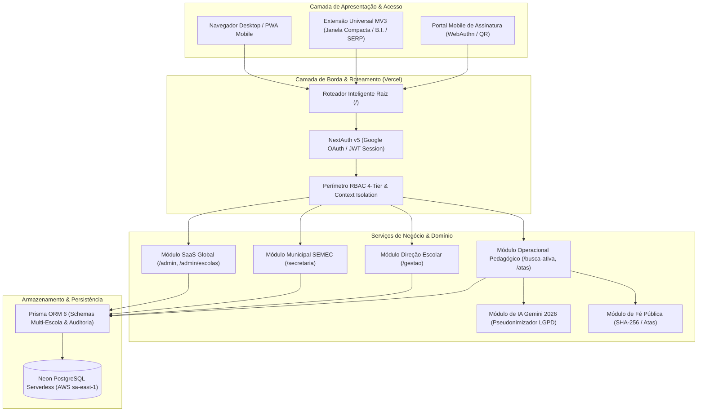
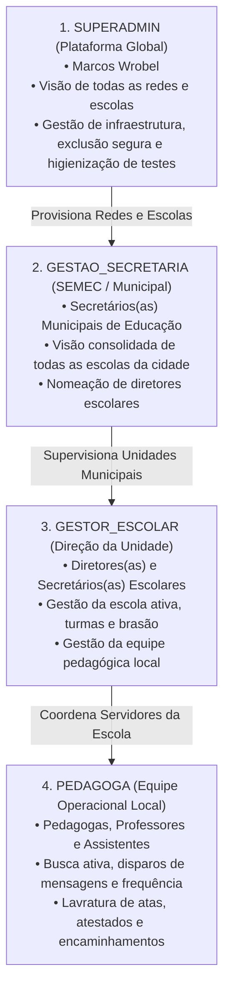

# Arquitetura do Sistema: Rede Ativa SaaS — Plataforma Multi-Escola de Busca Ativa, Gestão Pedagógica & Fé Pública Digital

> **Unidade Piloto Fundadora / Laboratório de Validação Tecnológica e Pedagógica:**  
> **Colégio Estadual Leopoldina B. Pedroso** (INEP `41042730`) — Ponta Grossa / Tibagi, Paraná (SEED-PR)  
> *Ambiente de homologação em produção onde o sistema foi idealizado, refinado com 689 estudantes reais e consolidado como padrão de referência tecnológica para redes municipais e estaduais.*

Este documento consolida a arquitetura completa da plataforma **Rede Ativa SaaS** no seu estado atual, detalhando o modelo de governança multi-escola, o catálogo completo de rotas e APIs, os mecanismos de segurança perimetral e o arcabouço tecnológico de proteção jurídica e conformidade legal.

---

## 1. Visão Geral da Arquitetura & Stack Tecnológica

A plataforma opera sob o paradigma de **Microsserviços Unificados (Monólito Modular Moderno)**, utilizando a pilha Next.js 16 com React 19 e Turbopack, com isolamento lógico estrito de multi-tenancy (*Logical Database Multi-Tenancy*) e computação de borda (*Edge & Serverless*).



### Componentes Principais da Infraestrutura:
* **Frontend & Backend (Full-Stack)**: Next.js 16.4.3 (App Router com Turbopack), React 19, TypeScript 5.8.
* **Estilização & Design System**: Tailwind CSS v4, Lucide React, Modern Web Guidance (Dialogs nativos acessíveis, Checkboxes `:indeterminate`, Progress bars sem bloqueio da main thread).
* **Banco de Dados Relacional Multi-Tenant**: Neon PostgreSQL Serverless (AWS São Paulo `sa-east-1`, endpoint direto com latência típica de ~60ms).
* **Camada de Dados (ORM)**: Prisma ORM 6 com mapeamento relacional multi-tenant (`EducationNetwork`, `School`, `UserSchool`, `Student`, `PedagogicalMinute`).
* **Autenticação & Sessões**: NextAuth.js v5 (Auth.js) operando com tokens JWT cifrados, revalidação periódica de papéis a cada 5 minutos e integração Google OAuth (`@escola.pr.gov.br` e e-mails governamentais/municipais).
* **Inteligência Artificial Generativa**: Google Gemini API (`@google/genai` 2026) com processamento estruturado JSON, *thinking level* otimizado (`thinkingLevel: "low"`), pseudonimização prévia (LGPD) e fuso horário oficial `America/Sao_Paulo`.
* **Mensageria & Integração WhatsApp**: *Client-side Dispatcher* com chaveamento dinâmico (Mobile nativo `wa.me` vs Desktop direto) e suporte à Janela Dedicada Compacta (480x760px) via Extensão de Navegador Manifest V3.
* **Rotinas em Background**: Vercel Cron (`/api/cron/weekly-digest`) para geração automatizada do boletim pedagógico semanal e alertas precoces de evasão.

---

## 2. Modelo de Governança & Hierarquia de 4 Camadas

A plataforma implementa um modelo hierárquico estrito de 4 níveis (*Role-Based Access Control - RBAC*), permitindo atender desde prefeituras inteiras com suas Secretarias de Educação até escolas individuais estaduais e privadas, preservando a **Escola Piloto Leopoldina** como referência permanente:



### Regras de Acesso e Isolamento por Papel:

| Camada | Papel no Sistema | Rota Inicial (Landing Page) | Escopo de Visão dos Dados | Menus Permitidos na Sidebar |
| :--- | :--- | :--- | :--- | :--- |
| **Nível 1** | `SUPERADMIN` | `/admin` | Global (todas as redes, escolas, alunos e logs de auditoria). | Visão Global SaaS, Redes de Ensino, Diretório de Escolas, Trilha de Auditoria Global, higienização/exclusão de escolas e ferramentas de qualquer escola ativa. |
| **Nível 2** | `GESTAO_SECRETARIA` | `/secretaria` | Regional/Municipal (todas as escolas vinculadas à sua `EducationNetwork` ou município). | Painel SEMEC / Rede, Escolas Municipais, Gestão de Diretores, Indicadores Consolidados da Cidade. |
| **Nível 3** | `GESTOR_ESCOLAR` | `/gestao` | Unidade Escolar Ativa (`schoolId` vinculado). | Painel da Direção, Equipe da Escola (`/equipe`), Identidade & Brasão (`/configuracoes/escola`), Importação SERE/Planilhas, e ferramentas pedagógicas da sua unidade. |
| **Nível 4** | `PEDAGOGA` | `/busca-ativa` | Unidade Escolar Ativa (somente registros pedagógicos e cadastrais locais). | Frequência & Alertas, Enviar Mensagem, Histórico & Retornos, Alunos e Turmas, Atestados, Livro de Atas, Combinados & Prazos, Boletim Semanal, Relatórios e Modelos de Mensagem. |

---

## 3. Catálogo Completo de Rotas Estabelecidas

### 3.1. Rotas de Páginas da Interface Web (*App Router*)

| Rota | Descrição Funcional | Acesso Mínimo |
| :--- | :--- | :--- |
| `/` | **Roteador Inteligente**: Detecta a role da sessão ativa e redireciona para a home nativa (`/admin`, `/secretaria`, `/gestao` ou `/busca-ativa`). | Autenticado |
| `/login` | Página de autenticação institucional via Google OAuth (`@escola.pr.gov.br` ou e-mails municipais autorizados). | Público |
| `/admin` | **Painel Global Super Admin**: Métricas globais SaaS, monitor de redes de ensino, diretório de escolas com chaveamento em 1 clique, higienização, exclusão e auditoria global. | `SUPERADMIN` |
| `/admin/escolas` | Gestão e cadastro de novas instituições de ensino, redes municipais (SEMEC), geração de tokens e exclusão de unidades de teste. | `SUPERADMIN` |
| `/secretaria` | **Painel Executivo Municipal (SEMEC)**: Indicadores consolidados da rede (taxa média de presença, risco crítico <75%), ranking de escolas e cadastro de colégios municipais. | `GESTAO_SECRETARIA` |
| `/gestao` | **Painel da Direção Escolar**: KPIs da escola, quadro de turmas ativas, ranking de infrequência e atalhos administrativos da unidade. | `GESTOR_ESCOLAR` |
| `/visao-geral` | Resumo operacional da escola com cards de ação e contadores gerais. | `GESTOR_ESCOLAR` |
| `/busca-ativa` | **Motor de Disparos WhatsApp**: Modo Individual e Modo Fila Assistida por Turma (wa.me / Janela Compacta), filtro de atestados médicos vigentes e saneamento de telefones. | `PEDAGOGA` |
| `/faltas` | **Painel de Frequência & Alertas**: Alunos em risco crítico (<75%), alertas de queda abrupta de frequência e triagem de protocolos SERP. | `PEDAGOGA` |
| `/historico` | Linha do tempo de mensagens enviadas, confirmação de leitura e botão de **Classificação & Formalização de Retornos com IA**. | `PEDAGOGA` |
| `/alunos` | Catálogo de estudantes matriculados e **Importador em Lote Multi-formato** (SERE `.xls`, `.xlsx`, `.pdf` e `.csv`). | `PEDAGOGA` |
| `/alunos/[id]` | **Prontuário 360º do Estudante**: Ficha cadastral integral, linha do tempo de mensagens, histórico de atestados médicos e atas do Livro Digital. | `PEDAGOGA` |
| `/alunos/[id]/dossie` | **Dossiê Oficial Probatório**: Emissão de relatório analítico A4 para Conselho Tutelar / Ministério Público com anonimização automática de outros menores (ECA). | `PEDAGOGA` |
| `/atestados` | Lançamento rápido e auditoria de atestados e licenças médicas com cálculo automático do período de afastamento e salto na busca ativa. | `PEDAGOGA` |
| `/atas` | **Livro Oficial de Atas Pedagógicas Digital**: Redação assistida por IA/Voz, assinaturas digitais com fé pública, QR Code para celular e numeração sequencial anual imutável. | `PEDAGOGA` |
| `/atas/[id]/imprimir` | Layout de impressão oficial A4 em folha única (`1 of 1`), brasão institucional, cabeçalho da prefeitura/estado e QR Code de autenticidade. | `PEDAGOGA` |
| `/atas/livro/[ano]` | Visualização do **Livro Anual Consolidado**: Termo de abertura, atas sequenciais de 1 a N do ano letivo e termo de encerramento anual. | `PEDAGOGA` |
| `/encaminhamentos` | Gestão e baixa de combinados pedagógicos, compromissos familiares e prazos firmados em atas. | `PEDAGOGA` |
| `/boletim` | Boletim semanal consolidado de infrequência para pauta de reuniões pedagógicas. | `PEDAGOGA` |
| `/relatorios` | Gráficos analíticos de causas de faltas, trimestres, desempenho por pedagoga e índices de contato. | `PEDAGOGA` |
| `/modelos` | Biblioteca de modelos institucionais com tags dinâmicas e estúdio de geração por IA. | `PEDAGOGA` |
| `/equipe` | Gestão de servidores autorizados da unidade escolar ativa com controle de papéis (`ADMIN`, `GESTOR_ESCOLAR`, `PEDAGOGA`). | `GESTOR_ESCOLAR` |
| `/configuracoes/escola` | Configuração da identidade da escola: nome oficial, INEP, telefones, upload do brasão e token de sincronização da extensão. | `GESTOR_ESCOLAR` |
| `/auditoria` | Trilha imutável de conformidade: logs detalhados de logins, alterações e disparos com endereço IP e User-Agent. | `SUPERADMIN` |
| `/validar/ata/[code]` | **Portal Público de Validação**: Validação da autenticidade e fé pública da ata via código hash ou leitura de QR Code (LGPD-Safe). | Público |
| `/assinar/ata/[token]` | **Portal Móvel de Coleta de Assinatura**: Página para assinatura presencial do responsável via biometria móvel (WebAuthn / Passkeys) ou desenho em tela. | Público (Token) |

---

### 3.2. Catálogo de APIs REST e Endpoints de Integração

| Endpoint | Método | Descrição e Finalidade | Permissão Requerida |
| :--- | :---: | :--- | :--- |
| `/api/auth/[...nextauth]` | `GET`, `POST` | Processamento do fluxo OAuth, emissão de cookies de sessão e callbacks JWT. | Público |
| `/api/auth/switch-school` | `POST` | Alternância controlada de instituição ativa com validação de vínculo e gravação de cookie `active_school_id`. | Autenticado |
| `/api/secretaria/metrics` | `GET` | Agregação estatística de indicadores municipais de frequência para a SEMEC. | `GESTAO_SECRETARIA` |
| `/api/schools` | `GET`, `POST` | Listagem e criação de novas escolas com auto-provisionamento do pacote inicial de modelos. | `SUPERADMIN` / `SEMEC` |
| `/api/schools/[id]` | `GET`, `PUT`, `DELETE` | Consulta, atualização cadastral e exclusão segura em cascata (protegendo a sede Leopoldina). | `GESTOR_ESCOLAR` / `SUPERADMIN` |
| `/api/schools/[id]/sanitize` | `POST` | **Higienização Operacional**: Zera estudantes, turmas, faltas e atas de teste, preservando o cadastro da escola. | `SUPERADMIN` |
| `/api/schools/[id]/sync-token` | `POST` | Geração e rotação criptográfica do token de integração para a extensão Chrome. | `GESTOR_ESCOLAR` |
| `/api/users` | `GET`, `POST`, `PUT`, `DELETE` | Gerenciamento de servidores da equipe escolar com isolamento estrito por `schoolId`. | `GESTOR_ESCOLAR` |
| `/api/students` | `GET`, `POST` | Consulta paginada e cadastro de estudantes com escopo multi-tenant. | `PEDAGOGA` |
| `/api/students/import` | `POST` | Motor de importação em lote para arquivos `.xls`, `.xlsx`, `.pdf` e `.csv` do SERE. | `GESTOR_ESCOLAR` |
| `/api/students/[id]/contacts` | `GET`, `POST` | Gestão de múltiplos contatos telefônicos e familiares do estudante. | `PEDAGOGA` |
| `/api/students/[id]/attendances` | `GET`, `POST` | Registro de presença/ausência individual. | `PEDAGOGA` |
| `/api/students/[id]/justifications` | `GET`, `POST` | Vínculo de atestados e justificativas ao prontuário do aluno. | `PEDAGOGA` |
| `/api/justifications` | `GET`, `POST` | Lançamento ágil de justificativas e atestados com verificação de vigência. | `PEDAGOGA` |
| `/api/justifications/[id]` | `PUT`, `DELETE` | Atualização ou cancelamento de justificativa médica. | `PEDAGOGA` |
| `/api/low-attendance` | `GET`, `POST` | Sincronização e monitoramento de alunos com frequência inferior a 75%. | `PEDAGOGA` |
| `/api/messages` | `GET` | Consulta ao histórico paginado de mensagens enviadas. | `PEDAGOGA` |
| `/api/messages/send` | `POST` | Registro de disparo de busca ativa com auditoria de IP e telefone utilizado. | `PEDAGOGA` |
| `/api/messages/reply` | `POST` | Registro do retorno familiar com acionamento do classificador IA. | `PEDAGOGA` |
| `/api/messages/status` | `PUT` | Atualização do status de entrega (`SENT`, `DELIVERED`, `FAILED_NO_WHATSAPP`). | `PEDAGOGA` |
| `/api/messages/manage` | `POST` | Operações em lote no histórico de mensageria. | `GESTOR_ESCOLAR` |
| `/api/atas` | `GET`, `POST` | Criação de minutas e listagem das atas pedagógicas da escola. | `PEDAGOGA` |
| `/api/atas/[id]` | `GET`, `PUT`, `DELETE` | Leitura, edição de rascunho ou descarte de minuta não finalizada. | `PEDAGOGA` |
| `/api/atas/[id]/finalize` | `POST` | **Lavratura Oficial com Fé Pública**: Congela o texto, atribui número anual sequencial e calcula hash `SHA-256`. | `PEDAGOGA` |
| `/api/atas/[id]/void` | `POST` | **Anulação Oficial Auditada**: Invalida a ata preservando o registro histórico, exigindo justificativa formal. | `GESTOR_ESCOLAR` |
| `/api/atas/[id]/sign-token` | `POST` | Emissão de token assinado temporário para geração do QR Code de coleta de assinatura. | `PEDAGOGA` |
| `/api/atas/[id]/addendums` | `POST` | Lavratura de termo aditivo *"Em tempo"* vinculado à ata original já selada. | `PEDAGOGA` |
| `/api/atas/[id]/actions/[actionId]` | `PUT` | Baixa de encaminhamento pedagógico ou registro de cumprimento de combinado. | `PEDAGOGA` |
| `/api/atas/actions` | `GET` | Listagem consolidada de todos os combinados pendentes na escola. | `PEDAGOGA` |
| `/api/atas/public/[code]` | `GET` | Endpoint público para conferência de autenticidade documental via QR Code. | Público |
| `/api/atas/sign-token/[token]` | `GET`, `POST` | Endpoint público para recebimento da assinatura do celular do responsável. | Público (Token) |
| `/api/templates` | `GET`, `POST`, `PUT`, `DELETE` | CRUD de modelos de mensagem padronizados com isolamento por escola. | `PEDAGOGA` |
| `/api/ai/formalize-ata` | `POST` | Redação jurídica de ata a partir de tópicos/áudio ditado via Google Gemini AI. | `PEDAGOGA` |
| `/api/ai/classify-reply` | `POST` | Classificação semântica de justificativas de pais via Gemini com pseudonimização prévia. | `PEDAGOGA` |
| `/api/ai/generate-template` | `POST` | Estúdio de redação de novos modelos com inteligência artificial. | `PEDAGOGA` |
| `/api/ai/test-key` | `GET` | Diagnóstico de conectividade e cotas da API Google Gemini. | `SUPERADMIN` |
| `/api/cron/weekly-digest` | `GET` | Rotina cron semanal disparada pela Vercel com segredo criptográfico (`CRON_SECRET`). | Cron Vercel |
| `/api/frequencia/sync` | `POST` | Ingestão segura de dados de frequência extraídos pelo agente de sincronização do B.I. estadual. | Token Escola |
| `/api/serp/sync` | `POST` | Sincronização de fichas abertas no portal SERP/Celepar da Rede de Proteção. | Token Escola |
| `/api/sync-config` | `GET` | Handshake de integridade e verificação de parâmetros da extensão institucional. | Autenticado |
| `/api/webhooks/whatsapp` | `POST` | Webhook de recebimento assinado de confirmações de entrega. | Gateway |

---

## 4. Tecnologias de Segurança Perimetral & Proteção de Dados

### 4.1. Autenticação Institucional & Gestão de Sessões (NextAuth v5 / Auth.js)
* **Provedor Institucional Primário**: Google OAuth integrado ao domínio educacional oficial `@escola.pr.gov.br`.
* **Flexibilização para Redes Municipais**: Acesso autorizado para domínios governamentais municipais (ex: `@tibagi.pr.gov.br`, `.gov.br`, `.edu.br`) e servidores previamente cadastrados pela direção escolar no banco de dados.
* **Token JWT Seguro**: Carga útil (*payload*) assinada com `AUTH_SECRET` (HMAC SHA-256 de 256 bits), transportada exclusivamente via cookies com atributos `HttpOnly`, `SameSite=Lax` e `Secure` (em produção).
* **Revalidação Periódica de Acessos**: O callback `jwt()` implementa checagem temporal (`SESSION_REVALIDATE_MS = 5 min`) que consulta o banco de dados Neon para verificar se a conta foi desativada ou teve o papel alterado, revogando privilégios instantaneamente sem aguardar a expiração do cookie.

### 4.2. Isolamento de Dados Multi-Tenant & Prevenção de IDOR
* **Isolamento Lógico Rígido**: Todas as consultas Prisma das entidades filhas (`Student`, `ClassGroup`, `MessageLog`, `PedagogicalMinute`, `AbsenceJustification`) contêm cláusulas estritas vinculadas ao `schoolId`:
  ```typescript
  // Exemplo de consulta blindada
  const students = await prisma.student.findMany({
    where: { schoolId, active: true },
    // ...
  });
  ```
* **Prevenção de IDOR (*Insecure Direct Object Reference*)**: Em operações de atualização, leitura detalhada ou exclusão por ID (`/api/students/[id]`, `/api/atas/[id]`), o backend valida se o registro pertence de fato à escola sob controle do usuário autenticado antes de executar a mutação.
* **Chaveamento de Contexto Seguro (`/api/auth/switch-school`)**:
  * SuperAdmin pode alternar para qualquer escola.
  * Gestor da Secretaria pode alternar apenas para escolas do seu município/rede.
  * Gestor Escolar e Pedagoga são restritos às escolas em que possuem vínculo em `UserSchool`.
  * Tentativas de manipular o cookie `active_school_id` são neutralizadas pelo fallback automático para a escola autorizada do usuário.
* **Proteção Especial da Escola Piloto Leopoldina**:
  * O Colégio Estadual Leopoldina B. Pedroso (INEP `41042730`) possui travas de segurança atômicas nos endpoints de exclusão (`DELETE /api/schools/[id]`) e higienização (`POST /api/schools/[id]/sanitize`), impedindo sua desativação inadvertida por qualquer operador.

### 4.3. Validação de Entrada & Proteção contra Injeção
* **Schemas Zod Estritos**: Todas as requisições que alteram estado passam por validação estrutural via Zod (`userCreateSchema`, `ataCreateSchema`, `switchSchoolSchema`, etc.), rejeitando propriedades desconhecidas e prevenindo ataques de *Mass Assignment*.
* **Sanitização de Consultas SQL**: Utilização exclusiva de queries parametrizadas via Prisma ORM, tornando a aplicação imune a *SQL Injection*.
* **Mitigação de Ataques de Timing**: Verificação de tokens estáticos e chaves de extensão utilizando `crypto.timingSafeEqual` para impedir ataques de análise de tempo de resposta.

---

## 5. Tecnologias de Proteção Jurídica & Conformidade Legal

A aplicação foi projetada desde a sua fundação para fornecer **fé pública documental**, garantir a **inviolabilidade de provas processuais** e cumprir rigorosamente as normas federais brasileiras relativas à infância, juventude e proteção de dados.

### 5.1. Fé Pública & Livro de Atas Digital (Lei Federal nº 14.063/2020)

A Lei Federal nº 14.063/2020 disciplina o uso das assinaturas eletrônicas nas interações com entes públicos. O módulo de atas implementa:

1. **Selagem Criptográfica SHA-256**:
   * No momento em que uma ata é finalizada (`/api/atas/[id]/finalize`), o sistema computa o hash criptográfico `SHA-256` canônico do documento, englobando o texto oficial, data/hora da lavratura, escola, participantes, encaminhamentos e metadados.
   * O hash resultante é gravado de forma imutável no banco de dados e impresso no rodapé do documento em conjunto com o código de validação público.
2. **Numeração Sequencial Anual Imutável**:
   * Cada ata recebe um número sequencial único dentro do ano letivo por escola (ex: *Ata nº 004/2026*), impedindo a inserção retroativa de documentos ou a criação de atas fantasmas.
   * A visualização consolidada do Livro Anual (`/atas/livro/[ano]`) organiza os termos de abertura e encerramento com fé pública, equivalendo juridicamente ao livro encadernado tradicional em papel.
3. **Imutabilidade e Adendos Judiciais (*Em tempo*)**:
   * Uma vez finalizada, a ata **não pode ser editada nem sofrer mutação in loco**.
   * Retificações, complementações ou novos fatos apurados devem ser lavrados obrigatoriamente através de **Termo Aditivo (*Em tempo*)** (`/api/atas/[id]/addendums`), preservando a linha temporal do registro original para fins de prova pericial e judicial.
4. **Anulação com Preservação Histórica**:
   * O cancelamento de uma ata finalizada (`/api/atas/[id]/void`) não exclui o registro do banco de dados. O documento é marcado como anulado (`isVoided = true`), exigindo justificativa legal expressa e mantendo a visibilidade do motivo no relatório de auditoria.
5. **Assinatura Eletrônica Avançada & Biometria Móvel (WebAuthn / Passkeys)**:
   * Servidores públicos assinam digitalmente utilizando seu e-mail institucional autenticado.
   * Pais e responsáveis assinam presencialmente por meio de **QR Code individual**, confirmando a autoria na tela do celular ou autenticando-se com a **biometria física do aparelho (FIDO2 / WebAuthn)**, gerando uma assinatura eletrônica avançada com carimbo de tempo (*timestamp*).

---

### 5.2. Conformidade LGPD & Proteção Especial de Menores (Lei nº 13.709/2018)

O Artigo 14 da LGPD estabelece que o tratamento de dados pessoais de crianças e adolescentes deve ser realizado em seu **melhor interesse**. O sistema implementa salvaguardas tecnológicas avançadas:

1. **Pseudonimização Criptográfica pré-IA (`aiPseudonymizer.ts`)**:
   * Nenhuma informação pessoal identificável de estudantes (nome completo, CGM, telefone, filiação) é enviada aos servidores da Google Gemini AI.
   * Antes da chamada à API externa, o sistema substitui os nomes de menores por identificadores genéricos sintéticos (ex: *"Estudante A"*, *"Responsável 1"*).
   * O texto retornado pela IA é des-anonimizado estritamente em memória no servidor antes de ser entregue à tela da pedagoga autenticada.
2. **Proteção Visual contra *Shoulder-Surfing* (Janela Compacta Linux)**:
   * Em salas de coordenação pedagógica onde circulam alunos e responsáveis, o agente de mensageria abre o WhatsApp em uma **Janela Dedicada Compacta (480x760px)** fixada à direita da tela, sem abas abertas e sem expor a lista de contatos do colégio, evitando a exposição indevida de dados de terceiros.
3. **Portal Público de Validação sem Exposição de Menores (`/validar/ata/[code]`)**:
   * Qualquer pessoa que aponte a câmera para o QR Code de uma ata física impressa é direcionada para o portal de conferência pública.
   * O portal atesta a autenticidade do documento e exibe apenas metadados formais (número da ata, escola, data e hash `SHA-256`), **ocultando na íntegra os dados pessoais dos menores e o relato circunstanciado**, preservando a intimidade e a privacidade da família.

---

### 5.3. Conformidade com o ECA (Lei Federal nº 8.069/1990)

Os Artigos 17 e 247 do Estatuto da Criança e do Adolescente prescrevem o direito à inviolabilidade da integridade física, psíquica e moral da criança, vedando a exibição de atos infracionais ou situações de vulnerabilidade perante terceiros.

1. **Dossiê Individual Oficial com Anonimização de Co-envolvidos (`/alunos/[id]/dossie`)**:
   * Ao emitir um Dossiê Oficial para envio formal ao Conselho Tutelar, Promotoria da Infância ou Sistema SERP, o sistema seleciona as atas em que o estudante é titular.
   * Se a ata relata um conflito envolvendo outros colegas de turma, o algoritmo do dossiê **substitui automaticamente os nomes dos outros menores por iniciais anônimas**, impedindo que a peça instrutória entregue ao Conselho Tutelar viole o sigilo de terceiros não sujeitos àquele procedimento específico.
2. **Protocolo Oficial de Busca Ativa Integrada & Provas Documentais**:
   * O sistema gera o histórico cronológico completo de mensagens enviadas, datas de abertura do link, justificativas anexadas, atestados e atas pedagógicas, fornecendo ao Ministério Público e aos órgãos de proteção a comprovação documental cabal de que a escola esgotou todos os meios institucionais de reintegração escolar antes de acionar a rede de proteção.

---

### 5.4. Marco Civil da Internet (Lei nº 12.965/2014, Art. 15) & Trilha de Auditoria

O Artigo 15 do Marco Civil da Internet impõe o dever de guarda e conservação de registros de acesso a aplicações de internet sob sigilo e ambiente seguro.

1. **Trilha de Auditoria Imutável (`AuditLog`)**:
   * Toda e qualquer operação relevante executada na plataforma é gravada na tabela `AuditLog`:
     - Autenticação com sucesso e tentativas de login rejeitadas;
     - Alternância de unidade escolar (`switch-school`);
     - Disparos de mensagens WhatsApp com identificação do servidor remetente;
     - Criação, finalização e cancelamento de atas pedagógicas;
     - Cadastro, edição, higienização e exclusão de servidores e escolas.
2. **Metadados Gravados**:
   * Endereço IP de origem (`x-forwarded-for` / `remoteAddress`);
   * Identificador do Navegador e Dispositivo (*User-Agent*);
   * Carimbo de data/hora oficial UTC gerado pelo banco de dados;
   * ID do usuário, nome, e-mail e payload detalhado das alterações em formato JSON estruturado;
   * Registros com proibição de exclusão ou sobrescrita lógica (*Append-Only Audit Log*).

---

## 6. Diagrama de Fluxo de Dados e Segurança

```
[ Usuário ] 
    │
    ▼
[ Proxy / Auth Check ] ──(Não Autenticado)──► [ Redireciona /login ]
    │
    ▼ (Sessão Válida + JWT)
[ Perímetro RBAC ] ──► Determina Tenant Ativo (schoolId / networkId)
    │
    ├─► SUPERADMIN      ──► /admin (Visão Global SaaS & Escolas)
    ├─► SECRETARIA      ──► /secretaria (Painel Executivo SEMEC)
    ├─► GESTOR ESCOLAR  ──► /gestao (Painel da Direção Escolar)
    └─► PEDAGOGA        ──► /busca-ativa (Rotina Pedagógica Local)
            │
            ├─► Disparo WhatsApp ──► Client Dispatcher ──► wa.me / Janela Compacta
            ├─► Atas Digitais    ──► Criptografia SHA-256 ──► Fé Pública & QR Code
            ├─► IA Gemini        ──► Pseudonimizador LGPD ──► Dados Mascarados
            └─► Dossiê ECA       ──► Anonimização de Terceiros ──► PDF Conselho Tutelar
```

---

## 7. Verificação de Integridade e Testes Automatizados

A estabilidade da arquitetura é verificada continuamente por meio de uma suíte de testes com o framework **Vitest**:
* **Total de Testes Automatizados**: **96 testes aprovados** em 21 arquivos de teste.
* **Coberturas Testadas**:
  - Segurança perimetral, bootstrap admin, hierarquia de 4 níveis de papéis e proteção da escola piloto (`securityAndRbac.test.ts`);
  - Algoritmo de pseudonimização LGPD para inteligência artificial (`aiPseudonymizer.test.ts`);
  - Criptografia SHA-256 e selagem de atas pedagógicas (`ataCrypto.test.ts` e `escolaSign.test.ts`);
  - Resolução contextual de instituições multi-escola (`multiTenancy.test.ts`);
  - Parsers multi-formato de importação SERE (`sereParser.test.ts`);
  - Despacho de mensagens e janela compacta (`clientDispatcher.test.ts`);
  - Renderização SSR resiliente em componentes de servidor (`buscaAtivaPageReal.test.tsx`, `faltasPageReal.test.tsx`).

---

*Documento gerado e mantido em conformidade com as diretrizes do Colégio Estadual Leopoldina B. Pedroso (Unidade Piloto Fundadora), da Secretaria de Estado da Educação do Paraná (SEED-PR), das Secretarias Municipais de Educação (SEMEC) e dos padrões de governança da plataforma Rede Ativa SaaS.*
