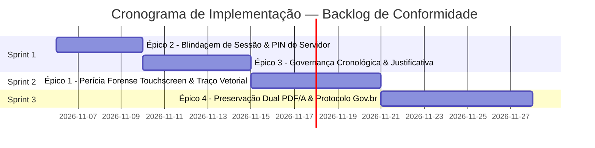

# Backlog Técnico-Jurídico de Conformidade e Fé Pública — Atas Pedagógicas
**Projeto:** Rede Ativa SaaS  
**Legislação Base:** Lei Federal nº 14.063/2020 (Assinaturas Eletrônicas Públicas), Lei Federal nº 13.709/2018 (LGPD), Lei Federal nº 8.069/1990 (ECA, Arts. 17 e 143), Código Civil (Arts. 219 e 225) e Código de Processo Civil (Arts. 411 e 440).  
**Data de Elaboração:** 05/11/2026  
**Status:** Aprovado para Implementação Gradual por Sprints  

---

## Sumário Executivo dos Épicos

| Épico | Título | Criticidade Jurídica | Complexidade Técnica |
| :--- | :--- | :---: | :---: |
| **ÉPICO 1** | Captura Forense & Perícia Grafotécnica de Assinaturas (Touchscreen/Mobile) | Alta | Média |
| **ÉPICO 2** | Blindagem de Sessão e Revalidação de Fé Pública do Servidor ao Lavrar | Alta | Baixa |
| **ÉPICO 3** | Governança da Sequência Cronológica e Lavratura Extemporânea (Auditoria MP/NRE) | Alta | Média |
| **ÉPICO 4** | Preservação Arquivística Dual (JSON Canônico + PDF/A) & Assinador Gov.br/ITI | Média | Alta |

---

## ÉPICO 1: Captura Forense & Perícia Grafotécnica de Assinaturas

### 1.1. Contexto e Fundamentação Jurídica
Nos termos do **Art. 4º, inciso II, alínea 'a' da Lei Federal nº 14.063/2020**, a Assinatura Eletrônica Avançada exige que o sistema seja capaz de comprovar a **associação unívoca entre o signatário e o documento**, bem como a utilização de dados sob seu controle exclusivo. 
Salvar apenas uma imagem estática PNG é vulnerável a alegações de adulteração ou colagem de assinatura por terceiros. A captura da **dinâmica biométrica do traço** (coordenadas espaciais, velocidade e tempo de pressão) assegura a realização de perícia grafotécnica forense válida em juízo.

### 1.2. Requisitos Funcionais e Técnicos
* **RF-1.1:** O componente `SignatureCanvas.tsx` e o fluxo móvel (`/assinar/ata/[token]`) devem capturar os eventos `PointerEvent` com as coordenadas relativas `(x, y)`, o carimbo de tempo em milissegundos `t` e o fator de pressão `p` do toque/caneta stylus.
* **RF-1.2:** Armazenar os pontos brutos em array JSON estruturado e compactado no campo `biometricStrokeData` da tabela `PedagogicalMinuteParticipant`.
* **RF-1.3:** Manter simultaneamente a renderização visual em `signatureData` (Data URL em WebP/PNG) para impressão imediata em relatórios e no Livro de Atas.
* **RF-1.4:** Registrar o `signerUserAgent` completo (navegador, sistema operacional e dispositivo) extraído dos cabeçalhos HTTP da requisição de assinatura.

### 1.3. Impacto no Banco de Dados (Prisma Schema)
```prisma
// Em PedagogicalMinuteParticipant
model PedagogicalMinuteParticipant {
  // ... campos existentes
  signerUserAgent     String?   // User-Agent completo no momento da assinatura
  biometricStrokeData String?   // JSON com array de traços vetoriais [{x, y, t, p}]
  clientTimestampIso  String?   // Timestamp emitido pelo relógio do aparelho
}
```

### 1.4. Critérios de Aceitação
- [ ] O payload de assinatura no endpoint `POST /api/atas/sign-token/[token]` aceita o campo `strokeData` e grava em banco.
- [ ] Uma assinatura colada artificialmente sem eventos temporais de traço é rejeitada ou sinalizada como sem prova pericial contínua.
- [ ] O teste unitário confirma que o `computeMinuteHash` inclui a consistência dos novos metadados forenses.

---

## ÉPICO 2: Blindagem de Sessão e Revalidação de Fé Pública do Servidor

### 2.1. Contexto e Fundamentação Jurídica
O servidor público (Pedagoga, Diretor, Gestor Escolar) atua investido de **fé pública institucional**. O principal risco pericial em escolas é a **sessão aberta abandonada** em computadores compartilhados da sala dos professores ou secretaria. Uma ata lavrada por terceiro em nome da pedagoga constitui falsidade ideológica e compromete a validade jurídica de todo o Livro de Atas.

### 2.2. Requisitos Funcionais e Técnicos
* **RF-2.1:** Configurar *timeout* ativo de inatividade da sessão de 45 minutos no NextAuth v5.
* **RF-2.2 (Ciclo de Vida do PIN de Fé Pública):**
  * **Onboarding Inteligente:** Se o servidor ainda não cadastrou seu PIN de 4 a 6 dígitos, ao clicar pela primeira vez em *"Lavrar e Assinar"*, o sistema abre um fluxo modal guiado para criar e confirmar o PIN imediatamente.
  * **Gerenciamento no Perfil:** Aba *"Segurança & PIN de Assinatura"* acessível a qualquer momento clicando no avatar do servidor no cabeçalho superior.
  * **Recuperação Instantânea ("Esqueci meu PIN"):** Sem travar reuniões presenciais, o servidor clica em *"Esqueci meu PIN"*, reautentica sua identidade em tempo real via popup institucional Google OAuth (`@escola.pr.gov.br`) e define um novo PIN na hora.
* **RF-2.3:** O PIN é criptografado com hash seguro (PBKDF2/bcrypt) e gravado no campo `signingPinHash` da model `User`.
* **RF-2.4:** No momento em que o servidor clica em **"Lavrar e Assinar Oficialmente"** em `AtaEditorModal.tsx`, a plataforma exige o PIN de 4 a 6 dígitos. O endpoint `POST /api/atas/[id]/finalize` valida o PIN antes de adquirir o lock transacional e rejeita com `401 Unauthorized` se estiver incorreto.
* **RF-2.5:** Gravação de auditoria em `AuditLog` especificando a confirmação ativa da credencial do servidor com IP e User-Agent.

### 2.3. Impacto no Banco de Dados (Prisma Schema)
```prisma
// Em User
model User {
  // ... campos existentes
  signingPinHash String?   // Hash seguro do PIN de 4 a 6 dígitos para lavratura
  pinCreatedAt   DateTime? // Data de criação/última troca do PIN
  pinAttempts    Int       @default(0) // Contador de tentativas incorretas consecutivas
  pinLockedUntil DateTime? // Bloqueio temporário após 3 erros consecutivos
}
```

### 2.4. Critérios de Aceitação
- [ ] Usuários sem PIN cadastrado são direcionados ao modal de onboarding na primeira tentativa de lavratura.
- [ ] O fluxo "Esqueci meu PIN" revalida a titularidade da conta Google institucional e permite redefinição imediata.
- [ ] Três tentativas incorretas consecutivas bloqueiam temporariamente a lavratura por 5 minutos, emitindo log em `AuditLog`.
- [ ] A revalidação não interfere nos testes automatizados através de credencial mockada ou bypass em ambiente de teste.

---

## ÉPICO 3: Governança da Sequência Cronológica e Lavratura Extemporânea

### 2.1. Contexto e Fundamentação Jurídica
A numeração sequencial anual (`ataNumber`) é vinculada estritamente ao momento da **lavratura oficial (`finalizedAt`)** para prevenir buracos e gaps numéricos vedados pelo NRE. Contudo, atendimentos que ocorreram dias ou semanas antes (`attendedAt`) e foram lavrados posteriormente geram aparente quebra de cronologia quando ordenados por data do fato pedagógico, atraindo questionamentos em auditorias de promotorias da infância.

### 2.2. Requisitos Funcionais e Técnicos
* **RF-3.1:** Quando a diferença entre a data do atendimento (`attendedAt`) e a data da lavratura (`finalizedAt`) for superior a **5 dias úteis**, o sistema categoriza a ata como **Lavratura Extemporânea**.
* **RF-3.2:** A interface do `AtaEditorModal.tsx` exige o preenchimento obrigatório do campo `extemporaneousReason` (Justificativa da Lavratura Extemporânea, ex.: *"Reunião presencial realizada em 03/11, aguardando comparecimento do responsável legal para colheita presencial da assinatura no estabelecimento de ensino"*).
* **RF-3.3:** O campo `extemporaneousReason` é incorporado ao payload canônico do hash SHA-256 e impresso em uma seção destacada de **"Nota de Escrituração & Fé Pública"** no rodapé do PDF oficial.
* **RF-3.4:** No Livro de Atas Anual (`/atas/livro/[ano]`), exibir aviso de regularidade administrativa demonstrando a conformidade legal do registro extemporâneo.

### 2.3. Impacto no Banco de Dados (Prisma Schema)
```prisma
// Em PedagogicalMinute
model PedagogicalMinute {
  // ... campos existentes
  isExtemporaneous     Boolean   @default(false)
  extemporaneousReason String?   // Justificativa administrativa do atraso
}
```

### 2.4. Critérios de Aceitação
- [ ] Se `diffDays(attendedAt, today) > 5` dias úteis e `extemporaneousReason` estiver vazio, o backend em `finalize/route.ts` retorna `400 Bad Request` com instrução expressa.
- [ ] O PDF oficial de impressão renderiza a Nota de Escrituração devidamente formatada.
- [ ] O cálculo canônico `computeMinuteHash` permanece 100% determinístico com ou sem o campo extemporâneo.

---

## ÉPICO 4: Preservação Arquivística Dual & Assinador Gov.br/ITI

### 4.1. Contexto e Fundamentação Jurídica
A **Lei nº 14.063/2020 (Art. 5º)** reconhece a validade plena das assinaturas realizadas através do portal do Governo Federal (**Assinador ITI / Gov.br** com contas nível Prata ou Ouro). A estratégia de preservação arquivística dual garante tanto a flexibilidade operacional (validação do JSON em tempo real no Postgres) quanto a perenidade documental oficial no padrão **PDF/A** (ISO 19005 para preservação digital de longo prazo).

### 4.2. Requisitos Funcionais e Técnicos
* **RF-4.1:** Gerar o artefato documental em padrão **PDF/A-1b** no momento em que a ata é selada como `FINALIZED`, embutindo os metadados XMP, carimbo do tempo, QR Code vetorial e hash SHA-256 no rodapé.
* **RF-4.2:** Manter a validação primária instantânea no portal público (`/validar/ata/[code]`) alimentada pelo JSON canônico em tempo real, dispensando leitura pesada de arquivos em disco.
* **RF-4.3:** Disponibilizar na tela de detalhes da ata a opção de **"Exportar para Assinador Gov.br"** e o botão **"Averbar Protocolo do Assinador ITI"**, permitindo que servidores ou pais autentiquem o PDF gerado diretamente no portal `assinador.iti.br`.
* **RF-4.4:** Armazenar os metadados de certificação federal nos campos `govBrVerified`, `govBrProtocol` e `govBrSignerCpf` já previstos na modelagem de integridade.

### 4.3. Critérios de Aceitação
- [ ] O PDF gerado cumpre as diretrizes de conformidade PDF/A sem elementos visuais que quebrem renderização offline.
- [ ] A averbação do protocolo Gov.br valida o formato oficial do código emitido pelo ITI e atualiza o selo da ata com destaque visual no portal público.
- [ ] A certidão cega pública informa a presença de certificação digital complementar Gov.br/ICP-Brasil quando averbada.

---

## Cronograma e Sprints de Entrega Recomendadas



---

## Conclusão e Próximos Passos
Este documento consolida todas as exigências técnico-jurídicas para que a plataforma **Rede Ativa SaaS** possua a mais alta blindagem probatória contra impugnações judiciais, auditorias de órgãos de controle e denúncias no Ministério Público.
A implementação de cada sprint deve seguir rigorosamente a regra inegociável de **177+ testes automatizados passando** e **zero erros de compilação TypeScript/Turbopack**.
