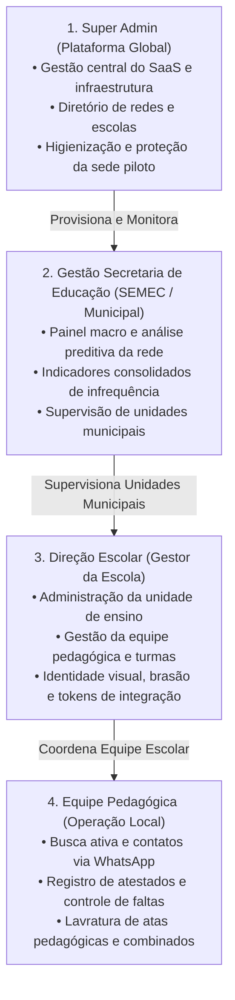

# Rede Ativa SaaS — Plataforma Multi-Escola de Busca Ativa, Gestão de Frequência & Livro Oficial de Atas Pedagógicas

> **Unidade Piloto Fundadora / Laboratório de Validação Tecnológica e Pedagógica:**  
> **Colégio Estadual Leopoldina B. Pedroso** (INEP `41042730`) — Ponta Grossa / Tibagi, Paraná (SEED-PR)  
> *Ambiente real onde o sistema foi idealizado, homologado com 689 estudantes e consolidado como padrão de referência para redes municipais e estaduais.*

---

## 🌟 Sobre a Plataforma Rede Ativa SaaS

O **Rede Ativa SaaS** é uma solução completa em nuvem (*Software as a Service*) projetada para transformar o combate à evasão escolar, o acompanhamento da frequência e a formalização de intervenções pedagógicas em redes públicas e privadas de ensino.

Originalmente desenvolvido no Colégio Estadual Leopoldina B. Pedroso (**Escola Piloto**), o sistema opera em **arquitetura SaaS multi-escola de alta performance**, permitindo que múltiplas instituições e secretarias municipais de educação (SEMEC) atuem de forma simultânea e independente, com isolamento lógico estrito de dados, governança hierárquica e fé pública digital.

A plataforma unifica:
1. **Busca Ativa Assistida & Comunicação Ágil via WhatsApp** (com detecção inteligente Mobile/Desktop, Janela Dedicada Compacta `480x760px` e confirmação automática de entrega via Extensão v1.5.0);
2. **Monitoramento de Infrequência em Tempo Real & Sincronização SERE/Power BI/SERP**;
3. **Livro Oficial Digital de Atas Pedagógicas** com validade jurídica (**Lei Federal nº 14.063/2020**, PIN de Fé Pública do servidor `PBKDF2-SHA512`, perícia vetorial de traço, selo criptográfico `SHA-256`, governança de lavratura extemporânea, averbação **Gov.br/ITI** e biometria móvel WebAuthn/FIDO2);
4. **Arcabouço Jurídico Probatório & Dossiês Unificados** com hash de integridade em mensagens e anonimização automática ECA para prestação de contas ao Conselho Tutelar, Ministério Público e Varas da Infância e Juventude;
5. **Inteligência Pedagógica & Preditiva (Google Gemini)** para estruturação formal de atas padrão NRE/SEED-PR, classificação de retornos familiares com pseudonimização LGPD e matriz preditiva de evasão para Secretarias Municipais.

---

## 🏛️ Governança Multi-Escola em 4 Camadas

A plataforma opera com controle de acesso baseado em papéis (*RBAC - Role-Based Access Control*) em 4 níveis hierárquicos:



| Nível | Perfil | Painel Inicial | Escopo Operacional |
| :--- | :--- | :--- | :--- |
| **Nível 1** | `SUPERADMIN` | `/admin` | Visão global do SaaS, diretório de redes e escolas, auditoria unificada, higienização e emulação segura de qualquer unidade. |
| **Nível 2** | `GESTAO_SECRETARIA` | `/secretaria` | Visão municipal consolidada da rede (SEMEC), ranking comparativo, análise preditiva de evasão e supervisão das escolas. |
| **Nível 3** | `GESTOR_ESCOLAR` | `/gestao` | Gestão da unidade escolar, equipe local (`/equipe`), criação de turmas, brasão institucional e token de sincronização. |
| **Nível 4** | `PEDAGOGA` | `/busca-ativa` | Operação diária: fila de busca ativa, livro de atas, acompanhamento de frequência, atestados, prazos e dossiês. |

---

## 🚀 Tecnologias & Engenharia

- **Frontend & Backend**: Next.js 16.4 (App Router + Turbopack), React 19.3, TypeScript 6.0 estrito
- **PWA Mobile**: Aplicativo web progressivo instalável com Service Worker (`sw.js`) e ícones adaptativos
- **Design System & Acessibilidade**: Tailwind CSS v4, Lucide Icons, `<dialog>` widescreen nativo e diagramação A4 pericial
- **Banco de Dados Multi-Tenant**: Neon PostgreSQL Serverless (AWS São Paulo - `sa-east-1`) com 21 models em Prisma ORM 6 (`EducationNetwork`, `School`, `UserSchool`, `PedagogicalMinute`, etc.)
- **Segurança, Fé Pública & Perícia**: NextAuth.js v5, Proxy de borda (`src/proxy.ts`), guarda atômica `assertTenantOwnership` (REST e SSR), validação anti-spoofing em `getCurrentSchool`, proteção contra CSV Formula Injection (CWE-1236 + RFC 4180), PIN de Fé Pública (`PBKDF2-SHA512`), captura vetorial de assinatura (`biometricStrokeData`), WebAuthn/FIDO2 e selamento `SHA-256` canônico
- **Ingestão Poliglota (SERE/SEED-PR)**: Parser em memória com `xlsx` (`.xls` BIFF8 e `.xlsx`), `unpdf` (`.pdf`) e `.csv` (`UTF-8` / `Windows-1252`), com desduplicação de dupla matrícula técnica
- **Extensão Universal Chrome MV3 (`v1.5.0`)**: Sincronização assistida com Power BI (*Presente na Escola*) e portal SERP/Celepar, Janela Dedicada Compacta (`480x760px`) e confirmação automática de envio no WhatsApp Web
- **Qualidade & Confiabilidade**: **418 testes automatizados em 57 suítes Vitest (100% verdes)** cobrindo os 10 vetores adversariais multi-tenant (`adversarialQa.test.ts`), segurança, isolamento de estado e integridade de retorno WhatsApp (`messageReplySecurity.test.ts`, `whatsappReplyCaptureModal.test.tsx`), sincronização de frequência Power BI / CSV / JSON (`frequenciaSync.test.ts`), otimização de egress/cache Neon (`egressAndCacheOptimization.test.ts`), serviços e subcomponentes de atas (`ataServices.test.ts`, `ataEditorSubcomponents.test.tsx`), usabilidade e preservação arquivística de atas (`atasArchiveUsability.test.ts`), RBAC 4-tier, criptografia forense, anonimização LGPD/ECA e renderização SSR

---

## ⚡ Quickstart de Desenvolvimento Local

```bash
# 1. Instalar dependências e gerar Prisma Client
npm install

# 2. Configurar variáveis locais (porta padrão 3001 + login dev habilitado)
cp .env.example .env.local

# 3. Iniciar servidor local em http://localhost:3001
npm run dev

# 4. Validar suíte de testes e build de produção
npm test
npm run build
```

---

## 📋 Módulos Principais do Sistema

| Módulo | Rota | Descrição |
| :--- | :--- | :--- |
| **Super Admin & Escolas** | `/admin` · `/admin/escolas` | Visão executiva global, diretório de redes/escolas, higienização de testes e proteção da sede piloto. |
| **Auto-Onboarding SaaS** | `/onboarding` | Wizard em 4 etapas para adesão de novas escolas/redes, brasão A4, carga inicial SERE e token da extensão. |
| **Painel Secretaria (SEMEC)** | `/secretaria` | Dashboard executivo municipal com ranking inter-escolas e análise preditiva de causas de infrequência. |
| **Painel Direção Escolar** | `/gestao` · `/equipe` · `/configuracoes/escola` | KPIs da unidade, criação de turmas, gestão de servidores autorizados, brasão oficial e token de sincronização. |
| **Busca Ativa WhatsApp** | `/busca-ativa` | Disparo individual ou Fila Assistida por Turma com salto automático de atestados vigentes e saneamento de telefones. |
| **Livro de Atas Digital** | `/atas` · `/atas/livro/[ano]` | Numeração anual sequencial, editor widescreen com voz e IA NRE, PIN do servidor, traço forense, QR Code móvel com biometria, scan físico/Gov.br direto na listagem e na visualização, atalho rápido PDF/A-1b (ISO 19005-1), adendos *"Em tempo"*, filtro de pendências arquivísticas e Livro Anual customizável. |
| **Validação & Assinatura** | `/validar/ata/[code]` · `/assinar/ata/[token]` | Certidão Cega pública LGPD-safe (`SHA-256`) e portal móvel temporário para assinatura presencial/remota. |
| **Prontuário 360º & Dossiê** | `/alunos/[id]` · `/alunos/[id]/dossie` | Linha do tempo integral do estudante e emissão em 1 clique de Dossiê Pericial A4 para Conselho Tutelar / MP (ECA Arts. 17 e 143). |
| **Frequência & Atestados** | `/faltas` · `/atestados` · `/boletim` | Monitoramento `<75%`, alerta de queda abrupta, fichas SERP, vigência de atestados e boletim semanal automatizado. |
| **Prazos, Histórico & Auditoria** | `/encaminhamentos` · `/historico` · `/relatorios` · `/auditoria` | Alertas de combinados vencidos, histórico paginado com selo `SHA-256`, gráficos gerenciais e trilha de auditoria isolada por escola. |

---

## 📖 Índice da Documentação Canônica

- 👉 **[Contexto Mestre & Regras Inegociáveis para IAs (`AI_CONTEXT.md`)](AI_CONTEXT.md)** — Fonte única de verdade (SSOT) de regras de negócio, estrutura do projeto e convenções.
- 👉 **[Arquitetura e Engenharia de Software (`docs/ARQUITETURA_E_ENGENHARIA.md`)](docs/ARQUITETURA_E_ENGENHARIA.md)** — Referência técnica unificada: diagramas C4/ERD, 21 models Prisma, 29 páginas SSR, 50 APIs REST, criptografia e segurança.
- 👉 **[Guia de Colaboração & Onboarding Dev (`docs/GUIA_COLABORACAO.md`)](docs/GUIA_COLABORACAO.md)** — Passo a passo de ambiente local (`localhost:3001`), Neon Branching e fluxo Git.
- 👉 **[Guia de Implantação e Operação Cloud (`docs/DEPLOY.md`)](docs/DEPLOY.md)** — Provisionamento na Vercel, Neon PostgreSQL, variáveis de ambiente e operação multi-escola.
- 👉 **[Backlog Evolutivo & Roadmap (`docs/BACKLOG.md`)](docs/BACKLOG.md)** — Registro completo das Sprints 1 a 18 concluídas e planejamento técnico-jurídico futuro.
- 👉 **[Relatórios Históricos de Auditoria (`docs/auditorias/`)](docs/auditorias/)** — Snapshots formais de auditoria técnica, transição SaaS e bateria adversarial dos 7 vetores multi-tenant.
