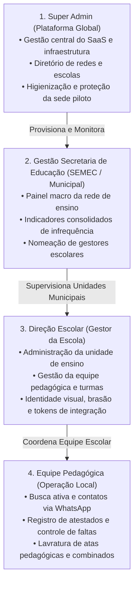

# Rede Ativa SaaS — Plataforma Multi-Escola de Busca Ativa, Gestão de Frequência & Livro Oficial de Atas Pedagógicas

> **Unidade Piloto Fundadora / Laboratório de Validação Tecnológica e Pedagógica:**  
> **Colégio Estadual Leopoldina B. Pedroso** (INEP `41042730`) — Ponta Grossa / Tibagi, Paraná (SEED-PR)  
> *Ambiente real onde o sistema foi idealizado, homologado com 689 estudantes e consolidado como padrão de referência para redes municipais e estaduais.*

---

## 🌟 Sobre a Plataforma Rede Ativa SaaS

O **Rede Ativa SaaS** é uma solução completa em nuvem (*Software as a Service*) projetada para transformar o combate à evasão escolar, o acompanhamento da frequência e a formalização de intervenções pedagógicas em redes públicas e privadas de ensino. 

Originalmente desenvolvido como projeto de inovação no Colégio Estadual Leopoldina B. Pedroso (**Escola Piloto**), a plataforma foi expandida para uma **arquitetura SaaS multi-escola de alta performance**, permitindo que múltiplas instituições e secretarias municipais de educação operem de forma simultânea e independente, com isolamento lógico estrito de dados, governança hierárquica e fé pública digital.

A plataforma unifica:
1. **Busca Ativa Assistida & Comunicação Ágil com Famílias via WhatsApp** (com detecção inteligente Mobile/Desktop e Janela Dedicada Compacta);
2. **Monitoramento de Infrequência em Tempo Real & Sincronização SERE/RCO/Power BI**;
3. **Livro Oficial Digital de Atas Pedagógicas** com validade jurídica (**Lei Federal nº 14.063/2020**, selo criptográfico `SHA-256`, assinaturas digitais institucionais e biometria móvel WebAuthn/FIDO2);
4. **Arcabouço Jurídico Probatório & Dossiês Unificados** para prestação de contas ao Conselho Tutelar, Ministério Público e Varas da Infância e Juventude;
5. **Inteligência Pedagógica Generativa (Google Gemini 2026)** para estruturação formal de atas, redação acolhedora e classificação de retornos de responsáveis.

---

## 🏛️ Governança Multi-Escola em 4 Camadas

A plataforma opera com controle de acesso baseado em papéis (*RBAC - Role-Based Access Control*) com 4 níveis hierárquicos e isolamento de painéis:

| Nível | Perfil | Painel de Aterrissagem | Escopo Operacional |
| :--- | :--- | :--- | :--- |
| **Nível 1** | `SUPERADMIN` | `/admin` | Visão global do SaaS, diretório de redes, auditoria unificada, exclusão/higienização de escolas e emulação segura de qualquer unidade. |
| **Nível 2** | `GESTAO_SECRETARIA` | `/secretaria` | Visão municipal consolidada da rede (SEMEC), métricas agregadas de presença e supervisão das escolas da rede. |
| **Nível 3** | `GESTOR_ESCOLAR` | `/gestao` | Gestão da unidade escolar, equipe da escola (`/equipe`), turmas, configurações institucionais e token de sincronização. |
| **Nível 4** | `PEDAGOGA` | `/busca-ativa` | Operação diária: fila de busca ativa, livro de atas, acompanhamento de frequência, atestados e dossiês de alunos da escola. |

---

## 🚀 Tecnologias & Engenharia

- **Frontend & Backend**: Next.js 16 (App Router + Turbopack), React 19, TypeScript 5.8
- **PWA Mobile**: Aplicativo web progressivo instalável nativamente em smartphones com Service Worker (`sw.js`), suporte offline e ícones maskable
- **Design System & Acessibilidade**: Tailwind CSS v4, Lucide Icons, Modern Web Guidance (Dialogs widescreen nativos, Checkboxes `:indeterminate`, Progress bars sem travamento da main thread)
- **Banco de Dados Multi-Tenant**: Neon PostgreSQL Serverless (AWS São Paulo - `sa-east-1`, latência típica ~60ms) com particionamento lógico via Prisma ORM 6 (`School`, `EducationNetwork`, `UserSchool`)
- **Autenticação, Fé Pública & Segurança**: NextAuth.js v5 (Google OAuth e contas institucionais), Proxy Middleware global (`proxy.ts`), Allowlist de equipe por escola (`/equipe`), selamento `SHA-256` canônico, biometria local **WebAuthn / FIDO2 (Passkeys)** e trilha de auditoria completa com IP e User-Agent
- **Ingestão Cadastral Poliglota (SERE/SEED-PR)**: Parser multiformato de alta fidelidade com `xlsx` (planilhas `.xls` BIFF8 e `.xlsx`), `unpdf` (relatórios `.pdf`) e arquivos `.csv` (`UTF-8` / `Windows-1252`), com desduplicação automática de dupla matrícula técnica
- **Inteligência Artificial Pedagógica**: Google Gemini API (`@google/genai` 2026) — Redação de comunicados, formalização de atas com rigor gramatical das diretrizes do NRE/SEED-PR, fuso horário oficial `America/Sao_Paulo`, thinking tokens otimizados (`thinkingLevel: "low"`), pseudonimização prévia (LGPD/ECA) e classificação estruturada JSON
- **Agente Universal de Sincronização & WhatsApp**: Extensão Web Manifest V3 com Janela Dedicada Compacta (Popup Minimalista 480x760px) sem abas e sem barra de URL no Linux/Desktop, chaveamento adaptativo Mobile nativo (`wa.me`) e bridge segura com o portal Power BI e SERP/Celepar através de tokens individuais por escola (`syncTokenHash`)
- **Rotinas em Nuvem**: Vercel Cron semanal (`/api/cron/weekly-digest`) para diagnóstico executivo e triagem preventiva automática de estudantes em risco
- **Qualidade & Confiabilidade**: Suíte de testes automatizados com **96 testes unitários e de integração (Vitest)** cobrindo RBAC multi-escola, isolamento multi-tenant, criptografia de atas, anonimização LGPD, parsers SERE e rotas de borda

---

## 📋 Módulos Principais do Sistema

| Módulo | Rota | Descrição |
| :--- | :--- | :--- |
| **Super Admin Global** | `/admin` | Visão executiva de todas as redes e escolas da plataforma, diretório global, trilha unificada de auditoria e acesso emulado. |
| **Gestão de Escolas** | `/admin/escolas` | Cadastro de novas unidades, geração de chaves de integração, higienização de dados de teste e proteção da sede piloto. |
| **Painel Secretaria** | `/secretaria` | Dashboard executivo da Secretaria Municipal de Educação (SEMEC) com indicadores macro da rede de ensino. |
| **Painel Direção Escolar** | `/gestao` | Painel da direção da escola ativa: panorama de alunos, turmas, equipe e atalhos de gestão. |
| **Busca Ativa** | `/busca-ativa` | Disparo individual ou **Fila Guiada por Turma** via Janela Compacta (Linux) ou mobile (`wa.me`), salto automático de atestados médicos vigentes e confirmação de entrega com saneamento de telefones. |
| **Livro de Atas Digital** | `/atas` | Livro eletrônico oficial com numeração anual sequencial por escola, editor widescreen em duas colunas, ditado por voz, formalização com Gemini AI, assinatura institucional em 1 clique, assinatura em tela ou **QR Code Móvel com Biometria**, adendos encadeados (*"Em tempo"*), cancelamento justificado e Livro Anual (`/atas/livro/[ano]`). |
| **Validação & Assinatura** | `/validar/ata/[code]` `/assinar/ata/[token]` | Portal público LGPD-safe para conferência de autenticidade (`SHA-256`) via QR Code e página móvel temporária para assinatura com biometria do smartphone dos responsáveis legais. |
| **Prontuário 360º do Aluno** | `/alunos/[id]` | Linha do tempo completa do estudante: faltas acumuladas, atestados médicos vigentes, contatos familiares, atas pedagógicas e histórico de acionamentos. |
| **Dossiê Jurídico Probatório** | `/alunos/[id]/dossie` | Emissão em 1 clique de relatório A4 pericial com cadeia de custódia completa para Conselho Tutelar, Ministério Público e Varas da Infância, com anonimização automática de outros menores citados (Arts. 17 e 143 do ECA). |
| **Painel de Frequência** | `/faltas` | Monitoramento com chips de risco, alerta de **📉 Queda Abrupta**, drawer lateral de envio sem perda de contexto e atalho para a fila da turma. |
| **Alunos & Importação SERE** | `/alunos` | Base de estudantes com CGM, turma, contatos e **Importador em Lote SERE** para arquivos `.xls`, `.xlsx`, `.pdf` e `.csv`. |
| **Modelos de Mensagem** | `/modelos` | Biblioteca de comunicados institucionais com tags dinâmicas e assistente generativo com IA. |
| **Histórico de Mensagens** | `/historico` | Linha do tempo paginada no servidor com status de entrega (`deliveryStatus`), registro de respostas dos pais e botão **"✨ Formalizar & Classificar com IA"**. |
| **Gestão de Equipe** | `/equipe` | Controle restrito a administradores e diretores para credenciamento, atribuição de cargos e controle de acessos da escola. |
| **Configurações da Escola** | `/configuracoes/escola` | Personalização da unidade: nome institucional, código INEP, município, brasão oficial para atas e token da extensão. |
| **Relatórios Gerenciais** | `/relatorios` | Gráficos consolidados por motivo, pedagoga, recorte temporal (trimestres/30 dias) e taxa de números sem WhatsApp. |
| **Auditoria & Segurança** | `/auditoria` | Trilha de auditoria imutável com carimbo de tempo, usuário, perfil, ação executada, IP e detalhes da alteração. |

---

## ⚖️ Arcabouço Jurídico, Fé Pública & Proteção de Dados

A plataforma foi desenvolvida para atender às mais rigorosas exigências do direito educacional brasileiro e da proteção da infância:

1. **Validade Jurídica de Atas Eletrônicas**:
   - Total conformidade com a **Lei Federal nº 14.063/2020** (Assinatura Eletrônica Avançada na Administração Pública) e **Medida Provisória nº 2.200-2/2001**.
   - Assinatura digital em 1 clique atestando a identidade do servidor com registro do e-mail institucional e carimbo temporal UTC.
   - Assinatura de pais e alunos via **WebAuthn / FIDO2 (Biometria nativa do smartphone)** ou desenho em tela capturado vetorialmente.
   - Hash criptográfico canônico `SHA-256` cobrindo o texto integral da ata, participantes, assinaturas, encaminhamentos e metadados.
   - Numeração sequencial contínua por ano e por escola, sem lacunas e com impossibilidade de alteração pós-lavratura.
2. **Conformidade LGPD & ECA**:
   - Cumprimento estrito da **Lei Geral de Proteção de Dados (Lei nº 13.709/2018)** e do **Estatuto da Criança e do Adolescente (Lei nº 8.069/1990 - Arts. 17 e 143)**.
   - O portal público de verificação (`/validar/ata/[code]`) exibe apenas uma **Certidão Cega** com dados de identificação mascarados, sem expor o teor confidencial ou dados sensíveis de menores.
   - O Dossiê Individual em PDF para órgãos externos aplica **pseudonimização automática** sobre nomes de outros colegas citados no corpo de atas coletivas.
3. **Cadeia de Custódia Probatória**:
   - Cada mensagem disparada, retorno recebido de responsáveis, atestado médico anexado e ata lavrada forma um conjunto probatório inalterável com carimbo de tempo, IP de envio e autor, fornecendo subsídio legal incontestável para órgãos de proteção e fiscalização.

---

## 🏫 O Papel do C.E. Leopoldina B. Pedroso como Escola Piloto

O **Colégio Estadual Leopoldina B. Pedroso** (Ponta Grossa/Tibagi - PR) permanece como a **Unidade Piloto Permanente e Berço Tecnológico** da plataforma Rede Ativa SaaS. É neste ambiente de referência que novos recursos pedagógicos, algoritmos preditivos de evasão e integrações com o sistema SERE e Power BI são validados em primeira mão com 689 alunos reais antes de serem disponibilizados para novas escolas e redes municipais.

Por razões de segurança e integridade histórica, a base da escola sede piloto possui proteções atômicas adicionais contra exclusão ou reinicialização acidental, mantendo-se sempre como o padrão de excelência da plataforma.

---

## 📖 Documentação Detalhada & Engenharia

- 👉 **[Arquitetura do Sistema & Multi-Tenancy](ARQUITETURA.md)** (Diagrama de blocos, modelo de dados multi-tenant, 4 camadas de governança e segurança)
- 👉 **[Documentação Técnica Completa do Sistema](docs/DOCUMENTACAO_SISTEMA.md)** (Manuais de módulos, fluxos de uso, integrações e segurança perimetral)
- 👉 **[Arquitetura e Engenharia de Software Detalhada](docs/ARQUITETURA_E_ENGENHARIA.md)** (Especificação canônica de código, esquemas Prisma, criptografia e extensões)
- 👉 **[Backlog Geral de Evolução & Roadmap](docs/BACKLOG.md)** (Histórico de épicos concluídos e planejamento de expansão do SaaS)
- 👉 **[Relatório de Auditoria Técnica & Segurança](docs/RELATORIO_AUDITORIA.md)** (Auditoria de vulnerabilidades, conformidade LGPD e pontuação de saúde)
- 👉 **[Guia de Implantação e Operação Multi-Escola](DEPLOY.md)** (Provisionamento na Vercel, Neon PostgreSQL e configuração de novas escolas)
