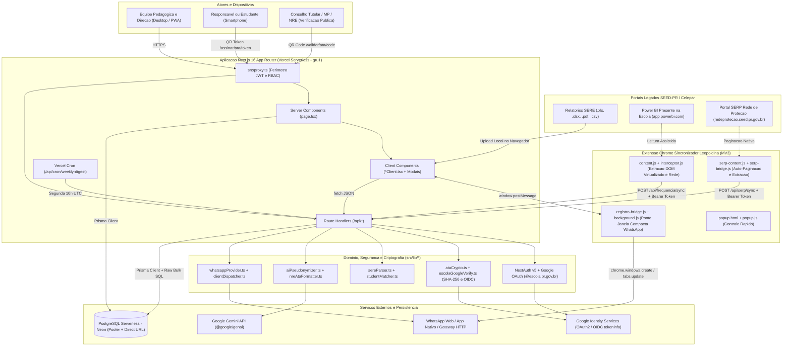
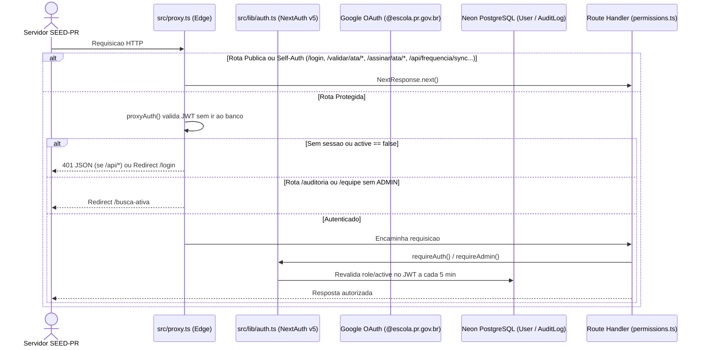
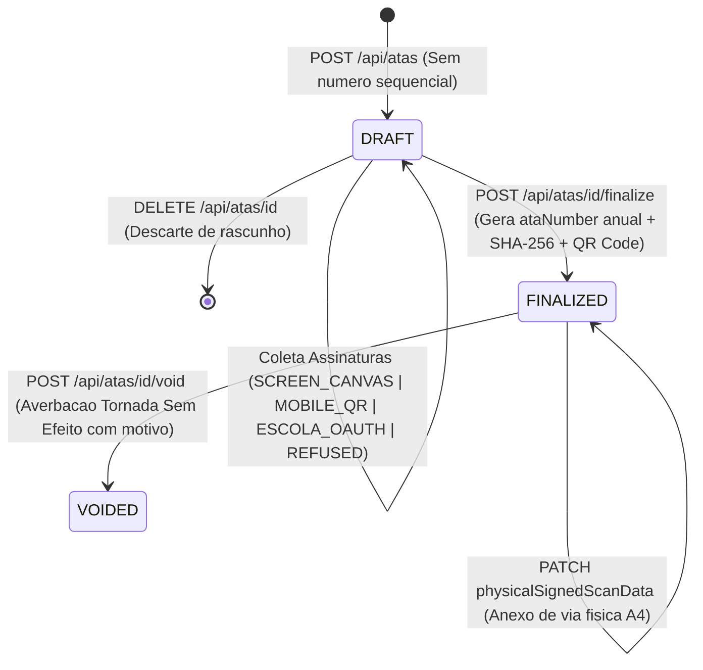
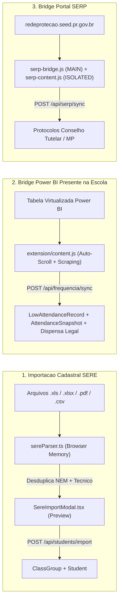

# Arquitetura e Engenharia de Software — Rede Ativa SaaS

> **Sistema:** Rede Ativa SaaS — Plataforma Multi-Escola de Busca Ativa, Gestão de Frequência & Livro Oficial de Atas Pedagógicas  
> **Unidade Piloto Fundadora:** Colégio Estadual Leopoldina B. Pedroso (INEP `41042730`) — NRE Ponta Grossa / Tibagi (SEED-PR)  
> **Edição:** 4.0 (Documentação Canônica SaaS Multi-Escola) · **Data:** 01/11/2026  
> **Escopo:** `src/`, `prisma/`, `extension/`, `scripts/`, `public/` e infraestrutura serverless multi-tenant (Vercel + Neon PostgreSQL).

---

## 1. Visão Geral da Arquitetura do Sistema

O **Rede Ativa SaaS** é uma plataforma web full-stack serverless de alta performance projetada para centralizar o combate preventivo à infrequência e ao abandono escolar, unificar a mensageria institucional com famílias via WhatsApp e conferir fé pública jurídica ao registro pedagógico através de um Livro Oficial de Atas Digital com validade legal em múltiplas redes públicas (estaduais e municipais) e privadas de ensino.

Originalmente concebida e validada no **Colégio Estadual Leopoldina B. Pedroso** (**Unidade Piloto Fundadora**, com 689 alunos reais), a solução foi estruturada para operar em modelo SaaS multi-inquilino (*multi-tenant*), combinando cinco pilares operacionais e jurídicos fundamentais:

1. **Ingestão Cadastral Poliglota (SERE):** Importação assistida de relatórios oficiais exportados do Sistema Estadual de Registro Escolar em `.xls` (BIFF8), `.xlsx`, `.pdf` e `.csv`, com desduplicação automática de dupla matrícula técnica (Ensino Médio Regular + Itinerário Profissional NEM/EPT) e higienização de telefones familiares.
2. **Telemetria de Frequência e Rede de Proteção (Bridge Power BI & SERP):** Extensão Chrome Manifest V3 que extrai indicadores semanais do painel oficial *Presente na Escola* (`app.powerbi.com`) — incluindo enriquecimento de alunos *Ganhando Mundo*, AEE/Deficiência, idade e vigência de Amparo Legal — e fichas ativas do portal *SERP / Rede de Proteção* (`redeprotecao.seed.pr.gov.br`), sincronizando em lote via API autenticada.
3. **Mensageria Assistida e Classificação Pedagógica com IA:** Fila inteligente de acionamento familiar via WhatsApp com roteamento adaptativo Mobile (`wa.me`) vs. Desktop (`web.whatsapp.com`), Janela Dedicada Compacta (`480x760` tipo `popup`) gerenciada pela extensão Chrome, suporte opcional a gateway HTTP + webhook passivo e classificação/sumarização formal de respostas via Google Gemini com pseudonimização prévia (LGPD/ECA) e fallback heurístico local.
4. **Livro Oficial Digital de Atas Pedagógicas:** Lavratura eletrônica amparada pela **Lei Federal nº 14.063/2020** e pelo **ECA (Lei nº 8.069/1990)**, com numeração sequencial anual por escola, coleta híbrida de assinaturas (Canvas em tela, QR Code móvel temporário com WebAuthn local e autenticação institucional OIDC `@escola.pr.gov.br`), selamento criptográfico `SHA-256` canônico, termos de aditamento encadeados (*hash-chaining*), averbação de cancelamento (*Tornada Sem Efeito*) e certidão pública de autenticidade cega.

### 1.1 Diagrama de Arquitetura do Ecossistema



---

## 2. Stack Tecnológica e Decisões de Engenharia

| Camada | Tecnologia | Versão (`package.json`) | Papel no Projeto e Justificativa Arquitetural |
| :--- | :--- | :---: | :--- |
| **Framework Web** | **Next.js (App Router)** | `^16.4.3` | Renderização híbrida Server/Client, Route Handlers serverless em [`src/app/api/`](file:///home/marcoswrobel/Documents/Registro/src/app/api), interceptação perimetral em [`src/proxy.ts`](file:///home/marcoswrobel/Documents/Registro/src/proxy.ts) e deploy regionalizado em São Paulo (`gru1` em [`vercel.json`](file:///home/marcoswrobel/Documents/Registro/vercel.json)). |
| **UI Runtime** | **React & React DOM** | `^19.3.1` | Construção declarativa de painéis operacionais densos, modais baseados em `<dialog>` nativo ([`ModalDialog.tsx`](file:///home/marcoswrobel/Documents/Registro/src/components/ModalDialog.tsx)) e assinatura vetorial HTML5 Canvas ([`SignatureCanvas.tsx`](file:///home/marcoswrobel/Documents/Registro/src/components/ata/SignatureCanvas.tsx)). |
| **Linguagem** | **TypeScript** | `^6.0.3` | `strict: true` habilitado em [`tsconfig.json`](file:///home/marcoswrobel/Documents/Registro/tsconfig.json), path alias `@/* -> ./src/*`, garantindo contratos estáticos entre banco, API e componentes. |
| **Estilização** | **Tailwind CSS v4** | `^4.3.3` | Estilização utilitária via `@tailwindcss/postcss`, tema escuro persistido sem *flash* (FOUC) em [`layout.tsx`](file:///home/marcoswrobel/Documents/Registro/src/app/layout.tsx#L50-L63), ícones `lucide-react` (`^1.63.0`) e regras CSS dedicadas `@media print` para folhas oficiais A4. |
| **ORM & Banco** | **Prisma ORM + PostgreSQL (Neon)** | `^6.4.0` | Schema declarativo em [`prisma/schema.prisma`](file:///home/marcoswrobel/Documents/Registro/prisma/schema.prisma) com suporte a *Connection Pooler* (`DATABASE_URL`) e conexão direta para DDL (`DIRECT_URL`), combinando queries tipadas com `Prisma.sql` parametrizado para *bulk upserts* de alta vazão. |
| **Autenticação** | **NextAuth.js (Auth.js v5)** | `^5.0.0-beta.32` | Estratégia de sessão `jwt` *stateless* dividida entre configuração leve de borda ([`auth.config.ts`](file:///home/marcoswrobel/Documents/Registro/src/lib/auth.config.ts)) e callbacks com Prisma ([`auth.ts`](file:///home/marcoswrobel/Documents/Registro/src/lib/auth.ts)), restringindo login ao Google Workspace `@escola.pr.gov.br`. |
| **Validação** | **Zod** | `^4.6.7` | Validação de payloads HTTP e normalização de erros em [`src/lib/schemas.ts`](file:///home/marcoswrobel/Documents/Registro/src/lib/schemas.ts) e schemas locais nos endpoints de atas e IA. |
| **IA Generativa** | **Google Gen AI SDK** | `^2.31.0` | Integração com modelos Gemini (`gemini-3.5-flash`, `gemini-3.5-flash-lite`, `gemini-3.8-flash`) usando *Structured Outputs* (`responseSchema`) e *fallback* secundário para Interactions API, sempre precedido por pseudonimização ([`aiPseudonymizer.ts`](file:///home/marcoswrobel/Documents/Registro/src/lib/aiPseudonymizer.ts)) e sucedido por *fallback* determinístico offline. |
| **Parsers SERE** | **SheetJS (`xlsx`) & `unpdf`** | `^0.18.5` / `^1.9.1` | Leitura 100% em memória (`ArrayBuffer`) de planilhas `.xls`/`.xlsx` e extração posicional de texto por coordenadas `(x, y)` em PDFs exportados pelo SERE ([`sereParser.ts`](file:///home/marcoswrobel/Documents/Registro/src/lib/sereParser.ts#L172-L345)). |
| **Emissão PDF** | **jsPDF** | `^4.2.1` | Geração vetorial client-side de Dossiês para Conselho Tutelar/MP e impressão paginada do Livro Anual de Atas. |
| **PWA & Mobile** | **Service Worker Nativo** | `v1.1.0` | Manifesto web (`/manifest.json`), registro em [`PwaRegister.tsx`](file:///home/marcoswrobel/Documents/Registro/src/components/PwaRegister.tsx) e cache seletivo *network-first* para navegação estática em [`public/sw.js`](file:///home/marcoswrobel/Documents/Registro/public/sw.js), ignorando `/api/*` para preservar consistência em tempo real. |
| **Extensão** | **Chrome Extension MV3** | `1.4.1` | Coleta assistida nos portais governamentais Power BI e SERP e orquestração da Janela Dedicada Compacta do WhatsApp Web, empacotada automaticamente no build por [`scripts/package_extension.cjs`](file:///home/marcoswrobel/Documents/Registro/scripts/package_extension.cjs) em `/public/extensao-leopoldina.zip`. |
| **Testes** | **Vitest** | `^5.0.5` | 30 suítes / 177+ testes unitários, integrados e adversariais (~2.7s) cobrindo governança multi-escola 4-tier, isolamento multi-tenant contra os 7 vetores de risco (BOLA/IDOR em REST e SSR, context leakage, integridade institucional de FKs, escalada RBAC e CSV Injection via `adversarialQa.test.ts`), proteção da sede piloto, criptografia de atas SHA-256, OIDC `@escola`, parser SERE, pareamento nominal, classificador pedagógico, mensageria e integridade relacional ([`vitest.config.ts`](file:///home/marcoswrobel/Documents/Registro/vitest.config.ts)). |

---

## 3. Padrões de Projeto e Estratégias de Arquitetura Aplicadas

### 3.1 Arquitetura Híbrida (Server Components vs. Client Components)

O sistema adota a convenção de **par `page.tsx` (Server) + `*Client.tsx` (Client)** em praticamente todas as rotas de domínio sob [`src/app/`](file:///home/marcoswrobel/Documents/Registro/src/app):

- **Camada de Servidor (`page.tsx` e `layout.tsx`):**
  - Executa diretamente na infraestrutura serverless próxima ao banco (`gru1`), sem enviar código de acesso a dados ao navegador.
  - Realiza verificação de sessão (`await auth()` ou `await requireAuth()`), resolução da unidade escolar (`await getCurrentSchool()`) e agregação paralela via `Promise.all(...)` no Prisma (ex.: [`src/app/faltas/page.tsx`](file:///home/marcoswrobel/Documents/Registro/src/app/faltas/page.tsx), [`src/app/busca-ativa/page.tsx`](file:///home/marcoswrobel/Documents/Registro/src/app/busca-ativa/page.tsx) e [`loadStudent360Bundle()`](file:///home/marcoswrobel/Documents/Registro/src/lib/safePhase3Queries.ts#L18-L81)).
  - Serializa o estado inicial pronto para a primeira pintura (*Zero Client Waterfall* na carga inicial).
- **Camada de Cliente (`*Client.tsx` e `src/components/*`):**
  - Marcada com `"use client"`, responsável por filtros instantâneos em memória, fila assistida de disparos, edição rica de atas, captura de assinatura touch/mouse ([`SignatureCanvas.tsx`](file:///home/marcoswrobel/Documents/Registro/src/components/ata/SignatureCanvas.tsx)), parsing local de arquivos SERE antes do envio ([`SereImportModal.tsx`](file:///home/marcoswrobel/Documents/Registro/src/app/alunos/SereImportModal.tsx)) e mutações assíncronas via `fetch("/api/...")`.
  - O shell global [`AppLayoutClient.tsx`](file:///home/marcoswrobel/Documents/Registro/src/components/AppLayoutClient.tsx) oculta automaticamente [`Sidebar.tsx`](file:///home/marcoswrobel/Documents/Registro/src/components/Sidebar.tsx) e [`TopHeader.tsx`](file:///home/marcoswrobel/Documents/Registro/src/components/TopHeader.tsx) nas rotas públicas/limpas (`/login`, `/assinar/ata/*`, `/validar/ata/*`) e em visualizações de impressão (`/imprimir`, `/dossie`, `/livro/*`).

### 3.2 Multi-tenancy, Isolamento de Inquilinos & Governança 4-Tier

A arquitetura SaaS multi-escola baseia-se nas entidades `EducationNetwork`, `School`, `UserSchool` e no resolvedor [`src/lib/currentSchool.ts`](file:///home/marcoswrobel/Documents/Registro/src/lib/currentSchool.ts):

- **Hierarquia de 4 Níveis (RBAC):**
  1. `SUPERADMIN`: Acesso global a todas as redes e escolas via painel `/admin`, com capacidade de gerenciar instituições, auditar acessos e higienizar dados de homologação.
  2. `GESTAO_SECRETARIA`: Acesso executivo municipal via `/secretaria` para consolidação dos indicadores das escolas pertencentes à rede mantenedora (`networkId`).
  3. `GESTOR_ESCOLAR`: Direção da unidade ativa (`/gestao`), controle da equipe autorizada (`/equipe`), turmas e token de sincronização.
  4. `PEDAGOGA`: Equipe pedagógica de campo focada na operação da busca ativa (`/busca-ativa`), faltas, atas e prontuários da escola local.
- **Resolução de Escopo & Prevenção de Cookie Spoofing (`getCurrentSchool`):** Recebe `schoolId` da sessão JWT do operador ([`currentSchool.ts#L31-L96`](file:///home/marcoswrobel/Documents/Registro/src/lib/currentSchool.ts#L31-L96)) ou do cookie verificado `active_school_id`. O valor de `active_school_id` nunca é aceito cegamente: é validado se o usuário possui vínculo ativo com a referida escola (`session.user.schools` / `schoolId`) ou privilégio global (`SUPERADMIN` / `GESTAO_SECRETARIA` autorizado). Quando `schoolId` não está vinculado ao usuário, busca a primeira escola ativa no PostgreSQL; caso a tabela esteja vazia (primeiro deploy), invoca [`ensureDefaultSchool()`](file:///home/marcoswrobel/Documents/Registro/src/lib/currentSchool.ts#L101-L122) para fazer `upsert` da **Unidade Piloto Leopoldina** pelo `inepCode` (`41042730`), garantindo integridade referencial.
- **Tolerância a Dados Legados Restrita à Sede Piloto:** Qualquer filtro de retrocompatibilidade com registros legados (`schoolId: null` ou `"default-leopoldina"`) é condicionado estritamente à comprovação de que a sessão ativa pertence à Escola Piloto Fundadora (`inepCode === "41042730"`), proibindo que escolas externas adotem ou acessem registros do Leopoldina via cláusulas `OR` ou rotinas de *auto-healing*.
- **Isolamento em Server Components (SSR Tenancy Enforcement):** Como o proxy de borda (`src/proxy.ts`) inspeciona apenas autenticação e RBAC genérico, todas as páginas Server Components com parâmetros dinâmicos (`/atas/[id]/imprimir`, `/atas/livro/[ano]` e `/alunos/[id]/dossie`) executam obrigatoriamente `auth()` e [`assertTenantOwnership(...)`](file:///home/marcoswrobel/Documents/Registro/src/lib/tenantGuard.ts) antes de renderizar dados ou persistir mutações de *auto-healing*.
- **Integridade Institucional de Chaves Estrangeiras (Cross-Tenant FK Defense):** Em mutações de criação, edição de rascunhos e finalizações (`POST /api/students`, `POST /api/atas`, `PATCH /api/atas/[id]`, `POST /api/atas/[id]/finalize`, `POST /api/messages/send`), todos os relacionamentos recebidos (`studentIds`, `classGroupId`, `templateId`) são validados contra o `schoolId` ativo (`matched.length === requestedIds.length`), impedindo a criação de vínculos orfãos ou cruzados entre tenants distintos.
- **Rejeição Explícita de Parâmetros Restritos:** Operações ou flags restritas (ex.: `updateSchoolInfo: true` na importação SERE para não-`SUPERADMIN`) retornam explicitamente código `403 Forbidden` (em vez de aceitar a requisição com `200 OK` ignorando silenciosamente a alteração).
- **Isolamento de Auditoria e Sanitização CSV:** Registros de auditoria (`logAudit`) recebem obrigatoriamente `schoolId` na raiz, e o endpoint `/auditoria` nunca expõe registros de outros tenants. Em exportações CSV (`FaltasClient.tsx`), campos textuais são sanitizados com `sanitizeCsvField(...)` e escape de aspas duplas RFC 4180.
- **Chaves Compostas por Escola no Schema:**
  - `ClassGroup`: `@@unique([schoolId, name])` permite que duas escolas distintas possuam turmas homônimas (ex.: `"6º A"`).
  - `PedagogicalMinute`: `@@unique([schoolId, year, ataNumber])` isola a numeração anual sequencial do Livro de Atas por estabelecimento de ensino.
- **Proteção Inviolável da Unidade Piloto Leopoldina:**
  - O Colégio Estadual Leopoldina B. Pedroso (INEP `41042730`) possui proteção atômica em nível de código contra exclusão acidental (`DELETE /api/schools/[id]`) e reinicialização de base (`POST /api/schools/[id]/sanitize`), assegurando a integridade contínua do laboratório piloto.
- **Estado do Isolamento Multi-Escola:** Todas as rotas de listagem (`/api/students`, `/api/messages`, `/api/atas`, `/api/atas/actions`, `/api/justifications`, `/api/low-attendance`, `/api/reports`) e mutações impõem validação prévia de pertencimento à unidade escolar do operador (`schoolId` resolvido via `getCurrentSchool(authCheck.schoolId)`), com bypass controlado exclusivamente para administradores globais (`role === "SUPERADMIN"` ou `"ADMIN"`). As chaves primárias e relacionamentos garantem isolamento estrito de dados entre diferentes colégios e prefeituras.

### 3.3 Segurança e Controle de Acesso (RBAC)

A arquitetura de autenticação e autorização opera em **quatro camadas coordenadas**:



1. **Perímetro de Borda ([`src/proxy.ts`](file:///home/marcoswrobel/Documents/Registro/src/proxy.ts)):**
   - Instancia `NextAuth(authConfig)` usando exclusivamente [`auth.config.ts`](file:///home/marcoswrobel/Documents/Registro/src/lib/auth.config.ts) (compatível com Edge Runtime, sem importar `@prisma/client`).
   - Libera caminhos públicos (`PUBLIC_PATHS`, `PUBLIC_PREFIXES`) e prefixos de API com autenticação própria (`SELF_AUTH_API_PREFIXES`, linhas `11-20`).
   - Para todas as demais rotas, exige sessão JWT válida com `active !== false` (retornando `401` JSON para `/api/*` ou redirecionando para `/login`) e restringe `/auditoria` e `/equipe` a administradores via [`checkIsAdmin()`](file:///home/marcoswrobel/Documents/Registro/src/lib/roles.ts#L23-L28).
2. **Login Institucional e Allowlist ([`src/lib/auth.ts`](file:///home/marcoswrobel/Documents/Registro/src/lib/auth.ts)):**
   - O callback `signIn` ([`auth.ts#L65-L143`](file:///home/marcoswrobel/Documents/Registro/src/lib/auth.ts#L65-L143)) impõe três travas sequenciais: (a) domínio estrito `@escola.pr.gov.br`, (b) pré-cadastro obrigatório na tabela `User` (exceto para o administrador *bootstrap*) e (c) flag `existingUser.active === true`. Qualquer recusa grava `LOGIN_DENIED` em `AuditLog`.
   - O callback `jwt` ([`auth.ts#L144-L182`](file:///home/marcoswrobel/Documents/Registro/src/lib/auth.ts#L144-L182)) reconsulta `prisma.user.findUnique` a cada `SESSION_REVALIDATE_MS` (**5 minutos**), propagando desativações de conta ou mudanças de papel sem exigir novo login.
   - Em desenvolvimento local, um provider `Credentials` (`escola-dev-auth`) só é habilitado sob dupla condição `NODE_ENV !== "production" && ENABLE_DEV_AUTH === "true"` ([`auth.ts#L8-L55`](file:///home/marcoswrobel/Documents/Registro/src/lib/auth.ts#L8-L55)).
3. **Papéis e Helpers de Rota ([`roles.ts`](file:///home/marcoswrobel/Documents/Registro/src/lib/roles.ts) e [`permissions.ts`](file:///home/marcoswrobel/Documents/Registro/src/lib/permissions.ts)):**
   - Dois perfis: `ADMIN` e `PEDAGOGA`. [`isBootstrapAdminEmail()`](file:///home/marcoswrobel/Documents/Registro/src/lib/roles.ts#L7-L18) assegura acesso administrativo irrevogável ao e-mail definido em `ADMIN_EMAIL` / constante de bootstrap por correspondência exata.
   - [`requireAuth()`](file:///home/marcoswrobel/Documents/Registro/src/lib/permissions.ts#L24-L55) e [`requireAdmin()`](file:///home/marcoswrobel/Documents/Registro/src/lib/permissions.ts#L60-L77) padronizam a guarda nos Route Handlers, retornando discriminated union `{ ok: true, userId, email, userName, role, schoolId } | { ok: false, response }`.
4. **Verificação OIDC de Assinantes `@escola` ([`escolaGoogleVerify.ts`](file:///home/marcoswrobel/Documents/Registro/src/lib/escolaGoogleVerify.ts)):**
   - Separada da sessão da pedagoga: quando um estudante ou docente assina uma ata em seu celular ou no computador, [`verifyEscolaGoogleIdToken()`](file:///home/marcoswrobel/Documents/Registro/src/lib/escolaGoogleVerify.ts#L26-L117) valida o `id_token` emitido pelo Google Identity Services junto a `https://oauth2.googleapis.com/tokeninfo`, exigindo domínio `escola.pr.gov.br` e `email_verified === true`.
   - Em seguida, [`verifyParticipantIdentityMatch()`](file:///home/marcoswrobel/Documents/Registro/src/lib/escolaGoogleVerify.ts#L139-L196) executa conferência anti-fraude ("anti-colega"), comparando `expectedEmail` (se cadastrado) ou exigindo correspondência de primeiro nome + sobrenome entre o cadastro da ata e o nome oficial do Google Workspace SEED-PR.

### 3.4 Imutabilidade, Criptografia e Validade Jurídica das Atas

O ciclo de vida do módulo `PedagogicalMinute` implementa os princípios de integridade documental e assinatura eletrônica da **Lei nº 14.063/2020**:



1. **Rascunho sem Queima de Numeração (`DRAFT`):** Toda ata nasce com `ataNumber = null` ([`src/app/api/atas/route.ts#L224-L229`](file:///home/marcoswrobel/Documents/Registro/src/app/api/atas/route.ts#L224-L229)). Ao vincular estudantes, o sistema congela `studentNameSnapshot`, `classNameSnapshot` e `cgmSnapshot` em `PedagogicalMinuteStudent`, preservando o contexto histórico mesmo que o aluno mude de turma em anos seguintes.
2. **Formalização Padrão NRE/SEED-PR:** O endpoint [`/api/ai/formalize-ata`](file:///home/marcoswrobel/Documents/Registro/src/app/api/ai/formalize-ata/route.ts) ou o motor determinístico [`nreAtaFormatter.ts`](file:///home/marcoswrobel/Documents/Registro/src/lib/nreAtaFormatter.ts) redigem a ata em bloco contínuo, pretérito perfeito, norma culta, sem abreviaturas informais e com abertura canônica contendo a data real por extenso ([`formatAtaDateExtenso()`](file:///home/marcoswrobel/Documents/Registro/src/lib/nreAtaFormatter.ts#L32-L86)).
3. **Coleta Multimodal de Assinaturas (`PedagogicalMinuteParticipant`):**
   - `SCREEN_CANVAS`: Assinatura colhida presencialmente via [`SignatureCanvas.tsx`](file:///home/marcoswrobel/Documents/Registro/src/components/ata/SignatureCanvas.tsx) (`Pointer Events` com `touch-action: none`).
   - `MOBILE_QR`: [`POST /api/atas/[id]/sign-token`](file:///home/marcoswrobel/Documents/Registro/src/app/api/atas/[id]/sign-token/route.ts) emite token criptográfico de 128 bits (`crypto.randomBytes(16)`) com validade temporária (5 a 1440 min). O signatário abre [`/assinar/ata/[token]`](file:///home/marcoswrobel/Documents/Registro/src/app/assinar/ata/[token]/MobileSignClient.tsx), assina na tela (com opção de desbloqueio biométrico local `PublicKeyCredential`) e [`POST /api/atas/sign-token/[token]`](file:///home/marcoswrobel/Documents/Registro/src/app/api/atas/sign-token/[token]/route.ts#L211-L224) queima o token (`mobileSignToken: null`).
   - `ESCOLA_OAUTH`: Ciência institucional em 1 clique com conta `@escola.pr.gov.br`, gravando `verifiedEmail`, `verifiedGoogleSub`, `verifiedGoogleName` e `emailVerifiedAt`, além de enriquecer automaticamente `Student.email` se estiver vazio ([`sign-token/[token]/route.ts#L183-L192`](file:///home/marcoswrobel/Documents/Registro/src/app/api/atas/sign-token/[token]/route.ts#L183-L192)).
   - `PAPER_A4` e `REFUSED`: Suporte à guarda de via física digitalizada (`physicalSignedScanData`) e ao registro formal de recusa de assinatura acompanhado de testemunha (`refusalReason`, `witnessName`).
4. **Lavratura e Selamento Canônico (`FINALIZED`):**
   - [`POST /api/atas/[id]/finalize`](file:///home/marcoswrobel/Documents/Registro/src/app/api/atas/[id]/finalize/route.ts#L224-L312) executa transação Prisma com *retry* automático contra colisão concorrente (`P2002`), atribui `nextAtaNumber`, gera `verificationCode` não sequencial (`ATA-XXXX-XXXX` via [`generateVerificationCode()`](file:///home/marcoswrobel/Documents/Registro/src/lib/ataCrypto.ts#L100-L108), alfabeto Base32 sem `0/O/1/I`) e calcula [`computeMinuteHash()`](file:///home/marcoswrobel/Documents/Registro/src/lib/ataCrypto.ts#L46-L87) (`SHA-256` determinístico sobre payload ordenado).
   - Uma vez `FINALIZED`, [`PATCH /api/atas/[id]`](file:///home/marcoswrobel/Documents/Registro/src/app/api/atas/[id]/route.ts#L164-L181) bloqueia com `403` qualquer mutação textual.
5. **Adendos com Hash-Chaining e Anulação (`VOIDED`):**
   - Correções materiais pós-lavratura são registradas como adendos *"Em tempo"* em [`POST /api/atas/[id]/addendums`](file:///home/marcoswrobel/Documents/Registro/src/app/api/atas/[id]/addendums/route.ts), encadeando cada termo ao hash anterior via [`computeAddendumHash()`](file:///home/marcoswrobel/Documents/Registro/src/lib/ataCrypto.ts#L92-L95):
     $$\text{addendumHash}_k = \text{SHA-256}\big(\text{previousHash}_{k-1} \;\|\; \text{content} \;\|\; \text{authorEmail} \;\|\; \text{createdAtIso}\big)$$
   - Vícios insanáveis recebem averbação via [`POST /api/atas/[id]/void`](file:///home/marcoswrobel/Documents/Registro/src/app/api/atas/[id]/void/route.ts), preservando o número no Livro Oficial com tarja de cancelamento.
6. **Validação Pública Cega e Proteção a Terceiros Menores (LGPD/ECA):**
   - [`GET /api/atas/public/[code]`](file:///home/marcoswrobel/Documents/Registro/src/app/api/atas/public/[code]/route.ts) e [`/validar/ata/[code]`](file:///home/marcoswrobel/Documents/Registro/src/app/validar/ata/[code]/page.tsx) atestam autenticidade exibindo hashes, datas e nomes/documentos/e-mails mascarados ([`maskName`](file:///home/marcoswrobel/Documents/Registro/src/lib/ataCrypto.ts#L114-L127), [`maskDocument`](file:///home/marcoswrobel/Documents/Registro/src/lib/ataCrypto.ts#L129-L134), [`maskEmail`](file:///home/marcoswrobel/Documents/Registro/src/lib/ataCrypto.ts#L140-L155)), jamais expondo o relato pedagógico.
   - Na emissão de Dossiê Individual ([`DossieClient.tsx`](file:///home/marcoswrobel/Documents/Registro/src/app/alunos/[id]/dossie/DossieClient.tsx)), [`anonymizeOtherMinorsInText()`](file:///home/marcoswrobel/Documents/Registro/src/lib/ataCrypto.ts#L161-L187) substitui nomes de outros estudantes citados em atas coletivas por suas iniciais (`P. H. S. (outro estudante)`), em cumprimento aos Arts. 17 e 143 do ECA.

### 3.5 Estratégia de Integração Reversa (Bridge SERE / Power BI / SERP)

Na ausência de APIs públicas da SEED-PR/Celepar para unidades escolares, o projeto implementa três pontes de interoperabilidade:



1. **Parser Poliglota SERE ([`src/lib/sereParser.ts`](file:///home/marcoswrobel/Documents/Registro/src/lib/sereParser.ts) — 1.440 linhas):**
   - Decodifica automaticamente CSVs `UTF-8` ou `Windows-1252` ([`decodeCsvBuffer`](file:///home/marcoswrobel/Documents/Registro/src/lib/sereParser.ts#L79-L86)), planilhas binárias `.xls`/`.xlsx` via SheetJS ([`parseExcelBufferToRows`](file:///home/marcoswrobel/Documents/Registro/src/lib/sereParser.ts#L172-L199)) e PDFs posicionais agrupando itens por coordenada `Y` com tolerância de linha ([`extractRowsFromFile`](file:///home/marcoswrobel/Documents/Registro/src/lib/sereParser.ts#L289-L345)).
   - Detecta metadados da escola no cabeçalho, classifica situação cadastral (`ACTIVE`, `MOVED_INTERNAL`, `LEFT_SCHOOL`, `CONCLUINTE`, `SEM_FREQUENCIA`) e consolida **dupla matrícula** e cursos complementares ([`isComplementarySereCourse`](file:///home/marcoswrobel/Documents/Registro/src/lib/sereParser.ts#L469-L542), [`consolidateSelectedStudents`](file:///home/marcoswrobel/Documents/Registro/src/lib/sereParser.ts#L1307-L1440)), evitando duplicar alunos de cursos em contraturno/técnicos integrados.
2. **Bridge Power BI ([`extension/interceptor.js`](file:///home/marcoswrobel/Documents/Registro/extension/interceptor.js) & [`extension/content.js`](file:///home/marcoswrobel/Documents/Registro/extension/content.js)):**
   - `interceptor.js` é injetado no `MAIN world` de `app.powerbi.com` (`all_frames: true`) interceptando `XMLHttpRequest` e `fetch` de queries DAX/Analysis Services e emitindo `CustomEvent('LEOPOLDINA_PBI_INTERCEPT')`.
   - `content.js` opera no `ISOLATED world` injetando um painel flutuante com *Auto-Scroll* sobre o grid virtualizado do Power BI, extraindo CGM, nome, turma, média geral, semana atual, semana anterior, idade, marcadores visuais de *Ganhando Mundo* (intercâmbio) e *Deficiência/Altas Habilidades*, além da coluna *Amparo Legal Vigência Máx*.
   - Ao sincronizar com [`POST /api/frequencia/sync`](file:///home/marcoswrobel/Documents/Registro/src/app/api/frequencia/sync/route.ts): autentica por sessão ou Bearer `SYNC_API_TOKEN` (`crypto.timingSafeEqual`), pareia em memória $O(N)$ via [`buildStudentLookupMaps()`](file:///home/marcoswrobel/Documents/Registro/src/lib/studentMatcher.ts#L67-L85), grava série histórica semanal (`AttendanceSnapshot` por chave ISO `YYYY-Www` de [`getIsoWeekKey()`](file:///home/marcoswrobel/Documents/Registro/src/lib/pedagogicalClassifier.ts#L29-L36)) via `ON CONFLICT DO UPDATE` em blocos de 250 linhas e cria/prorroga automaticamente dispensas legais (`AbsenceJustification`), excetuando alunos do programa *Ganhando Mundo* ([`frequencia/sync/route.ts#L186-L199`](file:///home/marcoswrobel/Documents/Registro/src/app/api/frequencia/sync/route.ts#L186-L199)).
3. **Bridge SERP ([`extension/serp-bridge.js`](file:///home/marcoswrobel/Documents/Registro/extension/serp-bridge.js) & [`extension/serp-content.js`](file:///home/marcoswrobel/Documents/Registro/extension/serp-content.js)):**
   - `serp-content.js` varre as tabelas de fichas de infrequência e coordena auto-paginação despachando `CustomEvent('LEO_SERP_NATIVE_PAGINAR')` para `serp-bridge.js` (`MAIN world`), que invoca a função legada `window.paginar(pagina, total)` do portal Celepar.
   - Os lotes são enviados a [`POST /api/serp/sync`](file:///home/marcoswrobel/Documents/Registro/src/app/api/serp/sync/route.ts) com CORS restrito por [`getSyncCorsHeaders()`](file:///home/marcoswrobel/Documents/Registro/src/lib/cors.ts#L34-L46), normalizando status em `CONSELHO_TUTELAR`, `MINISTERIO_PUBLICO`, `EM_ACOMPANHAMENTO` ou `ARQUIVADO` ([`normalizeSerpStatus()`](file:///home/marcoswrobel/Documents/Registro/src/lib/studentMatcher.ts#L47-L59)).

### 3.6 Engenharia de IA Aplicada e Mensageria

- **Formatação Contextual e Fila Inteligente:**
  - [`messageFormatter.ts`](file:///home/marcoswrobel/Documents/Registro/src/lib/messageFormatter.ts) monta mensagens personalizadas com saudação automática por turno (`Bom dia` / `Boa tarde` / `Boa noite` via [`determineShift()`](file:///home/marcoswrobel/Documents/Registro/src/lib/messageFormatter.ts#L48-L78)), interpolação de métricas reais de frequência e nome da escola.
  - [`evaluateQueueCandidate()`](file:///home/marcoswrobel/Documents/Registro/src/lib/whatsappProvider.ts#L202-L305) avalia cada estudante na Fila Assistida: bloqueia envios redundantes na janela de cooldown, suprime cobrança de faltas quando há atestado vigente ([`getActiveJustification()`](file:///home/marcoswrobel/Documents/Registro/src/lib/pedagogicalClassifier.ts#L185-L204)) ou aluno em intercâmbio *Ganhando Mundo*, e sinaliza quedas abruptas ($\Delta \le -20\text{ p.p.}$ na semana via [`detectAbruptDrop()`](file:///home/marcoswrobel/Documents/Registro/src/lib/pedagogicalClassifier.ts#L98-L161)).
- **Despacho WhatsApp Adaptativo e Janela Dedicada Compacta:**
  - [`buildWhatsAppDispatchUrl()`](file:///home/marcoswrobel/Documents/Registro/src/lib/whatsappProvider.ts#L81-L109) diferencia smartphones (`https://wa.me/...`) de desktops (`https://web.whatsapp.com/send/?phone=...`), evitando a página intermediária da Meta. Caso `WHATSAPP_PROVIDER=HTTP_GATEWAY` esteja configurado, [`dispatchWhatsAppMessage()`](file:///home/marcoswrobel/Documents/Registro/src/lib/whatsappProvider.ts#L131-L188) dispara via POST HTTP com fallback imediato para `WA_ME`.
  - No desktop, [`dispatchWhatsAppToBrowser()`](file:///home/marcoswrobel/Documents/Registro/src/lib/clientDispatcher.ts#L67-L97) verifica se a extensão está ativa (`document.documentElement.dataset.leopoldinaExtension === "true"`) e emite `window.postMessage({ type: "LEOPOLDINA_DISPATCH_WHATSAPP", url })`. [`registro-bridge.js`](file:///home/marcoswrobel/Documents/Registro/extension/registro-bridge.js) encaminha ao Service Worker [`background.js`](file:///home/marcoswrobel/Documents/Registro/extension/background.js), que cria ou reutiliza uma única janela `popup` (`480x760`) posicionada à direita da tela, aplicando [`whatsapp-focus.css`](file:///home/marcoswrobel/Documents/Registro/extension/whatsapp-focus.css) para ocultar a lista lateral de conversas. O operador pode alternar esse comportamento em [`WhatsAppDispatchToggle.tsx`](file:///home/marcoswrobel/Documents/Registro/src/components/whatsapp/WhatsAppDispatchToggle.tsx).
  - Respostas podem ingressar passivamente por [`POST /api/webhooks/whatsapp`](file:///home/marcoswrobel/Documents/Registro/src/app/api/webhooks/whatsapp/route.ts) ou ser registradas pela equipe em `/historico`, enquanto [`PATCH /api/messages/status`](file:///home/marcoswrobel/Documents/Registro/src/app/api/messages/status/route.ts) invalida automaticamente telefones marcados como `FAILED_NO_WHATSAPP` em `StudentContact`.
- **Pseudonimização LGPD e Resiliência de IA:**
  - Antes de qualquer chamada externa ao Gemini em [`formalize-ata`](file:///home/marcoswrobel/Documents/Registro/src/app/api/ai/formalize-ata/route.ts#L123-L126) e [`classify-reply`](file:///home/marcoswrobel/Documents/Registro/src/app/api/ai/classify-reply/route.ts#L88-L90), [`createAiPseudonymizer()`](file:///home/marcoswrobel/Documents/Registro/src/lib/aiPseudonymizer.ts#L18-L72) substitui nomes de estudantes e responsáveis por tokens `[ESTUDANTE_1]`, `[RESPONSAVEL_1]` (ordenados do maior comprimento para o menor contra colisões de substring) e reverte os placeholders na saída (`unmaskText`).
  - Se a chave Gemini estiver ausente ou os modelos oscilarem, o sistema degrada sem erro para [`generateLocalAtaMinuta()`](file:///home/marcoswrobel/Documents/Registro/src/lib/nreAtaFormatter.ts#L138-L202) e [`classifyGuardianReplyHeuristic()`](file:///home/marcoswrobel/Documents/Registro/src/lib/whatsappProvider.ts#L318-L393).

### 3.7 Resiliência, Evolução de Schema e Auditoria

- **Evolução Contínua de Schema:** Durante o build na Vercel, [`scripts/vercel_db_push.cjs`](file:///home/marcoswrobel/Documents/Registro/scripts/vercel_db_push.cjs) deriva `DIRECT_URL` caso ausente e executa `prisma db push --skip-generate`. Para evitar indisponibilidade em ambientes locais ainda não migrados, [`safeQueryList()`](file:///home/marcoswrobel/Documents/Registro/src/lib/safePhase3Queries.ts#L7-L16) intercepta o erro Prisma `P2021` (*table does not exist*) e devolve `[]`, mantendo o Prontuário 360º funcional; de modo análogo, [`reportsAggregator.ts`](file:///home/marcoswrobel/Documents/Registro/src/lib/reportsAggregator.ts#L77-L90) aplica `.catch(() => [])` em agrupamentos opcionais.
- **Trilha de Auditoria Pericial ([`src/lib/audit.ts`](file:///home/marcoswrobel/Documents/Registro/src/lib/audit.ts)):** Centraliza 31 tipos estritos de `AuditAction` (`USER_LOGIN`, `LOGIN_DENIED`, `SEND_MESSAGE`, `IMPORT_STUDENTS_SERE`, `FINALIZE_ATA`, `ADD_ATA_ADDENDUM`, `VOID_ATA`, `GENERATE_DOSSIER`, etc.). [`logAudit()`](file:///home/marcoswrobel/Documents/Registro/src/lib/audit.ts#L60-L96) resolve o IP cliente via [`extractClientIp()`](file:///home/marcoswrobel/Documents/Registro/src/lib/audit.ts#L47-L58) (`x-forwarded-for` / `x-real-ip`) e persiste de maneira *non-blocking* (`try/catch` interno) para nunca abortar a operação de negócio principal.

---

## 4. Modelagem de Dados (ERD)

### 4.1 Diagrama Entidade-Relacionamento Completo (`prisma/schema.prisma`)

```mermaid
erDiagram
    School ||--o{ User : "lotacao"
    School ||--o{ ClassGroup : "oferta"
    School ||--o{ Student : "matricula"
    School ||--o{ MessageTemplate : "padroniza"
    School ||--o{ AuditLog : "escopo"
    School ||--o{ PedagogicalMinute : "livro_oficial"

    User ||--o{ MessageLog : "SentByUser"
    User ||--o{ MessageLog : "RepliedByUser"
    User ||--o{ AuditLog : "operador"

    ClassGroup ||--o{ Student : "enturma"

    Student ||--o{ MessageLog : "acionamentos"
    Student ||--o| LowAttendanceRecord : "risco_e_serp"
    Student ||--o{ AttendanceSnapshot : "serie_semanal"
    Student ||--o{ StudentContact : "agenda_familiar"
    Student ||--o{ AbsenceJustification : "atestados"
    Student ||--o{ InPersonAttendance : "atendimentos_legados"
    Student ||--o{ PedagogicalMinuteStudent : "atas_vinculadas"

    MessageTemplate ||--o{ MessageLog : "modelo_origem"

    PedagogicalMinute ||--o{ PedagogicalMinuteStudent : "estudantes"
    PedagogicalMinute ||--o{ PedagogicalMinuteParticipant : "signatarios"
    PedagogicalMinute ||--o{ PedagogicalMinuteAddendum : "adendos_em_tempo"
    PedagogicalMinute ||--o{ PedagogicalActionItem : "encaminhamentos"

    School {
        String id PK
        String inepCode UK
        String name
        String city
        String state
        String nre
        String phone
        String email
        String logoUrl
        Boolean active
        String syncTokenHash
        String settingsJson
        DateTime createdAt
        DateTime updatedAt
    }

    User {
        String id PK
        String name
        String email UK
        String image
        String role
        Boolean active
        String schoolId FK
        DateTime createdAt
        DateTime updatedAt
    }

    ClassGroup {
        String id PK
        String name
        String segment
        String shift
        String schoolId FK
        DateTime createdAt
    }

    Student {
        String id PK
        String cgm UK
        String name
        String email
        String guardianName
        String phone
        String classGroupId FK
        String schoolId FK
        Boolean active
        Boolean isExchangeStudent
        Boolean isSpecialNeeds
        Int age
        DateTime createdAt
        DateTime updatedAt
    }

    MessageTemplate {
        String id PK
        String title
        String segment
        String prefixText
        String suffixText
        Boolean isAbsenceRelated
        Boolean active
        String schoolId FK
        DateTime createdAt
    }

    MessageLog {
        String id PK
        String studentId FK
        String templateId FK
        String reasonTitle
        String messageContent
        String phoneUsed
        String sentByUserId FK
        String sentByName
        Boolean guardianReplied
        String replyNotes
        String replyCategory
        DateTime repliedAt
        String repliedByUserId FK
        String deliveryStatus
        DateTime deliveryUpdatedAt
        DateTime sentAt
    }

    LowAttendanceRecord {
        String id PK
        String studentId UK_FK
        Float attendancePercent
        String enrollmentDetail
        String actionsTaken
        String serpProtocol
        String serpStatus
        DateTime serpOpenedAt
        String serpDetails
        DateTime updatedAt
    }

    AttendanceSnapshot {
        String id PK
        String studentId FK
        String referenceWeek
        Float attendancePercent
        Float weeklyPercent
        Float previousWeeklyPercent
        DateTime recordedAt
    }

    StudentContact {
        String id PK
        String studentId FK
        String name
        String kinship
        String phone
        Boolean isPrimary
        Boolean whatsappValid
        String notes
        DateTime createdAt
        DateTime updatedAt
    }

    AbsenceJustification {
        String id PK
        String studentId FK
        String type
        DateTime startDate
        DateTime endDate
        String cidCode
        String notes
        String createdByName
        String createdByEmail
        DateTime createdAt
    }

    InPersonAttendance {
        String id PK
        String studentId FK
        DateTime attendedAt
        String guardianPresent
        String subject
        String summary
        String agreements
        String recordedByName
        String recordedByEmail
        DateTime createdAt
    }

    AuditLog {
        String id PK
        String userId FK
        String userEmail
        String userName
        String action
        String entityType
        String entityId
        String details
        String ipAddress
        String schoolId FK
        DateTime createdAt
    }

    PedagogicalMinute {
        String id PK
        String schoolId FK
        Int year
        Int ataNumber
        String status
        String category
        Boolean isConfidential
        DateTime attendedAt
        String subject
        String rawNotes
        String summary
        String agreementsSummary
        String authorId
        String authorName
        String authorEmail
        String authorRole
        String authorIp
        DateTime finalizedAt
        String contentHash
        String verificationCode UK
        String physicalSignedScanData
        DateTime voidedAt
        String voidedByName
        String voidedByEmail
        String voidReason
        DateTime createdAt
        DateTime updatedAt
    }

    PedagogicalMinuteStudent {
        String id PK
        String minuteId FK
        String studentId FK
        String studentNameSnapshot
        String classNameSnapshot
        String cgmSnapshot
        DateTime createdAt
    }

    PedagogicalMinuteParticipant {
        String id PK
        String minuteId FK
        String role
        String studentId
        String name
        String kinship
        String documentType
        String documentNumber
        Boolean documentVerifiedByStaff
        String phone
        String signatureMode
        String signatureData
        DateTime signedAt
        String signerIp
        String refusalReason
        String witnessName
        String mobileSignToken UK
        DateTime mobileSignExpiresAt
        Boolean biometricVerified
        String biometricDeviceType
        DateTime biometricAuthTime
        String expectedEmail
        String verifiedEmail
        String verifiedGoogleSub
        String verifiedGoogleName
        DateTime emailVerifiedAt
        DateTime createdAt
    }

    PedagogicalMinuteAddendum {
        String id PK
        String minuteId FK
        String content
        String authorName
        String authorEmail
        String authorIp
        String previousHash
        String addendumHash
        String participantSignatureData
        String participantSignerName
        DateTime createdAt
    }

    PedagogicalActionItem {
        String id PK
        String minuteId FK
        String description
        String responsible
        DateTime dueDate
        String status
        DateTime completedAt
        String completedByName
        String completionNotes
        DateTime createdAt
        DateTime updatedAt
    }
```

### 4.2 Dicionário Detalhado das 15 Entidades e Relacionamentos

1. **`School` ([`schema.prisma#L11-L36`](file:///home/marcoswrobel/Documents/Registro/prisma/schema.prisma#L11-L36)):** Representa a unidade escolar (tenant), identificada univocamente por `inepCode`. Agrega `users`, `classGroups`, `students`, `templates`, `auditLogs` (todos `onDelete: SetNull`) e `pedagogicalMinutes` (`onDelete: Cascade`).
2. **`User` ([`schema.prisma#L38-L55`](file:///home/marcoswrobel/Documents/Registro/prisma/schema.prisma#L38-L55)):** Servidores autorizados na equipe (`email @unique` institucional `@escola.pr.gov.br`, `role` `ADMIN | PEDAGOGA`, `active`). Mantém duas relações nomeadas com `MessageLog` (`"SentByUser"` e `"RepliedByUser"`, `onDelete: SetNull`) para preservar histórico mesmo se um servidor for removido, além de `AuditLog`.
3. **`ClassGroup` ([`schema.prisma#L57-L71`](file:///home/marcoswrobel/Documents/Registro/prisma/schema.prisma#L57-L71)):** Turmas escolares (`name`, `segment`: `FUNDAMENTAL | MEDIO | NOTURNO`, `shift`: `MANHA | TARDE | NOITE`). Unicidade composta `@@unique([schoolId, name])`. A relação com `Student` usa `onDelete: Restrict`, impedindo exclusão acidental de turma que contenha alunos.
4. **`Student` ([`schema.prisma#L73-L103`](file:///home/marcoswrobel/Documents/Registro/prisma/schema.prisma#L73-L103)):** Entidade central do estudante. Contém `cgm` (`@unique` opcional da SEED-PR), `name`, `email` institucional opcional, contato principal espelhado (`guardianName`, `phone`), `active` (*soft delete*) e marcadores pedagógicos enriquecidos pelo Power BI (`isExchangeStudent` para *Ganhando Mundo*, `isSpecialNeeds` para AEE, `age`). Relaciona-se `1:1` opcional com `LowAttendanceRecord` e `1:N` com `MessageLog`, `StudentContact`, `AbsenceJustification`, `InPersonAttendance`, `PedagogicalMinuteStudent` e `AttendanceSnapshot`.
5. **`MessageTemplate` ([`schema.prisma#L105-L122`](file:///home/marcoswrobel/Documents/Registro/prisma/schema.prisma#L105-L122)):** Modelos padronizados de comunicação (`title`, `segment`, `prefixText` antes do nome do aluno, `suffixText` após o nome, e `isAbsenceRelated` que aciona interpolação de frequência e bloqueio automático por atestado vigente).
6. **`MessageLog` ([`schema.prisma#L124-L153`](file:///home/marcoswrobel/Documents/Registro/prisma/schema.prisma#L124-L153)):** Registro imutável de cada acionamento via WhatsApp, guardando snapshot do conteúdo enviado (`messageContent`), telefone (`phoneUsed`), autora (`sentByName`), ciclo de entrega (`deliveryStatus`: `LINK_OPENED | SENT | DELIVERED | READ | FAILED_NO_WHATSAPP`) e retorno familiar classificado (`guardianReplied`, `replyCategory`, `replyNotes`, `repliedAt`). Indexado por `sentAt DESC`, `[studentId, sentAt DESC]`, `deliveryStatus` e `replyCategory`.
7. **`LowAttendanceRecord` ([`schema.prisma#L155-L170`](file:///home/marcoswrobel/Documents/Registro/prisma/schema.prisma#L155-L170)):** Painel consolidado `1:1` (`studentId @unique`) de risco de abandono e acompanhamento na Rede de Proteção. Reúne `attendancePercent`, resumo semanal (`enrollmentDetail`), protocolo e status do SERP/FICAI (`serpProtocol`, `serpStatus`, `serpOpenedAt`, `serpDetails`) e anotações de busca ativa (`actionsTaken`).
8. **`AttendanceSnapshot` ([`schema.prisma#L192-L204`](file:///home/marcoswrobel/Documents/Registro/prisma/schema.prisma#L192-L204)):** Série temporal semanal de frequência por aluno (`@@unique([studentId, referenceWeek])`, formato ISO `2026-W44`), armazenando `attendancePercent` acumulado, `weeklyPercent` e `previousWeeklyPercent` para cálculo longitudinal e detecção de quedas bruscas no Prontuário 360º.
9. **`StudentContact` ([`schema.prisma#L206-L220`](file:///home/marcoswrobel/Documents/Registro/prisma/schema.prisma#L206-L220)):** Agenda familiar multi-contato (`MAE`, `PAI`, `AVOS`, `TIOS`, `IRMAOS`, `RESPONSAVEL`, `RECADO`, `PROPRIO_ALUNO`), com flag `isPrimary` (sincronizada transacionalmente com `Student.phone` e `Student.guardianName`) e `whatsappValid` (atualizada automaticamente quando um número falha no WhatsApp).
10. **`AbsenceJustification` ([`schema.prisma#L222-L237`](file:///home/marcoswrobel/Documents/Registro/prisma/schema.prisma#L222-L237)):** Atestados médicos/odontológicos, declarações de comparecimento, justificativas familiares e dispensas legais (`startDate`, `endDate`, `cidCode`, `notes`), alimentados manualmente em `/atestados` ou automaticamente pela vigência de Amparo Legal do Power BI.
11. **`InPersonAttendance` ([`schema.prisma#L239-L253`](file:///home/marcoswrobel/Documents/Registro/prisma/schema.prisma#L239-L253)):** Registro simplificado de atendimentos presenciais rápidos no Prontuário 360º (`attendedAt`, `guardianPresent`, `subject`, `summary`, `agreements`), complementar ao Livro Oficial de Atas.
12. **`AuditLog` ([`schema.prisma#L172-L190`](file:///home/marcoswrobel/Documents/Registro/prisma/schema.prisma#L172-L190)):** Trilha pericial de segurança e governança (`userId`, `userEmail`, `userName`, `action`, `entityType`, `entityId`, `details` JSON serializado, `ipAddress`, `schoolId`, `createdAt`).
13. **`PedagogicalMinute` ([`schema.prisma#L259-L305`](file:///home/marcoswrobel/Documents/Registro/prisma/schema.prisma#L259-L305)):** Cabeçalho e corpo da Ata Oficial do Atendimento Pedagógico. Controla `year`, `ataNumber` (`@@unique([schoolId, year, ataNumber])`), `status` (`DRAFT | FINALIZED | VOIDED`), `category`, `isConfidential`, notas brutas (`rawNotes`), texto oficial (`summary`), combinados (`agreementsSummary`), autoria com fé pública (`authorId`, `authorName`, `authorEmail`, `authorRole`, `authorIp`, `finalizedAt`), selo criptográfico (`contentHash`, `verificationCode @unique`, `physicalSignedScanData`) e metadados de anulação (`voidedAt`, `voidedByName`, `voidedByEmail`, `voidReason`).
14. **`PedagogicalMinuteStudent` ([`schema.prisma#L307-L324`](file:///home/marcoswrobel/Documents/Registro/prisma/schema.prisma#L307-L324)) & `PedagogicalMinuteParticipant` ([`schema.prisma#L326-L365`](file:///home/marcoswrobel/Documents/Registro/prisma/schema.prisma#L326-L365)):** Tabelas associativas da ata. A primeira vincula `N:N` estudantes (`@@unique([minuteId, studentId])`) com snapshots imutáveis de nome/turma/CGM; a segunda modela todos os presentes e suas evidências de assinatura (`signatureMode`, `signatureData`, `mobileSignToken @unique`, metadados biométricos e atributos OIDC `@escola.pr.gov.br`).
15. **`PedagogicalMinuteAddendum` ([`schema.prisma#L367-L385`](file:///home/marcoswrobel/Documents/Registro/prisma/schema.prisma#L367-L385)) & `PedagogicalActionItem` ([`schema.prisma#L387-L405`](file:///home/marcoswrobel/Documents/Registro/prisma/schema.prisma#L387-L405)):** A primeira armazena termos aditivos imutáveis encadeados por `previousHash -> addendumHash`; a segunda representa os encaminhamentos práticos derivados da ata (`description`, `responsible`: `FAMILIA | ESTUDANTE | ESCOLA | REDE_PROTECAO`, `dueDate`, `status`: `PENDING | COMPLETED | CANCELED`, `completedAt`, `completionNotes`), monitorados globalmente em `/encaminhamentos`.

---

## 5. Mapeamento Completo de Módulos e Fluxos de Dados

### 5.1 Catálogo de Rotas de Interface (`src/app/*` — 20 páginas)

| Rota | Arquivos (`Server` / `Client`) | Acesso | Consultas Server-Side (Entrada) | Funcionalidade e Fluxo de Interação |
| :--- | :--- | :---: | :--- | :--- |
| `/` | [`src/app/page.tsx`](file:///home/marcoswrobel/Documents/Registro/src/app/page.tsx) | Autenticado | `auth()`, KPIs agregados de alunos, mensagens, faltas críticas e últimos 6 envios | Dashboard inicial executivo com atalhos rápidos para Busca Ativa, Infrequência, Livro de Atas e Boletim. |
| `/login` | [`src/app/login/page.tsx`](file:///home/marcoswrobel/Documents/Registro/src/app/login/page.tsx) | Público | `auth()`, query `?error=` (`DomainRestricted`, `NotAuthorizedTeam`, `AccountInactive`) | Tela institucional de login com botão OAuth Google `@escola.pr.gov.br` e formulário dev condicional. |
| `/busca-ativa` | [`page.tsx`](file:///home/marcoswrobel/Documents/Registro/src/app/busca-ativa/page.tsx) / [`BuscaAtivaClient.tsx`](file:///home/marcoswrobel/Documents/Registro/src/app/busca-ativa/BuscaAtivaClient.tsx) | `PEDAGOGA` | Turmas, modelos ativos, estudantes ativos com últimos 3 envios + baixa frequência, atestados vigentes e contatos | Estação de disparo individual e **Fila Assistida** por turma via WhatsApp, com avaliação de elegibilidade, prévia editável e toggle de Janela Compacta. |
| `/faltas` | [`page.tsx`](file:///home/marcoswrobel/Documents/Registro/src/app/faltas/page.tsx) / [`FaltasClient.tsx`](file:///home/marcoswrobel/Documents/Registro/src/app/faltas/FaltasClient.tsx) | `PEDAGOGA` | `LowAttendanceRecord`, `MessageLog`, `ClassGroup`, `MessageTemplate`, `AbsenceJustification`, `StudentContact`, `AttendanceSnapshot` | Painel de Infrequência Crítica (<75%) e Fichas SERP, alerta de queda abrupta semanal, download da extensão `.zip` e cópia da chave de sync. |
| `/historico` | [`page.tsx`](file:///home/marcoswrobel/Documents/Registro/src/app/historico/page.tsx) / [`HistoricoClient.tsx`](file:///home/marcoswrobel/Documents/Registro/src/app/historico/HistoricoClient.tsx) | `PEDAGOGA` (`ADMIN` p/ editar/excluir) | Página inicial de `MessageLog`, `ClassGroup` e lista distinta de autoras | Auditoria operacional de mensagens enviadas, confirmação de entrega/sem WhatsApp, registro de resposta familiar assistido por IA e filtros avançados. |
| `/alunos` | [`page.tsx`](file:///home/marcoswrobel/Documents/Registro/src/app/alunos/page.tsx) / [`AlunosClient.tsx`](file:///home/marcoswrobel/Documents/Registro/src/app/alunos/AlunosClient.tsx) + [`SereImportModal.tsx`](file:///home/marcoswrobel/Documents/Registro/src/app/alunos/SereImportModal.tsx) | `PEDAGOGA` | Estudantes ativos com contagem de mensagens, turmas, atestados vigentes e contagem de contatos | Gestão cadastral de alunos e turmas, edição rápida e assistente em etapas para importação de relatórios `.xls/.xlsx/.pdf/.csv` do SERE. |
| `/alunos/[id]` | [`page.tsx`](file:///home/marcoswrobel/Documents/Registro/src/app/alunos/[id]/page.tsx) / [`ProntuarioClient.tsx`](file:///home/marcoswrobel/Documents/Registro/src/app/alunos/[id]/ProntuarioClient.tsx) | `PEDAGOGA` | [`loadStudent360Bundle(id)`](file:///home/marcoswrobel/Documents/Registro/src/lib/safePhase3Queries.ts#L18-L81) | **Prontuário 360º** do aluno: linha do tempo unificada, agenda familiar multi-contato, atestados, atendimentos presenciais, gráfico semanal e atas vinculadas. |
| `/alunos/[id]/dossie` | [`page.tsx`](file:///home/marcoswrobel/Documents/Registro/src/app/alunos/[id]/dossie/page.tsx) / [`DossieClient.tsx`](file:///home/marcoswrobel/Documents/Registro/src/app/alunos/[id]/dossie/DossieClient.tsx) | `PEDAGOGA` | `loadStudent360Bundle(id)` + `getCurrentSchool()` + grava `GENERATE_DOSSIER` em `AuditLog` | Emissão formal de Dossiê Individual em A4/PDF para instrução ao Conselho Tutelar e Ministério Público, anonimizando outros menores em atas conjuntas. |
| `/atestados` | [`page.tsx`](file:///home/marcoswrobel/Documents/Registro/src/app/atestados/page.tsx) / [`AtestadosClient.tsx`](file:///home/marcoswrobel/Documents/Registro/src/app/atestados/AtestadosClient.tsx) | `PEDAGOGA` | `AbsenceJustification`, `Student`, `ClassGroup` escopados pela escola | Lançamento ágil em série de atestados médicos/odontológicos e declarações, com filtro por vigência ativa/expirada no fuso `America/Sao_Paulo`. |
| `/atas` | [`page.tsx`](file:///home/marcoswrobel/Documents/Registro/src/app/atas/page.tsx) / [`AtasClient.tsx`](file:///home/marcoswrobel/Documents/Registro/src/app/atas/AtasClient.tsx) + [`AtaEditorModal.tsx`](file:///home/marcoswrobel/Documents/Registro/src/components/ata/AtaEditorModal.tsx) | `PEDAGOGA` | `getCurrentSchool()`, lista de estudantes ativos; atas carregadas via `/api/atas` | Livro Oficial de Atas: criação de rascunhos, formalização NRE por IA, coleta de assinaturas Canvas/QR/OIDC, lavratura `SHA-256`, adendos, scan físico e anulação. |
| `/atas/[id]/imprimir` | [`page.tsx`](file:///home/marcoswrobel/Documents/Registro/src/app/atas/[id]/imprimir/page.tsx) / [`PrintPageClient.tsx`](file:///home/marcoswrobel/Documents/Registro/src/app/atas/[id]/imprimir/PrintPageClient.tsx) | `PEDAGOGA` (via `proxy.ts`) | `PedagogicalMinute` completo com escola, alunos, participantes, adendos e ações | Folha oficial A4 formatada para impressão/PDF com brasão/cabeçalho institucional, assinaturas colhidas, QR Code público e hash `SHA-256`. |
| `/atas/livro/[ano]` | [`page.tsx`](file:///home/marcoswrobel/Documents/Registro/src/app/atas/livro/[ano]/page.tsx) / [`LivroAnualClient.tsx`](file:///home/marcoswrobel/Documents/Registro/src/app/atas/livro/[ano]/LivroAnualClient.tsx) | `PEDAGOGA` (via `proxy.ts`) | Todas as atas `FINALIZED` e `VOIDED` da escola no ano em ordem crescente de `ataNumber` | Compilação encadernável anual contendo Termo de Abertura, Índice Geral, corpo integral das atas + adendos e Termo de Encerramento. |
| `/encaminhamentos` | [`page.tsx`](file:///home/marcoswrobel/Documents/Registro/src/app/encaminhamentos/page.tsx) / [`EncaminhamentosClient.tsx`](file:///home/marcoswrobel/Documents/Registro/src/app/encaminhamentos/EncaminhamentosClient.tsx) | `PEDAGOGA` | `PedagogicalActionItem` ativos, KPIs de atraso e turmas da escola | Gestão centralizada de prazos e combinados firmados em atas (Família, Estudante, Escola, Rede de Proteção) com baixa comentada. |
| `/boletim` | [`page.tsx`](file:///home/marcoswrobel/Documents/Registro/src/app/boletim/page.tsx) / [`BoletimClient.tsx`](file:///home/marcoswrobel/Documents/Registro/src/app/boletim/BoletimClient.tsx) | `PEDAGOGA` | [`compileWeeklyDigest()`](file:///home/marcoswrobel/Documents/Registro/src/lib/weeklyDigest.ts#L51-L223) | Boletim Semanal Executivo com indicadores por turno, ranking de turmas críticas e fila prioritária de alunos críticos sem contato há >7 dias. |
| `/relatorios` | [`page.tsx`](file:///home/marcoswrobel/Documents/Registro/src/app/relatorios/page.tsx) / [`RelatoriosClient.tsx`](file:///home/marcoswrobel/Documents/Registro/src/app/relatorios/RelatoriosClient.tsx) | `PEDAGOGA` | [`getReportsSummary()`](file:///home/marcoswrobel/Documents/Registro/src/lib/reportsAggregator.ts#L29-L161) | Painel analítico por período e segmento: volume de envios, taxa de retorno familiar, distribuição por categoria de justificativa, autora e status de entrega. |
| `/modelos` | [`page.tsx`](file:///home/marcoswrobel/Documents/Registro/src/app/modelos/page.tsx) / [`ModelosClient.tsx`](file:///home/marcoswrobel/Documents/Registro/src/app/modelos/ModelosClient.tsx) | `PEDAGOGA` | `MessageTemplate` ativos | Catálogo CRUD de modelos de mensagem por segmento e assistente de criação automática com Google Gemini. |
| `/equipe` | [`page.tsx`](file:///home/marcoswrobel/Documents/Registro/src/app/equipe/page.tsx) / [`EquipeClient.tsx`](file:///home/marcoswrobel/Documents/Registro/src/app/equipe/EquipeClient.tsx) | `ADMIN` | `User` com contadores de mensagens enviadas e respondidas | Autorização de contas `@escola.pr.gov.br`, alternância de perfil `ADMIN`/`PEDAGOGA` e ativação/desativação de acesso. |
| `/auditoria` | [`page.tsx`](file:///home/marcoswrobel/Documents/Registro/src/app/auditoria/page.tsx) / [`AuditoriaClient.tsx`](file:///home/marcoswrobel/Documents/Registro/src/app/auditoria/AuditoriaClient.tsx) | `ADMIN` | Últimos 300 registros de `AuditLog` (`createdAt DESC`) | Inspeção forense de eventos de segurança, importações, envios, edições e lavraturas com filtro por ação, operador e IP. |
| `/assinar/ata/[token]` | [`page.tsx`](file:///home/marcoswrobel/Documents/Registro/src/app/assinar/ata/[token]/page.tsx) / [`MobileSignClient.tsx`](file:///home/marcoswrobel/Documents/Registro/src/app/assinar/ata/[token]/MobileSignClient.tsx) | **Público (Token)** | `PedagogicalMinuteParticipant` por `mobileSignToken` (exige `DRAFT` e não expirado) | Portal mobile de assinatura remota para familiares (Canvas + WebAuthn opcional) e alunos/servidores (1-clique Google OIDC `@escola.pr.gov.br`). |
| `/validar/ata/[code]` | [`src/app/validar/ata/[code]/page.tsx`](file:///home/marcoswrobel/Documents/Registro/src/app/validar/ata/[code]/page.tsx) | **Público** | `PedagogicalMinute` por `verificationCode` com escola, participantes e adendos | Certidão pública de autenticidade cega via QR Code, exibindo hash `SHA-256`, cadeia de adendos e signatários mascarados (LGPD). |

---

### 5.2 Catálogo Completo de Endpoints de API (`src/app/api/*` — 32 Route Handlers)

#### A. Autenticação e Sincronização Externa

| Endpoint | Métodos | Auth | Entrada (Query / Payload) | Processamento Principal | Saída |
| :--- | :---: | :---: | :--- | :--- | :--- |
| [`/api/auth/[...nextauth]`](file:///home/marcoswrobel/Documents/Registro/src/app/api/auth/%5B...nextauth%5D/route.ts) | `GET, POST` | Pública (OAuth) | Fluxo OAuth2 Google / callback / CSRF / signout | Delega integralmente a `handlers` exportados por [`src/lib/auth.ts`](file:///home/marcoswrobel/Documents/Registro/src/lib/auth.ts). | Cookies de sessão JWT HttpOnly / redirects OAuth. |
| [`/api/sync-config`](file:///home/marcoswrobel/Documents/Registro/src/app/api/sync-config/route.ts) | `GET` | `requireAuth` | Sem parâmetros | Lê `process.env.SYNC_API_TOKEN` para configuração assistida da extensão Chrome. | `{ configured: boolean, syncToken: string \| null }`. |
| [`/api/frequencia/sync`](file:///home/marcoswrobel/Documents/Registro/src/app/api/frequencia/sync/route.ts) | `OPTIONS, POST` | Sessão ou Bearer `SYNC_API_TOKEN` | [`frequenciaSyncSchema`](file:///home/marcoswrobel/Documents/Registro/src/lib/schemas.ts#L168-L170): `{ alunos: [...] }` | Pareia alunos por CGM/nome, vincula CGMs novos, atualiza flags *Ganhando Mundo*/AEE/idade, faz bulk upsert SQL em `LowAttendanceRecord` e `AttendanceSnapshot`, e automatiza `DISPENSA_LEGAL` de Amparo Legal (exceto intercâmbio). | `{ sucesso, totalRecebido, atualizados, cgmVinculados, emRiscoCount, estudantesEnriquecidos, amparosCriados, naoEncontrados }`. |
| [`/api/serp/sync`](file:///home/marcoswrobel/Documents/Registro/src/app/api/serp/sync/route.ts) | `OPTIONS, POST` | Sessão ou Bearer `SYNC_API_TOKEN` | `{ fichas \| alunos: serpSyncItemSchema[] }` | Pareia alunos por CGM/nome, normaliza status SERP (`CONSELHO_TUTELAR`, `MINISTERIO_PUBLICO`, `ARQUIVADO`, `EM_ACOMPANHAMENTO`) e executa bulk upsert SQL em `LowAttendanceRecord`. | `{ sucesso, totalRecebido, atualizados, cgmVinculados, conselhoTutelarCount, naoEncontrados }`. |

#### B. Inteligência Artificial Generativa (`src/app/api/ai/*`)

| Endpoint | Métodos | Auth | Entrada | Processamento Principal | Saída |
| :--- | :---: | :---: | :--- | :--- | :--- |
| [`/api/ai/formalize-ata`](file:///home/marcoswrobel/Documents/Registro/src/app/api/ai/formalize-ata/route.ts) | `POST` | `requireAuth` | `{ rawNotes, existingSummary?, category, studentNames[], guardianNames[], attendedAt?, apiKey? }` | Pseudonimiza nomes ([`aiPseudonymizer.ts`](file:///home/marcoswrobel/Documents/Registro/src/lib/aiPseudonymizer.ts)), injeta data real por extenso, consulta Gemini (`responseSchema`) com fallback para Interactions API e fallback offline [`generateLocalAtaMinuta()`](file:///home/marcoswrobel/Documents/Registro/src/lib/nreAtaFormatter.ts#L138-L202), desmascarando no retorno. | `{ success, usedFallback?, result: { formalSubject, formalSummary, agreementsSummary, actionItems[] } }`. |
| [`/api/ai/classify-reply`](file:///home/marcoswrobel/Documents/Registro/src/app/api/ai/classify-reply/route.ts) | `POST` | `requireAuth` | [`aiClassifyReplySchema`](file:///home/marcoswrobel/Documents/Registro/src/lib/schemas.ts#L145-L152): `{ rawReply, studentName?, reasonTitle? }` | Pseudonimiza `studentName`, classifica resposta via Gemini Interactions/GenerateContent ou fallback heurístico [`classifyGuardianReplyHeuristic()`](file:///home/marcoswrobel/Documents/Registro/src/lib/whatsappProvider.ts#L318-L393). | `{ success, usedFallback?, classification: { formalSummary, category, requiresMedicalCertificate, suggestedFollowUp } }`. |
| [`/api/ai/generate-template`](file:///home/marcoswrobel/Documents/Registro/src/app/api/ai/generate-template/route.ts) | `POST` | `requireAuth` | `{ prompt: string }` (+ header opcional `x-gemini-key`) | Solicita ao Gemini JSON estruturado para modelo institucional de WhatsApp com placeholders de aluno/escola. | `{ title, prefixText, suffixText, isAbsenceRelated }`. |
| [`/api/ai/test-key`](file:///home/marcoswrobel/Documents/Registro/src/app/api/ai/test-key/route.ts) | `GET, POST` | `requireAuth` | `GET`: vazio · `POST`: `{ apiKey? }` | `GET` verifica presença de chave Gemini no ambiente; `POST` realiza chamada real de diagnóstico aos modelos Gemini para validar conectividade e cota. | `GET`: `{ hasServerKey, maskedKey }` · `POST`: `{ success, modelUsed, maskedKey, source }`. |

#### C. Livro Oficial de Atas, Assinaturas e Encaminhamentos (`src/app/api/atas/*`)

| Endpoint | Métodos | Auth | Entrada | Processamento Principal | Saída |
| :--- | :---: | :---: | :--- | :--- | :--- |
| [`/api/atas`](file:///home/marcoswrobel/Documents/Registro/src/app/api/atas/route.ts) | `GET, POST` | `requireAuth` | `GET`: `?year=&status=&studentId=&category=&q=&includeSignatures=` · `POST`: `createMinuteDraftSchema` | `GET` lista atas da escola no ano (omitindo base64 de assinaturas por padrão); `POST` cria rascunho `DRAFT` com snapshots de estudantes, participantes e encaminhamentos. | `GET`: `{ success, minutes, year, school }` · `POST`: `{ success, minute }` (`201`). |
| [`/api/atas/[id]`](file:///home/marcoswrobel/Documents/Registro/src/app/api/atas/%5Bid%5D/route.ts) | `GET, PATCH, DELETE` | `requireAuth` (`DELETE` de lavrada exige `ADMIN`) | `PATCH`: `updateMinuteDraftSchema` (ou `{ physicalSignedScanData }` se já lavrada) | `GET` carrega ata completa validando escola; `PATCH` bloqueia alteração textual fora de `DRAFT` (preservando tokens/assinaturas mobile em rascunhos); `DELETE` descarta `DRAFT` ou expurga ata por `ADMIN` com `AuditLog`. | `{ success, minute }` ou confirmação de exclusão. |
| [`/api/atas/[id]/finalize`](file:///home/marcoswrobel/Documents/Registro/src/app/api/atas/%5Bid%5D/finalize/route.ts) | `POST` | `requireAuth` | Payload opcional de última sincronização do formulário | Valida texto mínimo e vínculo de estudante; executa `$transaction` com até 3 *retries* (`P2002`), incrementa `ataNumber` anual da escola, gera `verificationCode` e sela `contentHash` `SHA-256` (`FINALIZED`). | `{ success, minute, alreadyFinalized? }`. |
| [`/api/atas/[id]/sign-token`](file:///home/marcoswrobel/Documents/Registro/src/app/api/atas/%5Bid%5D/sign-token/route.ts) | `POST` | `requireAuth` | `{ participantId, expiresInMinutes? }` | Valida ata `DRAFT`, gera token hex de 16 bytes com expiração entre 5 e 1440 min e grava em `PedagogicalMinuteParticipant`. | `{ success, token, signUrl, expiresAt, expiresInMinutes, participantName }`. |
| [`/api/atas/sign-token/[token]`](file:///home/marcoswrobel/Documents/Registro/src/app/api/atas/sign-token/%5Btoken%5D/route.ts) | `GET, POST` | Pública (Token) | `POST`: `{ signatureData?, biometricVerified?, biometricDeviceType?, googleIdToken?, dryRun? }` | `GET` retorna resumo da ata `DRAFT` não expirada para leitura prévia; `POST` processa assinatura OIDC `@escola.pr.gov.br` (com anti-colega e modo `dryRun`) ou assinatura Canvas/WebAuthn e queima o token. | `GET`: `{ success, participant }` · `POST`: `{ success, mode, verifiedEmail?, message }`. |
| [`/api/atas/[id]/addendums`](file:///home/marcoswrobel/Documents/Registro/src/app/api/atas/%5Bid%5D/addendums/route.ts) | `POST` | `requireAuth` | `{ content, participantSignatureData?, participantSignerName? }` | Exige ata `FINALIZED`, encadeia hash ao `contentHash` ou último `addendumHash` via [`computeAddendumHash()`](file:///home/marcoswrobel/Documents/Registro/src/lib/ataCrypto.ts#L92-L95) e grava `PedagogicalMinuteAddendum`. | `{ success, addendum }` (`201`). |
| [`/api/atas/[id]/void`](file:///home/marcoswrobel/Documents/Registro/src/app/api/atas/%5Bid%5D/void/route.ts) | `POST` | `requireAuth` | `{ reason: string (min 10) }` | Exige ata `FINALIZED`, averba status `VOIDED` com data, autor e justificativa sem apagar o registro nem reutilizar número. | `{ success, minute }`. |
| [`/api/atas/public/[code]`](file:///home/marcoswrobel/Documents/Registro/src/app/api/atas/public/%5Bcode%5D/route.ts) | `GET` | Pública | Parâmetro `:code` (`ATA-XXXX-XXXX`) | Consulta ata por `verificationCode` e mascara nomes, documentos e e-mails, omitindo integralmente textos e dados de menores. | `{ success, data: maskedResponse }`. |
| [`/api/atas/actions`](file:///home/marcoswrobel/Documents/Registro/src/app/api/atas/actions/route.ts) | `GET` | `requireAuth` | `?status=ALL\|PENDING\|OVERDUE\|COMPLETED&responsible=&classGroupId=&q=&limit=` | Lista encaminhamentos das atas da escola calculando vencidos no fuso `America/Sao_Paulo`, junto com contadores globais e turmas. | `{ success, actionItems, kpis, classes }`. |
| [`/api/atas/actions/[id]`](file:///home/marcoswrobel/Documents/Registro/src/app/api/atas/actions/%5Bid%5D/route.ts) | `PATCH` | `requireAuth` | `{ status: "PENDING"\|"COMPLETED"\|"CANCELED", completionNotes? }` | Atualiza diretamente o status de um encaminhamento no painel `/encaminhamentos` e registra `UPDATE_ATA_ACTION` em `AuditLog`. | `{ success, actionItem }`. |
| [`/api/atas/[id]/actions/[actionId]`](file:///home/marcoswrobel/Documents/Registro/src/app/api/atas/%5Bid%5D/actions/%5BactionId%5D/route.ts) | `PATCH` | `requireAuth` | `{ status: "PENDING"\|"COMPLETED"\|"CANCELED", completionNotes? }` | Atualiza encaminhamento validando vínculo com `minuteId` (usado dentro do modal/prontuário da ata) e audita a baixa. | `{ success, actionItem }`. |

#### D. Estudantes, Prontuário 360º e Atestados (`src/app/api/students/*` & `/api/justifications/*`)

| Endpoint | Métodos | Auth | Entrada | Processamento Principal | Saída |
| :--- | :---: | :---: | :--- | :--- | :--- |
| [`/api/students`](file:///home/marcoswrobel/Documents/Registro/src/app/api/students/route.ts) | `GET, POST, PUT, DELETE` | `requireAuth` | `GET`: `?segment=&classGroupId=&search=&page=&pageSize=` · `POST/PUT`: Zod · `DELETE`: `?id=` | `GET` lista alunos ativos da escola; `POST` cadastra aluno; `PUT` atualiza dados cadastrais/turma/CGM; `DELETE` executa *soft delete* (`active: false`). Todos auditados. | Entidade(s) `Student` ou `{ success: true }`. |
| [`/api/students/import`](file:///home/marcoswrobel/Documents/Registro/src/app/api/students/import/route.ts) | `POST` | `requireAuth` | [`sereBatchImportSchema`](file:///home/marcoswrobel/Documents/Registro/src/lib/schemas.ts#L35-L86): `{ turmas, students, transferredStudents, options }` | Cria/atualiza `ClassGroup`, pareia alunos existentes por CGM/nome normalizado, insere novos em `createMany` (250), atualiza enturmação/telefones em transações (100), inativa transferidos e retorna estado reidratado. | `{ success, summary, students, classGroups }`. |
| [`/api/students/[id]/contacts`](file:///home/marcoswrobel/Documents/Registro/src/app/api/students/%5Bid%5D/contacts/route.ts) | `POST, PUT, DELETE` | `requireAuth` | `POST/PUT`: `studentContactCreateSchema` / `UpdateSchema` · `DELETE`: `?contactId=` | Gerencia contatos familiares em `$transaction`; quando `isPrimary: true`, desmarca os demais e sincroniza `Student.phone` e `Student.guardianName`. | Contato criado/atualizado ou `{ success: true }`. |
| [`/api/students/[id]/justifications`](file:///home/marcoswrobel/Documents/Registro/src/app/api/students/%5Bid%5D/justifications/route.ts) | `POST, DELETE` | `requireAuth` | `POST`: [`justificationCreateSchema`](file:///home/marcoswrobel/Documents/Registro/src/lib/schemas.ts#L249-L259) · `DELETE`: `?justificationId=` | Registra ou remove atestado/justificativa no Prontuário 360º convertendo datas para o fuso `-03:00` (`00:00:00` a `23:59:59.999`). | Atestado criado (`201`) ou `{ success: true }`. |
| [`/api/students/[id]/attendances`](file:///home/marcoswrobel/Documents/Registro/src/app/api/students/%5Bid%5D/attendances/route.ts) | `POST, DELETE` | `requireAuth` | `POST`: [`inPersonAttendanceCreateSchema`](file:///home/marcoswrobel/Documents/Registro/src/lib/schemas.ts#L261-L267) · `DELETE`: `?attendanceId=` | Cria ou exclui registro rápido de atendimento presencial no Prontuário 360º com trilha no `AuditLog`. | Atendimento criado (`201`) ou `{ success: true }`. |
| [`/api/justifications`](file:///home/marcoswrobel/Documents/Registro/src/app/api/justifications/route.ts) | `GET, POST` | `requireAuth` | `GET`: `?q=&status=ALL\|ACTIVE\|EXPIRED&type=&classGroupId=&limit=` · `POST`: `quickJustificationSchema` | Endpoint dedicado à central `/atestados`: lista atestados filtrados por vigência em Brasília com contadores KPI e cadastra novos atestados. | `GET`: `{ justifications, kpis, classes }` · `POST`: `{ justification }` (`201`). |
| [`/api/justifications/[id]`](file:///home/marcoswrobel/Documents/Registro/src/app/api/justifications/%5Bid%5D/route.ts) | `DELETE` | `requireAuth` | Parâmetro `:id` | Valida pertencimento à escola do usuário (com permissão global para `ADMIN`), exclui o atestado e registra `DELETE_JUSTIFICATION`. | `{ success: true }`. |
| [`/api/low-attendance`](file:///home/marcoswrobel/Documents/Registro/src/app/api/low-attendance/route.ts) | `GET, POST` | `requireAuth` | `POST`: `{ studentId, attendancePercent, enrollmentDetail?, actionsTaken? }` | `GET` lista `LowAttendanceRecord` da escola ordenados pela menor frequência; `POST` executa `upsert` manual de frequência/ações tomadas. | Lista ou registro `LowAttendanceRecord`. |

#### E. Mensageria, Relatórios, Cron e Administração (`src/app/api/messages/*`, `templates`, `reports`, `users`, `webhooks`, `cron`)

| Endpoint | Métodos | Auth | Entrada | Processamento Principal | Saída |
| :--- | :---: | :---: | :--- | :--- | :--- |
| [`/api/messages`](file:///home/marcoswrobel/Documents/Registro/src/app/api/messages/route.ts) | `GET` | `requireAuth` | `?page=&pageSize=&search=&segment=&classGroupId=&pedagoga=&replied=&deliveryStatus=&replyCategory=&dateFrom=&dateTo=` | Consulta paginada de `MessageLog` escopada por escola com filtros combinados de entrega, categoria pedagógica, autora e intervalo de datas `-03:00`. | `{ logs, total, page, pageSize, totalPages }`. |
| [`/api/messages/send`](file:///home/marcoswrobel/Documents/Registro/src/app/api/messages/send/route.ts) | `POST` | `requireAuth` | [`messageSendSchema`](file:///home/marcoswrobel/Documents/Registro/src/lib/schemas.ts#L124-L131) | Normaliza telefone (`normalizeWhatsAppPhone`), aciona [`dispatchWhatsAppMessage()`](file:///home/marcoswrobel/Documents/Registro/src/lib/whatsappProvider.ts#L131-L188), grava `MessageLog` e `AuditLog` (`SEND_MESSAGE`). | `{ success, logId, whatsappUrl, deliveryStatus, providerMode }`. |
| [`/api/messages/reply`](file:///home/marcoswrobel/Documents/Registro/src/app/api/messages/reply/route.ts) | `POST` | `requireAuth` | [`messageReplySchema`](file:///home/marcoswrobel/Documents/Registro/src/lib/schemas.ts#L138-L143) | Registra ou remove ciência/resposta do responsável, salva `replyCategory` e promove automaticamente `deliveryStatus` para `READ` quando respondido. | `{ success, updated }`. |
| [`/api/messages/status`](file:///home/marcoswrobel/Documents/Registro/src/app/api/messages/status/route.ts) | `PATCH, POST` | `requireAuth` | [`messageDeliveryStatusUpdateSchema`](file:///home/marcoswrobel/Documents/Registro/src/lib/schemas.ts#L133-L136) | Atualiza recibo de entrega (`SENT`, `DELIVERED`, `READ`, `FAILED_NO_WHATSAPP`) e sincroniza automaticamente `whatsappValid` na agenda `StudentContact` do aluno. | `{ success, updated, syncedContactInvalidated }`. |
| [`/api/messages/manage`](file:///home/marcoswrobel/Documents/Registro/src/app/api/messages/manage/route.ts) | `PUT, DELETE` | `requireAdmin` | `PUT`: campos editáveis de `MessageLog` · `DELETE`: `?id=` | Correção administrativa ou exclusão de registros do histórico com snapshot `before/after` completo gravado no `AuditLog`. | `{ success, updated }` ou `{ success: true }`. |
| [`/api/webhooks/whatsapp`](file:///home/marcoswrobel/Documents/Registro/src/app/api/webhooks/whatsapp/route.ts) | `POST` | Bearer / `x-webhook-secret` (`WHATSAPP_WEBHOOK_SECRET`) | Evento JSON de gateway (`event`, `phone`, `deliveryStatus` ou `text`) | Inativo (`503`) enquanto `WHATSAPP_WEBHOOK_SECRET` não estiver definido; quando ativo, localiza envio dos últimos 14 dias, atualiza status de entrega ou classifica resposta automaticamente. | `{ success, logId \| updatedLogId, category? }`. |
| [`/api/templates`](file:///home/marcoswrobel/Documents/Registro/src/app/api/templates/route.ts) | `GET, POST, PUT` | `requireAuth` | `GET`: `?segment=` · `POST`: `templateCreateSchema` · `PUT`: `templateUpdateSchema` | Lista, cria e atualiza (incluindo inativação via `active: false`) modelos de mensagens padronizadas com auditoria. | Modelo(s) `MessageTemplate`. |
| [`/api/reports`](file:///home/marcoswrobel/Documents/Registro/src/app/api/reports/route.ts) | `GET` | `requireAuth` | `?segment=&dateFrom=&dateTo=` | Invoca [`getReportsSummary()`](file:///home/marcoswrobel/Documents/Registro/src/lib/reportsAggregator.ts#L29-L161) executando `count` e `groupBy` paralelos no PostgreSQL para a escola atual. | `ReportsSummary` (`total`, `replied`, `byReason`, `byPedagoga`, `byCategory`, `byDelivery`). |
| [`/api/cron/weekly-digest`](file:///home/marcoswrobel/Documents/Registro/src/app/api/cron/weekly-digest/route.ts) | `GET, POST` | Bearer `CRON_SECRET` ou Sessão | Agendado em `vercel.json` (`0 10 * * 1` — segundas às 07h BRT) ou acionado pela UI | Executa [`compileWeeklyDigest()`](file:///home/marcoswrobel/Documents/Registro/src/lib/weeklyDigest.ts#L51-L223) consolidando KPIs semanais, distribuição por turno, turmas críticas e fila de alunos em atraso de busca ativa. | Objeto `WeeklyDigestData`. |
| [`/api/users`](file:///home/marcoswrobel/Documents/Registro/src/app/api/users/route.ts) | `GET, POST, PUT` | `requireAdmin` | `POST`: [`userCreateSchema`](file:///home/marcoswrobel/Documents/Registro/src/lib/schemas.ts#L187-L198) · `PUT`: `{ id, name?, role?, active? }` | Gerencia a allowlist da equipe `@escola.pr.gov.br`, bloqueando auto-desativação, auto-rebaixamento e alterações indevidas sobre o administrador *bootstrap*. | Lista ou objeto `User` com `_count`. |

### 5.3 Mapa de Módulos Centrais (`src/lib/*` e `extension/*`)

- **Segurança, Sessão e Escopo:** [`proxy.ts`](file:///home/marcoswrobel/Documents/Registro/src/proxy.ts), [`auth.config.ts`](file:///home/marcoswrobel/Documents/Registro/src/lib/auth.config.ts), [`auth.ts`](file:///home/marcoswrobel/Documents/Registro/src/lib/auth.ts), [`roles.ts`](file:///home/marcoswrobel/Documents/Registro/src/lib/roles.ts), [`permissions.ts`](file:///home/marcoswrobel/Documents/Registro/src/lib/permissions.ts), [`escolaGoogleVerify.ts`](file:///home/marcoswrobel/Documents/Registro/src/lib/escolaGoogleVerify.ts), [`currentSchool.ts`](file:///home/marcoswrobel/Documents/Registro/src/lib/currentSchool.ts), [`cors.ts`](file:///home/marcoswrobel/Documents/Registro/src/lib/cors.ts), [`audit.ts`](file:///home/marcoswrobel/Documents/Registro/src/lib/audit.ts).
- **Criptografia, Privacidade e Atas:** [`ataCrypto.ts`](file:///home/marcoswrobel/Documents/Registro/src/lib/ataCrypto.ts), [`nreAtaFormatter.ts`](file:///home/marcoswrobel/Documents/Registro/src/lib/nreAtaFormatter.ts), [`aiPseudonymizer.ts`](file:///home/marcoswrobel/Documents/Registro/src/lib/aiPseudonymizer.ts).
- **Ingestão, Pareamento e Inteligência Pedagógica:** [`sereParser.ts`](file:///home/marcoswrobel/Documents/Registro/src/lib/sereParser.ts), [`studentMatcher.ts`](file:///home/marcoswrobel/Documents/Registro/src/lib/studentMatcher.ts), [`pedagogicalClassifier.ts`](file:///home/marcoswrobel/Documents/Registro/src/lib/pedagogicalClassifier.ts), [`schemas.ts`](file:///home/marcoswrobel/Documents/Registro/src/lib/schemas.ts).
- **Mensageria, Banco e Indicadores:** [`whatsappProvider.ts`](file:///home/marcoswrobel/Documents/Registro/src/lib/whatsappProvider.ts), [`clientDispatcher.ts`](file:///home/marcoswrobel/Documents/Registro/src/lib/clientDispatcher.ts), [`messageFormatter.ts`](file:///home/marcoswrobel/Documents/Registro/src/lib/messageFormatter.ts), [`prisma.ts`](file:///home/marcoswrobel/Documents/Registro/src/lib/prisma.ts), [`safePhase3Queries.ts`](file:///home/marcoswrobel/Documents/Registro/src/lib/safePhase3Queries.ts), [`reportsAggregator.ts`](file:///home/marcoswrobel/Documents/Registro/src/lib/reportsAggregator.ts), [`weeklyDigest.ts`](file:///home/marcoswrobel/Documents/Registro/src/lib/weeklyDigest.ts).
- **Extensão Chrome MV3 (`extension/`):** [`manifest.json`](file:///home/marcoswrobel/Documents/Registro/extension/manifest.json), [`background.js`](file:///home/marcoswrobel/Documents/Registro/extension/background.js), [`registro-bridge.js`](file:///home/marcoswrobel/Documents/Registro/extension/registro-bridge.js), [`interceptor.js`](file:///home/marcoswrobel/Documents/Registro/extension/interceptor.js), [`content.js`](file:///home/marcoswrobel/Documents/Registro/extension/content.js), [`serp-bridge.js`](file:///home/marcoswrobel/Documents/Registro/extension/serp-bridge.js), [`serp-content.js`](file:///home/marcoswrobel/Documents/Registro/extension/serp-content.js), [`popup.js`](file:///home/marcoswrobel/Documents/Registro/extension/popup.js), [`whatsapp-focus.css`](file:///home/marcoswrobel/Documents/Registro/extension/whatsapp-focus.css).
