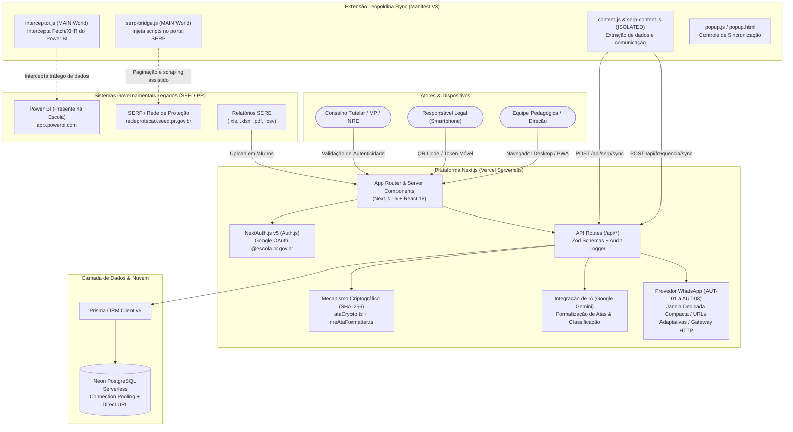

# Arquitetura e Engenharia de Software
**Sistema:** Busca Ativa Escolar, Comunicação Institucional & Livro Oficial de Atas Digital  
**Unidade Piloto:** Colégio Estadual Leopoldina B. Pedroso — Núcleo Regional de Educação de Ponta Grossa (SEED-PR)  
**Versão do Documento:** 2.0 (Edição Canônica de Engenharia)  
**Autor:** Engenheiro de Software Principal (Staff/Principal Engineer) & Arquiteto de Sistemas

---

## 1. Visão Geral da Arquitetura do Sistema

O **Sistema Busca Ativa Leopoldina** é uma plataforma de missão crítica projetada para unificar o combate preventivo ao abandono escolar, a comunicação ágil com responsáveis legais e a formalização jurídica do atendimento pedagógico escolar.

A aplicação opera em uma arquitetura moderna **Serverless e Orientada a Eventos**, integrando-se de forma híbrida e não-intrusiva a sistemas legados do Governo do Estado do Paraná (SEED-PR / Celepar):
1. **SERE (Sistema Estadual de Registro Escolar):** Ingestão em lote de relatórios cadastrais em múltiplos formatos (`.xls`, `.xlsx`, `.pdf`, `.csv`), executando desduplicação de dupla matrícula técnica e higienização nominal.
2. **PRESENTE NA ESCOLA (Power BI Oficial SEED-PR):** Captura de dados de frequência semanal e média acumulada por meio de uma Extensão Chrome Manifest V3 que intercepta as respostas de consultas DAX/Analysis Services na camada de rede do navegador.
3. **SERP / FICAI (Rede de Proteção da Criança e do Adolescente):** Sincronização automatizada de fichas de infrequência encaminhadas ao Conselho Tutelar e Ministério Público.
4. **Livro Digital de Atas Pedagógicas:** Sistema criptográfico com fé pública institucional, formalização via Inteligência Artificial, coleta híbrida de assinaturas (Canvas, WebAuthn e OIDC Google Workspace `@escola.pr.gov.br`) e selamento canônico `SHA-256` amparado pela **Lei Federal nº 14.063/2020**.

### Diagrama de Arquitetura do Ecossistema

---

## 2. Stack Tecnológica e Decisões de Engenharia

| Tecnologia / Biblioteca | Versão | Papel Arquitetural no Sistema | Justificativa de Decisão de Engenharia |
| :--- | :---: | :--- | :--- |
| **Next.js (App Router)** | `16.4.3` | Framework Full-Stack Serverless | Escolhido pela divisão nativa entre Server Components (renderização de dados estáticos com zero JS no bundle) e Client Components reativos, além de hospedagem escalável na Vercel com Edge Caching e Cron Jobs nativos. |
| **React & React DOM** | `19.3.1` | Biblioteca de Interface | Uso das APIs mais recentes do React (incluindo Server Actions, hooks concorrentes e transições de renderização). |
| **TypeScript** | `6.0.3` | Linguagem de Desenvolvimento | Tipagem estática em toda a base de código, garantindo contratos estritos de payloads de API, modelos de banco e schemas de validação. |
| **Prisma ORM** | `6.4.0` | Mapeador Objeto-Relacional | Modelagem declarativa via `schema.prisma`, migrações automatizadas, geração de tipos tipados em tempo de compilação e suporte nativo a `$executeRaw` para bulk inserts massivos. |
| **PostgreSQL (Neon)** | Cloud | Banco de Dados Relacional Serverless | Banco relacional com autoscaling, bifurcação instantânea (branching para testes) e compatibilidade com o pooler PgBouncer na porta 5432 (`DATABASE_URL` e `DIRECT_URL`). |
| **Tailwind CSS & PostCSS**| `4.3.3` | Estilização Utilitária & Design System | Engine de estilos moderna com compilação ultra-rápida, alternância de tema claro/escuro via classe `dark`, layouts responsivos e formatação estrita para impressão em folha A4. |
| **NextAuth.js (Auth.js)** | `5.0.0-beta.32` | Autenticação e Gestão de Sessão | Integração nativa com Google Identity Services (GIS), forçando restrição do domínio institucional `@escola.pr.gov.br`, emissão de JWTs criptografados e controle por allowlist de usuários. |
| **Zod** | `4.6.7` | Validação de Schemas e Contratos | Validação em tempo de execução de todas as entradas de formulários e requisições HTTP na camada de API (`src/lib/schemas.ts`), impedindo injeção de dados malformados. |
| **@google/genai** | `2.31.0` | SDK Oficial de IA Google Gemini | Formalização de anotações livres em atas cultas conforme padrão NRE/SEED-PR e classificação pedagógica de respostas via WhatsApp, com schemas de saída em JSON estrito. |
| **Unpdf & SheetJS (XLSX)** | `1.9.1 / 0.18.5` | Parsers de Documentos em Memória | Extração de texto de PDFs oficiais do SERE e processamento de planilhas legadas `.xls` (formato binário BIFF8) sem necessidade de persistir arquivos em disco temporário. |
| **jsPDF** | `4.2.1` | Emissão de Documentos e Livros em PDF | Renderização vetorial e diagramação de alta fidelidade para Dossiês Individuais (Conselho Tutelar/MP) e do Livro Anual de Atas com cabeçalho oficial do Estado do Paraná. |
| **Vitest** | `5.0.5` | Suíte de Testes Automatizados | Executor de testes unitários ultrarrápido baseado em ESM nativo, validando criptografia, parsers, formatadores e regras de negócio puras. |
| **Service Worker & PWA** | Nativo | Suporte Offline & Mobile | Registro de Web App instalável nos smartphones da equipe escolar, com estratégia de cache offline em [`public/sw.js`](file:///home/marcoswrobel/Documents/Registro/public/sw.js) para consulta rápida em visitas domiciliares. |

---

## 3. Padrões de Projeto e Estratégias de Arquitetura Aplicadas

### 3.1. Arquitetura Híbrida: Server Components vs. Client Components
O projeto implementa uma separação sistemática em todas as rotas sob `src/app/`:
- **Server Components (`page.tsx`):**
  - Executam exclusivamente no servidor durante o ciclo de requisição HTTP (`export const dynamic = "force-dynamic"`).
  - Verificam imediatamente a sessão com `await auth()`. Caso não autenticado, executam `redirect("/login")` antes de qualquer execução de consulta ao banco.
  - Buscam os dados via Prisma diretamente no PostgreSQL da nuvem, eliminando viagens adicionais de rede (waterfalls).
  - Repassam os dados serializados como propriedades tipadas para os componentes clientes.
- **Client Components (`*Client.tsx`):**
  - Declarados obrigatoriamente com `"use client"` no topo do arquivo.
  - Gerenciam o estado local interativo (filtros, paginação, digitação em tempo real, ditado por voz, canvas de desenho para assinaturas e modais).
  - Comunicam-se com a camada de API através de `fetch()` assíncrono para mutações e persistências atômicas.

### 3.2. Multi-tenancy e Isolamento Escolar
A estratégia multi-tenancy está centralizada em [`src/lib/currentSchool.ts`](file:///home/marcoswrobel/Documents/Registro/src/lib/currentSchool.ts):
- O modelo `School` armazena dados institucionais, código INEP (`41042730`), cidade, Núcleo Regional de Educação (NRE) e hash de sincronização.
- A função [`getCurrentSchool(schoolId)`](file:///home/marcoswrobel/Documents/Registro/src/lib/currentSchool.ts#L31-L96) atua como um resolvedor defensivo:
  - Se um `schoolId` explícito for fornecido pelo contexto do usuário logado, retorna a escola correspondente.
  - Caso contrário, consulta a primeira escola ativa do banco ou cria/assegura dinamicamente o registro semente do *Colégio Estadual Leopoldina B. Pedroso* via [`ensureDefaultSchool()`](file:///home/marcoswrobel/Documents/Registro/src/lib/currentSchool.ts#L101-L121).

### 3.3. Segurança e Controle de Acesso Baseado em Papéis (RBAC)
O subsistema de controle de acesso opera em três barreiras:
1. **Validação de Domínio Institucional:**
   - Em [`src/lib/auth.ts#L66-L77`](file:///home/marcoswrobel/Documents/Registro/src/lib/auth.ts#L66-L77), qualquer tentativa de autenticação via Google com e-mail que não termine em `@escola.pr.gov.br` é barrada no callback `signIn` com registro imediato no `AuditLog`.
2. **Allowlist da Equipe Escolar:**
   - Apenas usuários previamente autorizados e cadastrados na tabela `User` por um Administrador têm permissão de acesso.
   - O e-mail raiz (`ADMIN_EMAIL` no `.env` ou `marcos.wrobel@escola.pr.gov.br`) atua como administrador bootstrap incondicional em [`src/lib/roles.ts#L7-L18`](file:///home/marcoswrobel/Documents/Registro/src/lib/roles.ts#L7-L18).
3. **Papeis Sistêmicos:**
   - `ADMIN`: Acesso total, incluindo gestão de usuários da equipe (`/equipe`), auditoria global de ações (`/auditoria`), descarte de atas lavradas para expurgo de homologação e edição cadastral da escola.
   - `PEDAGOGA`: Acesso operacional a atendimentos, atas pedagógicas, prontuários 360º de alunos, justificativas e busca ativa via WhatsApp.
   - Funções utilitárias [`requireAuth()`](file:///home/marcoswrobel/Documents/Registro/src/lib/permissions.ts#L24-L55) e [`requireAdmin()`](file:///home/marcoswrobel/Documents/Registro/src/lib/permissions.ts#L60-L75) garantem retornos padronizados em JSON com status HTTP `401` ou `403`.

### 3.4. Livro Oficial de Atas: Imutabilidade, Criptografia e Validade Jurídica
O módulo de atas foi projetado para atender aos rigorosos critérios da **Lei nº 14.063/2020** (Assinatura Eletrônica Avançada na Administração Pública):
1. **Fase de Rascunho (`DRAFT`):** A ata pode ser editada, gravada em rascunho automático, ter seu texto formalizado por IA generativa ou revisor gramatical local e registrar participantes provisórios.
2. **Coleta Híbrida de Assinaturas:**
   - **Canvas em Tela:** Coleta do traço vetorial de assinatura dos presentes no monitor ou tablet da coordenação pedagógica.
   - **QR Code Móvel com Token Efêmero:** O familiar escaneia o QR Code no smartphone, abrindo `/assinar/ata/[token]`, com suporte opcional a biometria nativa do aparelho via **WebAuthn / FIDO2 Passkeys** (`biometricVerified: true`).
   - **Assinatura Institucional OIDC:** Alunos ou docentes com conta institucional podem assinar com 1 clique utilizando seu Google Workspace `@escola.pr.gov.br`. O endpoint [`verifyEscolaGoogleIdToken()`](file:///home/marcoswrobel/Documents/Registro/src/lib/escolaGoogleVerify.ts#L26-L117) valida o token diretamente junto aos servidores do Google e [`verifyParticipantIdentityMatch()`](file:///home/marcoswrobel/Documents/Registro/src/lib/escolaGoogleVerify.ts#L139-L196) previne fraudes verificando se o nome da conta conectada bate com o participante cadastrado.
3. **Lavratura Oficial (`FINALIZED`):**
   - Transação atômica em [`src/app/api/atas/[id]/finalize/route.ts#L230-L295`](file:///home/marcoswrobel/Documents/Registro/src/app/api/atas/[id]/finalize/route.ts#L230-L295) que calcula o próximo número sequencial anual da escola (`nextAtaNumber = lastAta.ataNumber + 1`).
   - Geração do código único e não enumerável de validação pública: `generateVerificationCode()` (ex: `ATA-7K9P-4X2M`).
   - Cálculo do Hash SHA-256 Canônico através de [`computeMinuteHash()`](file:///home/marcoswrobel/Documents/Registro/src/lib/ataCrypto.ts#L46-L87). A partir deste instante, o registro torna-se estritamente imutável na base de dados.
4. **Termos de Aditamento ("Em tempo") via Hash-Chaining:**
   - Retificações após a lavratura não alteram o texto original. Elas são averbadas através da tabela `PedagogicalMinuteAddendum`, gerando um novo hash encadeado:  
     $$\text{AddendumHash} = \text{SHA-256}(\text{PreviousHash} \parallel \text{Content} \parallel \text{AuthorEmail} \parallel \text{CreatedAtIso})$$
5. **Averbação de Cancelamento ("Tornada Sem Efeito"):**
   - Se uma ata lavrada tiver vício insanável, o status é alterado para `VOIDED` via [`/api/atas/[id]/void`](file:///home/marcoswrobel/Documents/Registro/src/app/api/atas/[id]/void/route.ts), preservando todo o histórico e registrando a justificativa da Direção Escolar.

### 3.5. Estratégia de Integração Reversa (SERE e SERP Bridge)
Como os sistemas da Celepar e SEED-PR não oferecem APIs REST públicas para escolas locais, o sistema desenvolveu duas estratégias:
1. **Parser Poliglota em Memória (`src/lib/sereParser.ts`):**
   - Processa arquivos exportados pelo sistema estadual: relatórios em PDF (via `unpdf`), planilhas binárias `.xls` legadas (BIFF8) e `.xlsx` (via `xlsx`), além de arquivos `.csv`.
   - Implementa algoritmos de desduplicação de **Dupla Matrícula Técnica**: quando um aluno cursa o Ensino Médio Regular e o Itinerário Profissional (NEM EPT) no mesmo turno e série, o parser mescla as duas matrizes em uma turma unificada preservando a matrícula principal.
2. **Extensão de Navegador Multissistema (Manifest V3):**
   - **Power BI (Presente na Escola):** O script `interceptor.js` roda no `MAIN world` da aba e sobrescreve nativamente `window.fetch` e `XMLHttpRequest.prototype.send`. Quando o Power BI executa chamadas para `/explore/reports/querydata` ou endpoints do Analysis Services, o interceptor clona a resposta JSON e a repassa ao content script.
   - **SERP (Rede de Proteção):** O script `serp-bridge.js` atua no portal da Celepar, permitindo a leitura e paginação das fichas de alunos em acompanhamento e acionamentos do Conselho Tutelar.
   - Ambas as extrações disparam requisições `POST` diretamente para `/api/frequencia/sync` e `/api/serp/sync`, autenticadas pelo `SYNC_API_TOKEN` com timing seguro (`crypto.timingSafeEqual`).

### 3.6. Engenharia de IA Aplicada e Mensageria
- **Disparo WhatsApp com Detecção Adaptativa e Janela Dedicada Compacta:**
  - **Detecção de Plataforma (`src/lib/whatsappProvider.ts`):** O sistema inspeciona o ambiente via `isMobileDevice()`. No Mobile (Android/iOS), gera URLs nativas `https://wa.me/...` que abrem diretamente no aplicativo instalado no smartphone. No Desktop (Linux/Windows), gera `https://web.whatsapp.com/send/?phone=...`, eliminando 100% da tela intermediária estática da Meta ("Baixar WhatsApp / Ir para o app").
  - **Janela Dedicada Compacta (Linux / Chrome Extension):** A extensão Manifest V3 gerencia janelas do tipo `popup` (`chrome.windows.create`, 480x760px) fixadas no canto direito da tela. Essa janela não possui barra de abas, barra de favoritos nem omnibox, proporcionando a experiência de um mini-aplicativo desktop nativo. Durante toda a Fila de Busca Ativa, a mesma janela é mantida e focada (`chrome.tabs.update`), prevenindo a desconexão de sessão (*"Usar aqui"*) e garantindo privacidade LGPD (em 480px, o WhatsApp Web oculta o painel geral de conversas).
  - **Controle Liga/Desliga (`src/lib/clientDispatcher.ts`):** A secretária pode alternar com 1 clique entre o *Modo Janela Compacta* e o *Modo Convencional (Nova Aba)*, com preferência persistida em `localStorage`.
- **Classificador e Formalizador Híbrido:**
  - O sistema tenta contatar os modelos de ponta **Google Gemini** (`gemini-3.5-flash`, `gemini-3.8-flash` ou `gemini-3.5-flash-lite`) com saída estruturada via JSON Schema.
  - Caso a API Key não esteja configurada ou ocorra oscilação de conectividade, ativam-se instantaneamente os mecanismos de fallback determinísticos locais: [`generateLocalAtaMinuta()`](file:///home/marcoswrobel/Documents/Registro/src/lib/nreAtaFormatter.ts#L330-L394) e [`classifyGuardianReplyHeuristic()`](file:///home/marcoswrobel/Documents/Registro/src/lib/whatsappProvider.ts#L241-L316). O sistema nunca trava na ausência da IA.

### 3.7. Padrões Defensivos e Resiliência de Schema
- **Consultas com Fallback Gracioso:** [`safeQueryList()`](file:///home/marcoswrobel/Documents/Registro/src/lib/safePhase3Queries.ts#L7-L16) captura erros `P2021` do Prisma (tabela inexistente) e retorna coleções vazias se o ambiente de homologação ainda não tiver aplicado todas as migrações, garantindo que o bundle do aluno carregue normalmente.
- **Trilha de Auditoria Universal (`src/lib/audit.ts`):** Todas as mutações cadastrais, envios de mensagens, alterações de papel, logins e lavraturas de atas registram o endereço IP resolvido do cliente (`extractClientIp`), o e-mail do operador e o payload de alteração em JSON.

---

## 4. Modelagem de Dados (ERD)

### 4.1. Diagrama Entidade-Relacionamento (Mermaid)

```mermaid
erDiagram
    School ||--o{ User : "possui"
    School ||--o{ ClassGroup : "oferta"
    School ||--o{ Student : "matricula"
    School ||--o{ MessageTemplate : "padroniza"
    School ||--o{ AuditLog : "registra"
    School ||--o{ PedagogicalMinute : "livro_de_atas"

    User ||--o{ MessageLog : "sentByUser"
    User ||--o{ MessageLog : "repliedByUser"
    User ||--o{ AuditLog : "responsavel"

    ClassGroup ||--o{ Student : "compoe"

    Student ||--o{ MessageLog : "recebe"
    Student ||--o| LowAttendanceRecord : "monitoramento"
    Student ||--o{ StudentContact : "telefones_responsaveis"
    Student ||--o{ AbsenceJustification : "atestados_apresentados"
    Student ||--o{ InPersonAttendance : "atendimentos_presenciais"
    Student ||--o{ PedagogicalMinuteStudent : "vinculado_em_atas"
    Student ||--o{ AttendanceSnapshot : "serie_historica_semanal"

    PedagogicalMinute ||--o{ PedagogicalMinuteStudent : "alunos_em_pauta"
    PedagogicalMinute ||--o{ PedagogicalMinuteParticipant : "presentes_assinantes"
    PedagogicalMinute ||--o{ PedagogicalMinuteAddendum : "termos_aditamento"
    PedagogicalMinute ||--o{ PedagogicalActionItem : "combinados_prazos"

    MessageTemplate ||--o{ MessageLog : "baseado_em"

    School {
        string id PK
        string inepCode UK
        string name
        string city
        string state
        string nre
        string phone
        string email
        string logoUrl
        boolean active
        string syncTokenHash
        string settingsJson
        datetime createdAt
        datetime updatedAt
    }

    User {
        string id PK
        string name
        string email UK
        string image
        string role "ADMIN | PEDAGOGA"
        boolean active
        string schoolId FK
        datetime createdAt
        datetime updatedAt
    }

    ClassGroup {
        string id PK
        string name UK
        string segment "FUNDAMENTAL | MEDIO | NOTURNO"
        string shift "MANHA | TARDE | NOITE"
        string schoolId FK
        datetime createdAt
    }

    Student {
        string id PK
        string cgm UK
        string name
        string email
        string guardianName
        string phone
        string classGroupId FK
        string schoolId FK
        boolean active
        datetime createdAt
        datetime updatedAt
    }

    MessageTemplate {
        string id PK
        string title
        string segment
        string prefixText
        string suffixText
        boolean isAbsenceRelated
        boolean active
        string schoolId FK
        datetime createdAt
    }

    MessageLog {
        string id PK
        string studentId FK
        string templateId FK
        string reasonTitle
        string messageContent
        string phoneUsed
        string sentByUserId FK
        string sentByName
        boolean guardianReplied
        string replyNotes
        string replyCategory
        datetime repliedAt
        string repliedByUserId FK
        string deliveryStatus
        datetime deliveryUpdatedAt
        datetime sentAt
    }

    LowAttendanceRecord {
        string id PK
        string studentId UK, FK
        float attendancePercent
        string enrollmentDetail
        string actionsTaken
        string serpProtocol
        string serpStatus
        datetime serpOpenedAt
        string serpDetails
        datetime updatedAt
    }

    AuditLog {
        string id PK
        string userId FK
        string userEmail
        string userName
        string action
        string entityType
        string entityId
        string details
        string ipAddress
        string schoolId FK
        datetime createdAt
    }

    AttendanceSnapshot {
        string id PK
        string studentId FK
        string referenceWeek "YYYY-Www"
        float attendancePercent
        float weeklyPercent
        float previousWeeklyPercent
        datetime recordedAt
    }

    StudentContact {
        string id PK
        string studentId FK
        string name
        string kinship
        string phone
        boolean isPrimary
        boolean whatsappValid
        string notes
        datetime createdAt
        datetime updatedAt
    }

    AbsenceJustification {
        string id PK
        string studentId FK
        string type "ATESTADO_MEDICO | etc"
        datetime startDate
        datetime endDate
        string cidCode
        string notes
        string createdByName
        string createdByEmail
        datetime createdAt
    }

    InPersonAttendance {
        string id PK
        string studentId FK
        datetime attendedAt
        string guardianPresent
        string subject
        string summary
        string agreements
        string recordedByName
        string recordedByEmail
        datetime createdAt
    }

    PedagogicalMinute {
        string id PK
        string schoolId FK
        int year
        int ataNumber "Sequencial anual"
        string status "DRAFT | FINALIZED | VOIDED"
        string category
        boolean isConfidential
        datetime attendedAt
        string subject
        string rawNotes
        string summary
        string agreementsSummary
        string authorId
        string authorName
        string authorEmail
        string authorRole
        string authorIp
        datetime finalizedAt
        string contentHash "SHA-256 Canônico"
        string verificationCode UK "ATA-XXXX-XXXX"
        string physicalSignedScanData
        datetime voidedAt
        string voidedByName
        string voidedByEmail
        string voidReason
        datetime createdAt
        datetime updatedAt
    }

    PedagogicalMinuteStudent {
        string id PK
        string minuteId FK
        string studentId FK
        string studentNameSnapshot
        string classNameSnapshot
        string cgmSnapshot
        datetime createdAt
    }

    PedagogicalMinuteParticipant {
        string id PK
        string minuteId FK
        string role
        string studentId
        string name
        string kinship
        string documentType
        string documentNumber
        boolean documentVerifiedByStaff
        string phone
        string signatureMode
        string signatureData
        datetime signedAt
        string signerIp
        string refusalReason
        string witnessName
        string mobileSignToken UK
        datetime mobileSignExpiresAt
        boolean biometricVerified
        string biometricDeviceType
        datetime biometricAuthTime
        string expectedEmail
        string verifiedEmail
        string verifiedGoogleSub
        string verifiedGoogleName
        datetime emailVerifiedAt
        datetime createdAt
    }

    PedagogicalMinuteAddendum {
        string id PK
        string minuteId FK
        string content
        string authorName
        string authorEmail
        string authorIp
        string previousHash
        string addendumHash
        string participantSignatureData
        string participantSignerName
        datetime createdAt
    }

    PedagogicalActionItem {
        string id PK
        string minuteId FK
        string description
        string responsible
        datetime dueDate
        string status "PENDING | COMPLETED | CANCELED"
        datetime completedAt
        string completedByName
        string completionNotes
        datetime createdAt
        datetime updatedAt
    }
```

---

## 5. Mapeamento Completo de Módulos e Fluxos de Dados

### 5.1. Catálogo de Telas e Rotas de Interface (`src/app/*`)

| Rota / URL | Componente Server / Client | Perfil Mínimo | Fontes de Dados e Entradas | Propósito e Interações Principais |
| :--- | :--- | :--- | :--- | :--- |
| `/` | `src/app/page.tsx` | Qualquer | Sessão via `auth()` | Rota de despacho inicial. Redireciona para `/busca-ativa` se autenticado ou `/login` se anônimo. |
| `/login` | `src/app/login/page.tsx` | Público | Formulário OAuth Google | Portal de entrada institucional. Executa autenticação via Google Workspace `@escola.pr.gov.br`. |
| `/busca-ativa` | `page.tsx` / `BuscaAtivaClient.tsx` | `PEDAGOGA` | Turmas, Estudantes, Modelos, Histórico de Frequência | Painel principal de busca ativa. Envio individual e Fila Assistida por turma via WhatsApp (`wa.me`), seleção de modelos e registro de respostas. |
| `/faltas` | `page.tsx` / `FaltasClient.tsx` | `PEDAGOGA` | Estudantes em Risco (<75%), Fichas SERP, Snapshots | Painel integrado de infrequência e SERP. Download da extensão Chrome, instrução de sincronização e detecção de quedas abruptas. |
| `/alunos` | `page.tsx` / `AlunosClient.tsx` | `PEDAGOGA` | Lista de Estudantes Ativos, Turmas, Atestados Recentes | Cadastro escolar. Gerenciamento de estudantes, contatos telefônicos e modal de importação em lote do SERE (`SereImportModal.tsx`). |
| `/alunos/[id]` | `page.tsx` / `ProntuarioClient.tsx`| `PEDAGOGA` | `loadStudent360Bundle(id)` | Prontuário Pedagógico 360º com 6 abas integradas: Visão Geral, Contatos, Atestados/Justificativas, Atendimentos Presenciais, Frequência Semanal e Atas. |
| `/alunos/[id]/dossie`| `page.tsx` / `DossieClient.tsx`| `PEDAGOGA` | `loadStudent360Bundle(id)`, Escola | Geração e impressão do Dossiê Individual em PDF A4 para Conselho Tutelar/Ministério Público com anonimização automática de terceiros (ECA). |
| `/atas` | `page.tsx` / `AtasClient.tsx` | `PEDAGOGA` | Atas do Ano, Turmas, Alunos, Escola | Livro Oficial de Atas. Criação de rascunhos, modal completo de lavratura (`AtaEditorModal.tsx`), filtros por status (`DRAFT`, `FINALIZED`, `VOIDED`) e pauta. |
| `/atas/[id]/imprimir`| `page.tsx` / `PrintPageClient.tsx`| `PEDAGOGA` | `PedagogicalMinute` por ID, Escola | Visualização e impressão oficial da ata em página única A4, com cabeçalho oficial do Estado do Paraná, assinaturas e QR Code de verificação pública. |
| `/atas/livro/[ano]` | `page.tsx` / `LivroAnualClient.tsx`| `PEDAGOGA` | Todas as Atas Lavradas no Ano | Termo de Abertura, Índice Cronológico, Atas Oficiais e Termo de Encerramento para encadernação e arquivamento anual na Secretaria Escolar. |
| `/atestados` | `page.tsx` / `AtestadosClient.tsx` | `PEDAGOGA` | Justificativas e Atestados Ativos/Expirados | Painel rápido de gestão e cadastro de atestados médicos, odontológicos e declarações legais, com cálculo de vigência civil no fuso de Brasília. |
| `/encaminhamentos` | `page.tsx` / `EncaminhamentosClient.tsx`| `PEDAGOGA` | `PedagogicalActionItem` | Painel de monitoramento de combinados, encaminhamentos e prazos pactuados nas reuniões pedagógicas (Família, Estudante, Escola e Rede de Proteção). |
| `/boletim` | `page.tsx` / `BoletimClient.tsx` | `PEDAGOGA` | `compileWeeklyDigest()` | Boletim Semanal Executivo para reuniões da Equipe Diretiva: KPIs de evasão, turmas críticas e alertas precoces de queda abrupta. |
| `/historico` | `page.tsx` / `HistoricoClient.tsx`| `PEDAGOGA` | `MessageLog` com paginação | Histórico de mensagens enviadas. Marcação de ciência das famílias, categorização com IA (`SAUDE`, `TRANSPORTE`, etc.) e visualização de comprovantes. |
| `/modelos` | `page.tsx` / `ModelosClient.tsx` | `PEDAGOGA` | `MessageTemplate` | Gerenciamento de modelos de mensagens escolares, segmentados por turno/segmento, com assistência de geração via Google Gemini. |
| `/relatorios` | `page.tsx` / `RelatoriosClient.tsx` | `PEDAGOGA` | `getReportsSummary()` | Estatísticas analíticas: taxa de resposta dos pais, principais causas de ausência escolar e ranking de motivos pedagógicos. |
| `/equipe` | `page.tsx` / `EquipeClient.tsx` | `ADMIN` | Usuários cadastrados na escola | Gestão da equipe escolar autorizada. Cadastro de e-mails `@escola.pr.gov.br`, atribuição de papéis (`ADMIN` / `PEDAGOGA`) e desativação de contas. |
| `/auditoria` | `page.tsx` / `AuditoriaClient.tsx`| `ADMIN` | `AuditLog` ordenado por data desc | Trilha de auditoria pericial. Rastreabilidade completa com IP, timestamp, usuário, ação e detalhes em JSON de cada evento ocorrido no sistema. |
| `/assinar/ata/[token]`| `page.tsx` / `MobileSignClient.tsx`| **Público (Token)**| Token efêmero na URL | Interface mobile para assinatura digital do familiar no smartphone. Suporte a Canvas Touch, Biometria (WebAuthn) e autenticação Google `@escola`. |
| `/validar/ata/[code]`| `src/app/validar/ata/[code]/page.tsx`| **Público** | Código curto da Ata (`ATA-XXXX-XXXX`)| Certidão Pública de Autenticidade Cega. Confere fé pública e hash SHA-256 com mascaramento integral de dados de menores e participantes (LGPD). |

---

### 5.2. Catálogo Completo de Endpoints de API (`src/app/api/*`)

```mermaid
flowchart LR
    subgraph AIEndpoints ["Módulo de Inteligência Artificial"]
        API_AI1["POST /api/ai/classify-reply"]
        API_AI2["POST /api/ai/formalize-ata"]
        API_AI3["POST /api/ai/generate-template"]
        API_AI4["POST /api/ai/test-key"]
    end

    subgraph AtasEndpoints ["Módulo de Livro de Atas & Assinaturas"]
        API_ATA1["GET/POST /api/atas"]
        API_ATA2["GET/PATCH/DELETE /api/atas/[id]"]
        API_ATA3["POST /api/atas/[id]/finalize"]
        API_ATA4["POST /api/atas/[id]/sign-token"]
        API_ATA5["GET/POST /api/atas/sign-token/[token]"]
        API_ATA6["POST /api/atas/[id]/addendums"]
        API_ATA7["POST /api/atas/[id]/void"]
        API_ATA8["GET /api/atas/public/[code]"]
        API_ATA9["GET/POST /api/atas/actions"]
        API_ATA10["PATCH /api/atas/actions/[id]"]
        API_ATA11["PATCH /api/atas/[id]/actions/[actionId]"]
    end

    subgraph SyncEndpoints ["Módulo de Sincronização & Bridges"]
        API_SYNC1["POST /api/frequencia/sync"]
        API_SYNC2["POST /api/serp/sync"]
        API_SYNC3["GET /api/sync-config"]
        API_SYNC4["POST /api/students/import"]
    end

    subgraph CoreEndpoints ["Módulo de Alunos, Mensagens e Gestão"]
        API_CORE1["GET/POST/PUT/DELETE /api/students"]
        API_CORE2["POST /api/students/[id]/contacts"]
        API_CORE3["POST /api/students/[id]/justifications"]
        API_CORE4["POST /api/students/[id]/attendances"]
        API_CORE5["GET/POST /api/messages"]
        API_CORE6["POST /api/messages/send"]
        API_CORE7["POST /api/messages/reply"]
        API_CORE8["PATCH /api/messages/status"]
        API_CORE9["PATCH/DELETE /api/messages/manage"]
        API_CORE10["GET/POST /api/low-attendance"]
        API_CORE11["GET/POST /api/justifications"]
        API_CORE12["DELETE /api/justifications/[id]"]
        API_CORE13["GET /api/reports"]
        API_CORE14["GET/POST/PATCH/DELETE /api/templates"]
        API_CORE15["GET/POST/PATCH /api/users"]
        API_CORE16["GET/POST /api/cron/weekly-digest"]
        API_CORE17["POST /api/webhooks/whatsapp"]
    end
```

#### Detalhamento Técnico das Rotas de API

1. **`POST /api/ai/classify-reply`**
   - **Entrada:** `{ rawReply: string, studentName?: string, reasonTitle?: string }` via `aiClassifyReplySchema`.
   - **Processamento:** Extrai chave Gemini; se ausente, aciona [`classifyGuardianReplyHeuristic()`](file:///home/marcoswrobel/Documents/Registro/src/lib/whatsappProvider.ts#L241); se presente, chama Google Gemini com JSON Schema forçado (`formalSummary`, `category`, `requiresMedicalCertificate`, `suggestedFollowUp`).
   - **Saída:** JSON com `{ success: true, classification: { formalSummary, category, ... } }`.
2. **`POST /api/ai/formalize-ata`**
   - **Entrada:** `{ rawNotes, existingSummary, category, studentNames, guardianNames, attendedAt, apiKey? }`.
   - **Processamento:** Converte data para extenso oficial (`formatAtaDateExtenso`); aplica regras gramaticais e diretrizes do NRE/SEED-PR (pretérito perfeito, texto corrido contínuo, proibição de abreviaturas); chama Gemini 3.5 com fallback local determinístico via `generateLocalAtaMinuta()`.
   - **Saída:** `{ success: true, result: { formalSubject, formalSummary, agreementsSummary, actionItems } }`.
3. **`POST /api/atas`**
   - **Entrada:** Schema `createMinuteDraftSchema` (categoria, data, pauta, texto, estudantes vinculados, participantes iniciais).
   - **Processamento:** Obtém escola atual via `getCurrentSchool()`; cria o rascunho com status `DRAFT` e grava evento no `AuditLog`.
   - **Saída:** Objeto da ata criada com código HTTP `201`.
4. **`POST /api/atas/[id]/finalize`**
   - **Entrada:** ID da ata na URL e payload opcional para sincronização pré-lavratura.
   - **Processamento:** Verifica se status é `DRAFT`; valida se há texto formal e ao menos um aluno; inicia transação `$transaction` com timeout de 20s; busca último número do ano para a escola e incrementa atomicamente; calcula hash canônico `SHA-256` com `computeMinuteHash()`; gera código de validação QR `ATA-XXXX-XXXX`; marca status como `FINALIZED`.
   - **Saída:** Ata finalizada com hash, data de lavratura e fé pública do servidor.
5. **`POST /api/atas/[id]/sign-token`**
   - **Entrada:** `{ participantId: string, expiresInMinutes?: number }`.
   - **Processamento:** Exige ata `DRAFT`; gera token criptográfico seguro de 32 caracteres hexadecimais; define expiração (padrão 20min); monta a URL completa de assinatura móvel.
   - **Saída:** `{ success: true, token, signUrl, expiresAt }`.
6. **`POST /api/atas/sign-token/[token]`**
   - **Entrada:** Payload `submitSignSchema`: Modo 1 (`signatureData`, `biometricVerified`) ou Modo 2 (`googleIdToken`).
   - **Processamento:** Localiza o participante pelo token; confere se a ata ainda é `DRAFT` e se o token não expirou. No Modo 2, valida o token OIDC com os servidores do Google, checa o domínio `@escola.pr.gov.br` e confere a identidade com `verifyParticipantIdentityMatch()`. Queima o token de uso único (`mobileSignToken: null`).
   - **Saída:** Confirmação da gravação com timestamp e IP do signatário.
7. **`POST /api/frequencia/sync`**
   - **Entrada:** Array de alunos com CGM, nome, turma e frequências (`frequenciaSyncSchema`), autenticado via Bearer `SYNC_API_TOKEN` com `crypto.timingSafeEqual`.
   - **Processamento:** Busca alunos existentes em 1 consulta leve; pareia por CGM e nome normalizado; vincula CGMs faltantes em transação de 100 itens; executa bulk upsert via SQL bruto `$executeRaw` em blocos de 250 registros nas tabelas `LowAttendanceRecord` e `AttendanceSnapshot`.
   - **Saída:** Resumo com quantidade de alunos atualizados, vinculados e estatísticas de risco.
8. **`POST /api/serp/sync`**
   - **Entrada:** Array de fichas SERP com número de protocolo, situação, data de abertura e detalhes.
   - **Processamento:** Normaliza status do SERP para enum interno (`CONSELHO_TUTELAR`, `MINISTERIO_PUBLICO`, `ARQUIVADO`, `EM_ACOMPANHAMENTO`); pareia alunos da escola e atualiza o histórico via bulk upsert parametrizado.
   - **Saída:** JSON com total de fichas sincronizadas e protocolo vinculado.
9. **`POST /api/students/import`**
   - **Entrada:** `sereBatchImportSchema` contendo turmas parseadas, alunos elegíveis, transferidos e opções de importação.
   - **Processamento:** Garante a existência da escola padrão; cria ou atualiza as turmas (`ClassGroup`); pareia estudantes em memória $O(N)$ priorizando CGM e nome fonético; insere novos alunos via `createMany` em chunks de 250; atualiza alunos modificados em blocos transacionais de 100; inativa transferidos se solicitado; registra auditoria.
   - **Saída:** Métricas completas da importação (criados, atualizados, turmas criadas e reativados).
10. **`GET/POST /api/cron/weekly-digest`**
    - **Entrada:** Cabeçalho Bearer com `CRON_SECRET` ou sessão administrativa ativa.
    - **Processamento:** Executa `compileWeeklyDigest()`, consolidando alunos com infrequência crítica (<75%), alertas precoces de queda abrupta (>= -20 p.p. na semana) e taxa de retorno de mensagens dos últimos 7 dias.
    - **Saída:** JSON com o boletim executivo da escola.
