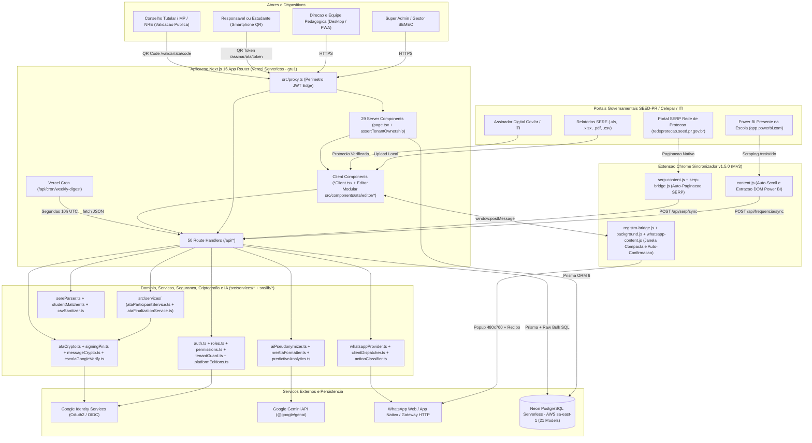
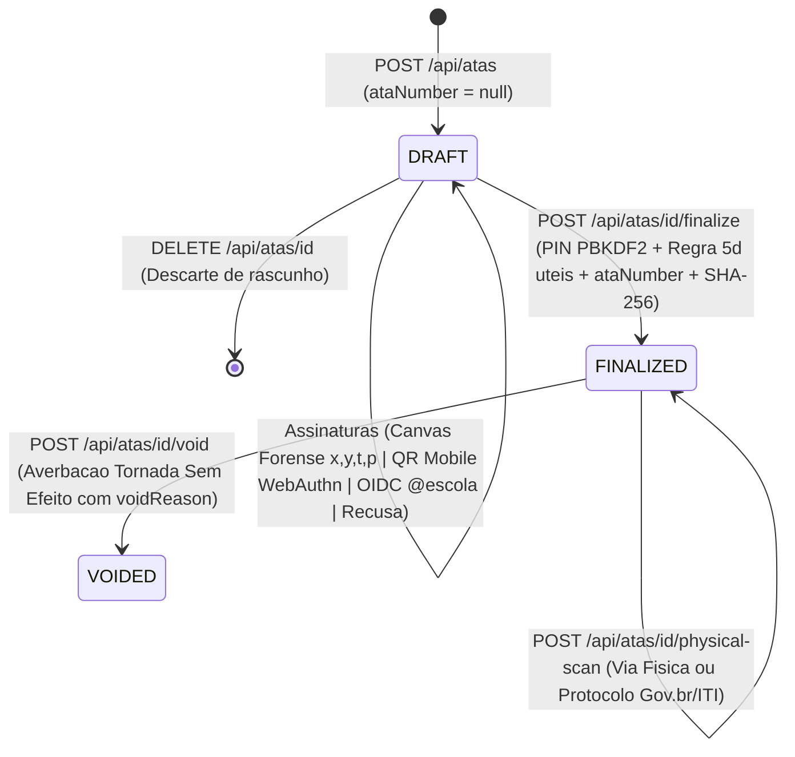
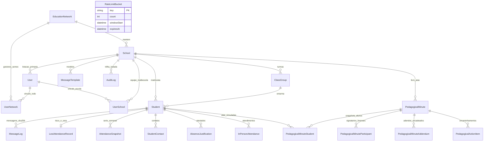

# Arquitetura e Engenharia de Software — Rede Ativa SaaS

> **Sistema:** Rede Ativa SaaS — Plataforma Multi-Escola de Busca Ativa, Gestão de Frequência & Livro Oficial de Atas Pedagógicas  
> **Unidade Piloto Fundadora:** Colégio Estadual Leopoldina B. Pedroso (INEP `41042730`) — NRE Ponta Grossa / Tibagi (SEED-PR)  
> **Edição:** 5.1 (Referência Canônica Unificada — Arc42 / C4) · **Data:** 10/11/2026  
> **Escopo:** `src/`, `prisma/`, `extension/`, `scripts/`, `public/` e infraestrutura serverless multi-tenant (Vercel `gru1` + Neon PostgreSQL `sa-east-1`).

---

## 1. Visão Geral da Arquitetura do Sistema

O **Rede Ativa SaaS** é uma plataforma web full-stack serverless concebida sob o paradigma de **Monólito Modular Multi-Tenant** com **Next.js 16 (App Router + Turbopack)**, **React 19** e **TypeScript 6 estrito**. Sua missão é centralizar o combate preventivo à evasão escolar, padronizar a comunicação institucional via WhatsApp e conferir fé pública probatória aos atos pedagógicos por meio de um Livro Oficial de Atas Digital.

Originalmente idealizada e homologada em produção no **Colégio Estadual Leopoldina B. Pedroso** (**Unidade Piloto Fundadora**, com 689 estudantes reais), a plataforma atende múltiplas redes municipais (SEMEC), unidades estaduais e instituições privadas simultaneamente sob cinco pilares técnicos e jurídicos:

1. **Governança Multi-Tenant em 4 Camadas & Isolamento Adversarial:** Particionamento lógico estrito (`EducationNetwork`, `UserNetwork`, `School`, `UserSchool`) com verificação anti-spoofing de sessão/cookie (`getCurrentSchool`), guarda atômica `assertTenantOwnership` em Route Handlers e Server Components dinâmicos, e blindagem inviolável da Escola Piloto (`41042730`).
2. **Ingestão Cadastral Poliglota (SERE):** Importação em memória de relatórios oficiais exportados em `.xls` (BIFF8), `.xlsx`, `.pdf` e `.csv` (`UTF-8` / `Windows-1252`), com desduplicação automática de dupla matrícula técnica (Ensino Médio Regular + Itinerário Profissional NEM/EPT) e higienização de telefones familiares.
3. **Telemetria de Frequência, Rede de Proteção & Retorno Assistido (Extensão MV3 v1.5.0):** Agente universal de navegador que extrai indicadores semanais do painel oficial *Presente na Escola* (`app.powerbi.com`), fichas do portal *SERP / Rede de Proteção* (`redeprotecao.seed.pr.gov.br`), gerencia a **Janela Dedicada Compacta (`480x760px`)** com confirmação automática de envio, executa a **captura assistida *Read-Only* de retornos do WhatsApp Web** ([`WhatsAppReplyCaptureModal.tsx`](../src/components/whatsapp/WhatsAppReplyCaptureModal.tsx) + [`extractWhatsAppReplyViaExtension`](../src/lib/clientDispatcher.ts)) e assegura fé pública probatória com a **Regra Bipartida** do `computeMessageContentHash` em [`src/lib/messageCrypto.ts`](../src/lib/messageCrypto.ts).
4. **Inteligência Artificial Pedagógica & Preditiva (LGPD/ECA-Safe):** Formalização gramatical de atas conforme diretrizes NRE/SEED-PR, classificação estruturada de retornos familiares via Google Gemini precedida obrigatoriamente por pseudonimização ([`aiPseudonymizer.ts`](../src/lib/aiPseudonymizer.ts)), além de motor preditivo de risco de evasão para Secretarias Municipais ([`predictiveAnalytics.ts`](../src/lib/predictiveAnalytics.ts)).
5. **Livro Oficial Digital de Atas & Arcabouço Probatório (Lei nº 14.063/2020):** Lavratura eletrônica com **PIN de Fé Pública do servidor (`PBKDF2-SHA512`)**, numeração anual sequencial atômica por escola, captura forense vetorial do traço (`x, y, t, p` + `User-Agent`), autenticação biométrica móvel **WebAuthn/FIDO2** via QR Code, governança de lavratura extemporânea (> 5 dias úteis), averbação **Gov.br / ITI**, selo canônico `SHA-256`, adendos encadeados (*"Em tempo"*), certidão cega pública e Dossiê Pericial A4 unificado.

### 1.1 Diagrama de Contexto e Containers (C4 / Ecossistema)

---

## 2. Stack Tecnológica e Decisões de Engenharia

| Camada | Tecnologia | Versão (`package.json`) | Papel Arquitetural |
| :--- | :--- | :---: | :--- |
| **Framework Full-Stack** | **Next.js (App Router + Turbopack)** | `^16.4.3` | Renderização híbrida Server/Client (**29 páginas `page.tsx`** + **50 Route Handlers** serverless em [`src/app/api/`](../src/app/api)), camada de serviços em [`src/services/`](../src/services), proxy de borda em [`src/proxy.ts`](../src/proxy.ts) e deploy regionalizado em São Paulo (`gru1` em [`vercel.json`](../vercel.json)). |
| **UI Runtime** | **React & React DOM** | `^19.3.1` | Painéis operacionais densos, modais baseados em `<dialog>` nativo ([`ModalDialog.tsx`](../src/components/ModalDialog.tsx)), subcomponentes tipados em [`src/components/ata/editor/`](../src/components/ata/editor) e captura vetorial/forense de traço em [`SignatureCanvas.tsx`](../src/components/ata/SignatureCanvas.tsx). |
| **Linguagem** | **TypeScript** | `^6.0.3` | `strict: true` em [`tsconfig.json`](../tsconfig.json) e alias `@/* -> ./src/*`, garantindo contratos estáticos ponta a ponta. |
| **Estilização** | **Tailwind CSS v4** | `^4.3.3` | Utilitários via `@tailwindcss/postcss`, modo escuro sem *flash* (FOUC), ícones `lucide-react` (`^1.63.0`) e diagramação `@media print` A4 pericial com moldura perimétrica padronizada. |
| **ORM & Persistência** | **Prisma ORM + Neon PostgreSQL** | `^6.4.0` | Schema multi-tenant com **21 models** em [`prisma/schema.prisma`](../prisma/schema.prisma), usando *Connection Pooler* (`DATABASE_URL`) em runtime e conexão direta (`DIRECT_URL`) para DDL, além de `Prisma.sql` parametrizado em *bulk upserts*. |
| **Autenticação** | **NextAuth.js (Auth.js v5)** | `^5.0.0-beta.32` | Sessão `jwt` *stateless* dividida entre borda ([`auth.config.ts`](../src/lib/auth.config.ts)) e Node/Prisma ([`auth.ts`](../src/lib/auth.ts)), com revalidação periódica a cada 5 minutos (`SESSION_REVALIDATE_MS`). |
| **Validação** | **Zod** | `^4.6.7` | Validação estrutural estrita em [`src/lib/schemas.ts`](../src/lib/schemas.ts) e nos endpoints críticos contra *Mass Assignment*. |
| **IA Generativa** | **Google Gen AI SDK (`@google/genai`)** | `^2.31.0` | Integração com modelos Gemini usando `responseSchema` JSON estrito, fuso `America/Sao_Paulo`, precedida por [`aiPseudonymizer.ts`](../src/lib/aiPseudonymizer.ts) e sucedida por *fallback* determinístico local. |
| **Parsers & QR/PDF** | **`xlsx`, `unpdf`, `jspdf`, `qrcode`** | `^0.18.5` / `^1.9.1` / `^4.2.1` / `^1.5.4` | Parsing em memória de planilhas BIFF8/OpenXML e PDFs posicionais do SERE; emissão de Dossiês A4 e geração offline de QR Codes institucionais ([`qrCode.ts`](../src/lib/qrCode.ts)). |
| **PWA & Mobile** | **Service Worker Nativo** | `v1.1.0` | Manifesto instalável (`/manifest.json`), [`PwaRegister.tsx`](../src/components/PwaRegister.tsx) e cache seletivo *network-first* em [`public/sw.js`](../public/sw.js) (ignorando `/api/*`). |
| **Extensão Browser** | **Chrome Extension MV3** | `1.5.0` | Coleta assistida no Power BI e SERP, Janela Dedicada Compacta e confirmação automática de envio WhatsApp, empacotada no build por [`scripts/package_extension.cjs`](../scripts/package_extension.cjs) em `/public/extensao-rede-ativa.zip` (`/public/extensao-leopoldina.zip` mantido automaticamente como alias de retrocompatibilidade). |
| **Qualidade & Testes** | **Vitest** | `^5.0.5` | **57 suítes / 418 testes automatizados aprovados (100% verdes)** cobrindo os vetores adversariais multi-tenant (`adversarialQa.test.ts`), segurança de retornos assistidos (`messageReplySecurity.test.ts`), modal de captura WhatsApp (`whatsappReplyCaptureModal.test.tsx`), camada de serviços e subcomponentes de atas (`ataServices.test.ts`, `ataEditorSubcomponents.test.tsx`), sincronização de frequência Power BI / CSV / JSON (`frequenciaSync.test.ts`), otimização de egress e cache Neon (`egressAndCacheOptimization.test.ts`), tokens da extensão (`schoolSyncToken.test.ts`), duas edições no Paraná (`platformEditions.test.ts`), atas de orientação docente (`teacherAtas.test.ts`), usabilidade do livro de atas (`atasArchiveUsability.test.ts`), auditoria V3 (`securityAndStabilityAuditV3.test.ts`), RBAC 4-tier, criptografia SHA-256, PIN forense, SERE parser e SSR. |

---

## 3. Padrões de Arquitetura, Governança 4-Tier e Segurança

### 3.1 Arquitetura Híbrida (`page.tsx` Server + `*Client.tsx` Client)

- **Server Components (`page.tsx`):** Executam na camada serverless próxima ao banco (`gru1`), validam sessão (`auth()`), resolvem o tenant (`getCurrentSchool()`), aplicam `assertTenantOwnership(...)` em rotas com parâmetros dinâmicos (`[id]`, `[ano]`) e agregam consultas em paralelo (`Promise.all`) sem *client waterfall*.
- **Client Components (`*Client.tsx`):** Gerenciam interatividade rica (filtros instantâneos, fila assistida de WhatsApp, editor bimodal de atas, canvas de assinatura com `PointerEvent` e modais). **Regra invariante:** o Prisma Client nunca é importado em Client Components.

### 3.2 Governança Multi-Escola em 4 Camadas (RBAC)

Definida em [`src/lib/roles.ts`](../src/lib/roles.ts) e [`src/lib/permissions.ts`](../src/lib/permissions.ts) (mantendo compatibilidade legada para `"ADMIN"`):

| Nível | Papel (`RoleLevel`) | Landing Page | Escopo de Dados | Atribuições Principais |
| :---: | :--- | :---: | :--- | :--- |
| **1** | `SUPERADMIN` | `/admin` | Global SaaS (todas as redes e escolas) | Diretório global (`/admin/escolas`), auditoria transversal, emulação segura de escola, higienização (`/sanitize`), exclusão de escolas de teste e atualização cadastral SERE (`updateSchoolInfo`). |
| **2** | `GESTAO_SECRETARIA` | `/secretaria` | Rede Mantenedora (`EducationNetwork`) | Painel executivo municipal (SEMEC), ranking comparativo inter-escolas, análise preditiva de evasão e supervisão de diretores. |
| **3** | `GESTOR_ESCOLAR` | `/gestao` | Unidade Escolar Ativa (`schoolId`) | Gestão da escola ativa, credenciamento da equipe local (`/equipe`), turmas (`/api/classes`), identidade visual/brasão (`/configuracoes/escola`), rotação de `syncToken` e anulação justificada de atas. |
| **4** | `PEDAGOGA` | `/busca-ativa` | Unidade Escolar Ativa (`schoolId`) | Operação diária: disparos WhatsApp, monitoramento `/faltas`, atestados, Prontuário 360º, Dossiê Probatório, Livro Oficial de Atas e controle de encaminhamentos. |

### 3.3 Autenticação Institucional e Defesas Multi-Tenant (7 Vetores)

1. **Login Institucional Híbrido ([`src/lib/auth.ts`](../src/lib/auth.ts)):**
   - Permite acesso via Google OAuth para: (a) o `SUPERADMIN` raiz (`ADMIN_EMAIL` / bootstrap), (b) servidores `@escola.pr.gov.br` previamente cadastrados na allowlist `User` com `active === true`, e (c) gestores/equipes municipais ou externas previamente convidados na tabela `User`. Tentativas não autorizadas gravam `LOGIN_DENIED` em `AuditLog`.
   - Em desenvolvimento local (`NODE_ENV !== "production" && ENABLE_DEV_AUTH === "true"`), habilita o provider `"escola-dev-auth"` na porta `3001`.
2. **Neutralização de Cookie & Parameter Spoofing ([`src/lib/currentSchool.ts`](../src/lib/currentSchool.ts)):**
   - O cookie `active_school_id` nunca é aceito cegamente: `getCurrentSchool()` verifica vínculo ativo em `session.user.schools` / `schoolId` ou privilégio `SUPERADMIN` / `GESTAO_SECRETARIA`. Qualquer `schoolId` enviado no body JSON é descartado em favor da sessão validada.
3. **Proteção Atômica & Gating de Legados da Escola Piloto (`41042730`):**
   - `DELETE /api/schools/[id]`, `POST /api/schools/[id]/sanitize` e `/onboarding` bloqueiam qualquer tentativa de excluir, zerar ou duplicar o INEP `41042730` (`403 Forbidden`).
   - Cláusulas de retrocompatibilidade (`schoolId: null` ou `"default-leopoldina"`) são estritamente condicionadas a sessões comprovadas da Escola Piloto Fundadora.
4. **Guarda de Posse em REST e SSR ([`src/lib/tenantGuard.ts`](../src/lib/tenantGuard.ts)):**
   - `assertTenantOwnership(...)` protege tanto mutações/leituras por ID nas APIs quanto páginas SSR dinâmicas (`/atas/[id]/imprimir`, `/atas/livro/[ano]`, `/alunos/[id]/dossie`), complementando o perímetro de autenticação de [`src/proxy.ts`](../src/proxy.ts).
5. **Defesa contra Cross-Tenant FK Traversal & RBAC Explícito:**
   - Endpoints de criação, edição e finalização (`POST/PATCH/finalize` em atas, alunos e mensagens) conferem `matched.length === requestedIds.length` no `schoolId` ativo para `studentIds`, `classGroupId` e `templateId`.
   - Parâmetros restritos (como `options.updateSchoolInfo: true` por não-`SUPERADMIN` em `/api/students/import` ou autopromoção em `/api/users`) retornam explicitamente **`403 Forbidden`**.
6. **Isolamento de Auditoria & Sanitização CSV:**
   - `logAudit(...)` exige `schoolId` na raiz do objeto em operações escolares, e `/auditoria` filtra estritamente pelo tenant ativo.
   - Exportações CSV aplicam [`sanitizeCsvField(...)`](../src/lib/csvSanitizer.ts) (prefixando `=`, `+`, `-`, `@`, `\t`, `\r` com `'`) combinado ao escape RFC 4180 (`""`).
7. **Duas Versões da Plataforma no Paraná & Herança de Políticas ([`src/lib/platformEditions.ts`](../src/lib/platformEditions.ts)):**
   - A plataforma opera sob duas edições oficiais:
     - `PILOTO_INTEGRADA`: Versão completa com automações assistidas de frequência do Power BI (*Presente na Escola*), portal SERP da Celepar (*Rede de Proteção*) e gestão de tokens da Extensão Chrome MV3.
     - `INSTITUCIONAL_ESSENCIAL`: Versão padrão para novas escolas e SEMECs focada naquilo que é juridicamente viável e autônomo (Busca Ativa WhatsApp via `wa.me` ou companion, Livro Oficial de Atas sob a Lei nº 14.063/2020, Gestão de Faltas via CSV/SERE e Dossiê ECA), ocultando botões e menções a scrapers governamentais.
   - **Inviolabilidade da Sede Piloto:** O INEP `41042730` e o id `default-leopoldina` operam permanentemente em `PILOTO_INTEGRADA`. Tentativas de rebaixar a edição retornam expressamente `403 Forbidden`.
   - **Herança Hierárquica:** O `SUPERADMIN` define a versão no cadastro da SEMEC (`EducationNetwork`); quando gestores municipais (`GESTAO_SECRETARIA`) cadastram novas escolas municipais vinculadas à sua rede, as escolas **herdam automaticamente** a versão definida pelo Superadmin para aquela SEMEC.
   - **Blindagem Dupla de Backend:** `POST /api/frequencia/sync` e `POST /api/serp/sync` avaliam a versão do tenant de destino (`currentSchool.edition`) e rejeitam qualquer tentativa de raspagem com `403 Forbidden` quando o tenant estiver configurado na edição `INSTITUCIONAL_ESSENCIAL`.

### 3.4 Fé Pública, Perícia Forense e Conformidade Legal (Lei 14.063/2020, LGPD e ECA)

- **PIN de Fé Pública do Servidor ([`src/lib/signingPin.ts`](../src/lib/signingPin.ts)):** Derivado com `PBKDF2-SHA512` (100.000 iterações + salt aleatório e comparação em tempo constante), bloqueio temporário após 3 falhas consecutivas e redefinição via reautenticação OIDC `@escola.pr.gov.br` em `/api/user/signing-pin`.
- **Perícia Grafotécnica Vetorial:** `SignatureCanvas.tsx` e `/assinar/ata/[token]` capturam coordenadas, tempo e pressão (`[{x, y, t, p}]`) em `biometricStrokeData`, além de `signerUserAgent` e `clientTimestampIso`, integrados ao hash canônico `computeMinuteHash()`.
- **Governança Cronológica Extemporânea:** Se a diferença entre `attendedAt` e a data de lavratura exceder **5 dias úteis** no fuso `America/Sao_Paulo`, o backend exige `extemporaneousReason` (`400 Bad Request` se ausente), gravando `isExtemporaneous: true` e exibindo Nota de Escrituração na folha A4 e na certidão pública.
- **Integridade de Comunicações, Regra Bipartida e Retorno Assistido ([`src/lib/messageCrypto.ts`](../src/lib/messageCrypto.ts)):** Cada `MessageLog` possui `contentHash` (`SHA-256`) individual calculado via **Regra Bipartida** no `computeMessageContentHash`: (1) na fase de despacho original, o digest cobre 7 chaves canônicas (`studentId`, `schoolId`, `phoneUsed`, `reasonTitle`, `messageContent`, `sentByName`, `sentAt`); (2) ao registrar o retorno do responsável (`guardianReplied === true`), incorpora deterministicamente 4 chaves adicionais (`guardianReplied`, `replyNotes`, `replyCategory`, `repliedAt`), blindando o ciclo de comunicação com não-repúdio. A captura assistida *Read-Only* do WhatsApp Web ([`WhatsAppReplyCaptureModal.tsx`](../src/components/whatsapp/WhatsAppReplyCaptureModal.tsx) + [`extractWhatsAppReplyViaExtension`](../src/lib/clientDispatcher.ts)) executa extração segura sem simular digitação, opera com ciclo de vida isolado por `messageLog.id` (desmontagem limpa ao fechar e bloqueio de replay de caches da extensão entre contatos sequenciais), sugere síntese/classificação IA com pseudonimização LGPD/ECA e exige confirmação humana (*Human-in-the-Loop*). O Dossiê Pericial (`/alunos/[id]/dossie`) emite selo consolidado `computeDossierIntegritySeal()`, anonimizando por iniciais outros menores citados em atas coletivas (Arts. 17 e 143 do ECA).

### 3.5 Camada de Serviços de Domínio (`src/services/`) e Editor Modular (`src/components/ata/editor/`)

- **Camada de Serviços (`src/services/`):**
  - [`src/services/ataParticipantService.ts`](../src/services/ataParticipantService.ts): Concentra a sanitização bimodal de rascunhos (`sanitizeMinutePayload`) e o pareamento anti-adulteração de signatários (`mergeParticipantSignatures`), preservando provas OIDC/WebAuthn e controlando a queima de tokens móveis (`clearMobileTokens`).
  - [`src/services/ataFinalizationService.ts`](../src/services/ataFinalizationService.ts): Desacopla o cálculo de dias úteis em Brasília (`calculateBusinessDaysDiff` / `evaluateExtemporaneousFinalization`), a montagem do payload canônico (`buildCanonicalMinutePayload`) e a orquestração transacional da lavratura com *advisory lock* e *retry* em colisão `P2002` (`executeMinuteFinalization`).
- **Modularização Tipada do Editor de Atas (`src/components/ata/editor/`):**
  - [`src/components/ata/editor/types.ts`](../src/components/ata/editor/types.ts): Contratos TypeScript estritos sem `any` (`AtaStudentOption`, `AtaParticipantDraft`, `AtaActionItemDraft`, `AtaActionItemRecord`, `AtaAddendumRecord`, `AtaMinuteRecord`, `SchoolHeaderConfig`, `SpeechRecognitionInstance`, `AtaEditorModalProps`).
  - Subcomponentes puros e acessíveis: [`AtaExtemporaneousBanner.tsx`](../src/components/ata/editor/AtaExtemporaneousBanner.tsx), [`AtaAddendumsSection.tsx`](../src/components/ata/editor/AtaAddendumsSection.tsx) e [`AtaActionItemsSection.tsx`](../src/components/ata/editor/AtaActionItemsSection.tsx), consumidos por [`AtaEditorModal.tsx`](../src/components/ata/AtaEditorModal.tsx).

---

## 4. Modelagem de Dados Multi-Tenant (`prisma/schema.prisma` — 21 Models)

### 4.1 Diagrama Entidade-Relacionamento (ERD)

### 4.2 Síntese das 21 Entidades do Schema

| # | Model Prisma | Chave / Unicidade | Responsabilidade Principal |
| :-: | :--- | :--- | :--- |
| 1 | `EducationNetwork` | `id` | Rede mantenedora municipal (SEMEC), estadual ou privada (`name`, `shortName`, `city`, `type`, `logoUrl`). |
| 2 | `UserNetwork` | `@@unique([userId, networkId])` | Vínculo N:N de secretários/supervisores municipais com redes de ensino. |
| 3 | `School` | `inepCode @unique` | Unidade escolar (tenant): `name`, `city`, `nre`, `network`, `logoUrl`, `syncTokenHash`, `settingsJson`, `networkId`. |
| 4 | `User` | `email @unique` | Operador autenticado (`role`, `active`, `schoolId`) + credenciais de PIN de Fé Pública (`signingPinHash`, `pinAttempts`, `pinLockedUntil`). |
| 5 | `UserSchool` | `@@unique([userId, schoolId])` | Lotação multi-escola permitindo que um servidor atue com papéis distintos em unidades autorizadas. |
| 6 | `ClassGroup` | `@@unique([schoolId, name])` | Turma escolar (`segment`: `FUNDAMENTAL \| MEDIO \| NOTURNO`, `shift`), com `onDelete: Restrict` sobre alunos. |
| 7 | `Student` | `cgm @unique` | Estudante matriculado (`schoolId`, `classGroupId`, `phone`, `isExchangeStudent`, `isSpecialNeeds`, `age`, `active`). |
| 8 | `MessageTemplate` | `id` | Modelos padronizados de busca ativa escopados por `schoolId` e `segment`. |
| 9 | `MessageLog` | `id` | Histórico de comunicações WhatsApp com `deliveryStatus`, classificação IA (`replyCategory`) e `contentHash` (`SHA-256`). |
| 10 | `LowAttendanceRecord` | `studentId @unique` | Indicador consolidado de risco (<75%) e acompanhamento de ficha SERP/Conselho Tutelar/MP. |
| 11 | `AuditLog` | `id` | Trilha pericial append-only escopada por `schoolId` raiz, `ipAddress`, `action` e `details`. |
| 12 | `AttendanceSnapshot` | `@@unique([studentId, referenceWeek])` | Série histórica semanal ISO (`YYYY-Www`) para detecção de queda abrupta ($\Delta \le -20\text{ p.p.}$). |
| 13 | `StudentContact` | `id` | Múltiplos contatos familiares sincronizados transacionalmente com `isPrimary` e `whatsappValid`. |
| 14 | `AbsenceJustification` | `id` | Atestados médicos, odontológicos e dispensas legais com vigência temporal em Brasília. |
| 15 | `InPersonAttendance` | `id` | Registros rápidos de atendimentos presenciais no Prontuário 360º. |
| 16 | `PedagogicalMinute` | `@@unique([schoolId, year, ataNumber])` | Ata oficial (`DRAFT \| FINALIZED \| VOIDED`), `contentHash`, `verificationCode`, `govBrVerified`, `govBrProtocol`, `isExtemporaneous`, `extemporaneousReason`. |
| 17 | `PedagogicalMinuteStudent` | `@@unique([minuteId, studentId])` | Vínculo N:N congelando `studentNameSnapshot`, `classNameSnapshot` e `cgmSnapshot` na data da ata. |
| 18 | `PedagogicalMinuteParticipant` | `mobileSignToken @unique` | Signatários com evidências híbridas: `signatureData`, `biometricStrokeData`, `signerUserAgent`, WebAuthn e OIDC `@escola.pr.gov.br`. |
| 19 | `PedagogicalMinuteAddendum` | `id` | Termos aditivos *"Em tempo"* encadeados criptograficamente (`previousHash -> addendumHash`). |
| 20 | `PedagogicalActionItem` | `id` | Combinados e prazos derivados da ata (`responsible`, `dueDate`, `status`, `completedAt`). |
| 21 | `RateLimitBucket` | `key @id` | Bucket distribuído no PostgreSQL (`key`, `count`, `windowStart`, `expiresAt`) para mitigação de ataques de força bruta e DoS. |

---

## 5. Catálogo Completo de Rotas e Endpoints

### 5.1 Páginas da Aplicação (`src/app/*` — 29 Páginas)

| Rota | Acesso Mínimo | Descrição Funcional |
| :--- | :---: | :--- |
| `/` | Público / Autenticado | Renderiza a landing pública [`ImpactoClient`](../src/app/impacto/ImpactoClient.tsx) para visitantes (com redirecionamento de hosts legados `.vercel.app` para `/login`) ou despacha usuários autenticados por papel (`/admin`, `/secretaria`, `/gestao` ou `/busca-ativa`). |
| `/login` | Público | Login institucional Google OAuth e login dev condicional (`ENABLE_DEV_AUTH`). |
| `/onboarding` | `SUPERADMIN` / Gestor | Wizard guiado em 4 etapas para adesão de novas escolas/redes, upload de brasão, carga SERE e token. |
| `/admin` | `SUPERADMIN` | Dashboard global SaaS, métricas transversais, emulação de escola e trilha global. |
| `/admin/escolas` | `SUPERADMIN` | Diretório de redes e escolas, criação, edição, higienização (`/sanitize`) e exclusão segura. |
| `/secretaria` | `GESTAO_SECRETARIA` | Painel executivo SEMEC: ranking inter-escolas, alertas de defasagem SERE e análise preditiva de evasão. |
| `/gestao` | `GESTOR_ESCOLAR` | Painel da direção escolar: KPIs da unidade, criação de turmas, ranking de infrequência e atalhos. |
| `/visao-geral` | `GESTOR_ESCOLAR` | Panorama operacional resumido da unidade escolar ativa. |
| `/equipe` | `GESTOR_ESCOLAR` | Gestão da allowlist de servidores da unidade ativa e atribuição de papéis dentro do teto hierárquico. |
| `/configuracoes/escola` | `GESTOR_ESCOLAR` | Identidade institucional, INEP, contatos, brasão oficial A4 e token de sincronização da extensão. |
| `/busca-ativa` | `PEDAGOGA` | Disparo individual e Fila Assistida por Turma via WhatsApp (wa.me / Janela Compacta v1.5.0). |
| `/faltas` | `PEDAGOGA` | Painel de infrequência crítica (<75%), queda abrupta, protocolos SERP e exportação CSV blindada. |
| `/historico` | `PEDAGOGA` | Linha do tempo paginada no servidor com recibos de entrega, selo SHA-256 e classificação com IA. |
| `/alunos` | `PEDAGOGA` | Catálogo cadastral, gestão de turmas e Importador Poliglota SERE (`.xls`, `.xlsx`, `.pdf`, `.csv`). |
| `/alunos/[id]` | `PEDAGOGA` | Prontuário 360º do estudante (frequência, contatos, atestados, prazos de atas e digitalização física). |
| `/alunos/[id]/dossie` | `PEDAGOGA` | Emissão de Dossiê Pericial A4 para Conselho Tutelar / MP com selo criptográfico e sigilo ECA. |
| `/atestados` | `PEDAGOGA` | Central de lançamento e auditoria de atestados médicos e dispensas legais vigentes. |
| `/atas` | `PEDAGOGA` | Livro Oficial Digital de Atas: editor widescreen, ditado por voz, IA NRE, PIN de fé pública, QR Code, digitalização direta de via física/Gov.br, download rápido de PDF/A-1b e filtro de pendências. |
| `/atas/[id]/imprimir` | `PEDAGOGA` | Diagramação oficial A4 em folha única (`1 of 1`) com moldura perimétrica, brasão, nota extemporânea e download PDF/A-1b. |
| `/atas/livro/[ano]` | `PEDAGOGA` | Livro Anual consolidado com Termo de Abertura, índice sequencial, Termo de Encerramento com extenso feminino (0–999) e datas parametrizáveis. |
| `/encaminhamentos` | `PEDAGOGA` | Central de alertas temáticos e baixa de combinados/prazos firmados em atas. |
| `/boletim` | `PEDAGOGA` | Boletim semanal executivo de infrequência e fila prioritária sem contato > 7 dias. |
| `/relatorios` | `PEDAGOGA` | Indicadores analíticos agregados por motivo, segmento, trimestre, autora e status de entrega. |
| `/impacto` | Público | Redirecionamento permanente (`permanentRedirect("/")`) para a landing pública institucional na raiz. |
| `/preview-landing` | Público | Simulador e demonstração interativa do workflow pedagógico (`PreviewLandingClient`). |
| `/modelos` | `PEDAGOGA` | Biblioteca CRUD de modelos institucionais de mensagens e estúdio generativo Gemini. |
| `/auditoria` | `GESTOR_ESCOLAR` / `SUPERADMIN` | Trilha pericial imutável estritamente escopada pelo `schoolId` da sessão (ou global para `SUPERADMIN`). |
| `/assinar/ata/[token]` | Público (Token) | Portal móvel temporário para coleta de assinatura com traço forense, WebAuthn ou OIDC `@escola`. |
| `/validar/ata/[code]` | Público | Certidão pública cega LGPD-safe de conferência de autenticidade (`SHA-256`), adendos e averbação Gov.br. |

### 5.2 Route Handlers REST (`src/app/api/*` — 50 Endpoints)

| Domínio | Endpoint | Métodos Exatos | Finalidade e Guarda |
| :--- | :--- | :---: | :--- |
| **Auth & Contexto** | `/api/auth/[...nextauth]` | `GET, POST` | Handlers OAuth2 / JWT do NextAuth v5. |
| **Auth & Contexto** | `/api/auth/switch-school` | `POST` | Comutação validada de tenant ativo (`active_school_id`). |
| **Auth & Contexto** | `/api/user/signing-pin` | `GET, POST` | Consulta de status, cadastro inicial, alteração e reset OIDC do PIN de Fé Pública. |
| **SaaS & Redes** | `/api/schools` | `GET, POST` | Listagem e provisionamento de escolas com templates padrão (`SUPERADMIN` / `SEMEC`). |
| **SaaS & Redes** | `/api/schools/[id]` | `GET, PUT, DELETE` | Consulta, edição cadastral e exclusão em cascata (bloqueia INEP `41042730`). |
| **SaaS & Redes** | `/api/schools/[id]/logo` | `GET` | Proxy binário cacheado em CDN (`s-maxage=604800`, CSP SVG) para servir brasões sem egress recorrente de Base64. |
| **SaaS & Redes** | `/api/schools/[id]/sanitize` | `POST` | Higienização transacional de dados de homologação (`SUPERADMIN`, bloqueia `41042730`). |
| **SaaS & Redes** | `/api/schools/[id]/sync-token` | `GET, POST` | Consulta de status e rotação criptográfica do token de extensão por escola. |
| **SaaS & Redes** | `/api/secretaria/metrics` | `GET` | Indicadores municipais consolidados e análise preditiva para SEMEC. |
| **SaaS & Redes** | `/api/users` | `GET, POST, PUT` | Gestão da equipe escolar com isolamento multi-tenant e teto hierárquico RBAC. |
| **Turmas & Alunos** | `/api/classes` | `GET, POST` | Listagem e criação manual de turmas na unidade escolar ativa. |
| **Turmas & Alunos** | `/api/students` | `GET, POST, PUT, DELETE` | CRUD e *soft delete* de estudantes com validação institucional de `classGroupId`. |
| **Turmas & Alunos** | `/api/students/import` | `POST` | Importação SERE em lote (`403` explícito se `updateSchoolInfo: true` sem `SUPERADMIN`). |
| **Turmas & Alunos** | `/api/students/[id]/contacts` | `POST, PUT, DELETE` | Gestão transacional da agenda familiar multi-contato do aluno. |
| **Turmas & Alunos** | `/api/students/[id]/justifications` | `POST, DELETE` | Vínculo e remoção de atestados no Prontuário 360º. |
| **Turmas & Alunos** | `/api/students/[id]/attendances` | `POST, DELETE` | Registro e exclusão de atendimentos presenciais rápidos. |
| **Frequência & Sync** | `/api/justifications` | `GET, POST` | Listagem por vigência e lançamento ágil na central `/atestados`. |
| **Frequência & Sync** | `/api/justifications/[id]` | `DELETE` | Exclusão de justificativa validada por `assertTenantOwnership`. |
| **Frequência & Sync** | `/api/low-attendance` | `GET, POST` | Consulta e upsert de registros de baixa frequência (<75%). |
| **Frequência & Sync** | `/api/sync-config` | `GET` | Diagnóstico administrativo do token global de sincronização (`requireAdmin`). |
| **Frequência & Sync** | `/api/frequencia/sync` | `OPTIONS, POST` | Ingestão em lote do Power BI (*Presente na Escola*) via extensão MV3. |
| **Frequência & Sync** | `/api/serp/sync` | `OPTIONS, POST` | Ingestão em lote de fichas do portal SERP/Celepar via extensão MV3. |
| **Mensageria** | `/api/messages` | `GET` | Histórico paginado de mensagens filtradas por escola, período, status e categoria. |
| **Mensageria** | `/api/messages/send` | `POST` | Disparo auditado de busca ativa com geração de `contentHash` `SHA-256` e checagem de `templateId`. |
| **Mensageria** | `/api/messages/reply` | `POST` | Registro de ciência/resposta familiar e atualização de categoria. |
| **Mensageria** | `/api/messages/status` | `PATCH, POST` | Atualização de recibo de entrega e invalidação automática de números sem WhatsApp. |
| **Mensageria** | `/api/messages/manage` | `PUT, DELETE` | Retificação ou exclusão administrativa auditada de logs (`requireAdmin`). |
| **Mensageria** | `/api/templates` | `GET, POST, PUT` | Catálogo CRUD/inativação de modelos institucionais por escola. |
| **Mensageria** | `/api/webhooks/whatsapp` | `POST` | Recebimento autenticado de eventos de gateway HTTP (`WHATSAPP_WEBHOOK_SECRET`). |
| **Livro de Atas** | `/api/atas` | `GET, POST` | Listagem escopada e abertura de minutas `DRAFT` com validação estrita de `studentIds`. |
| **Livro de Atas** | `/api/atas/[id]` | `GET, PATCH, DELETE` | Leitura, autosave de rascunho (bloqueado se `FINALIZED`) e descarte/expurgo. |
| **Livro de Atas** | `/api/atas/[id]/finalize` | `POST` | Lavratura oficial atômica: valida PIN do servidor, regra extemporânea, numeração anual e `SHA-256`. |
| **Livro de Atas** | `/api/atas/[id]/pdfa` | `GET` | Emissão pericial de certidão arquivística em padrão normativo ISO 19005-1 (PDF/A-1b). |
| **Livro de Atas** | `/api/atas/[id]/addendums` | `POST` | Lavratura de termo aditivo *"Em tempo"* com *hash-chaining* transacional. |
| **Livro de Atas** | `/api/atas/[id]/void` | `POST` | Anulação justificada (`VOIDED`) preservando a sequência numérica do Livro Oficial. |
| **Livro de Atas** | `/api/atas/[id]/physical-scan` | `POST, DELETE` | Upload auditado de via física escaneada e averbação de protocolo Gov.br/ITI. |
| **Livro de Atas** | `/api/atas/[id]/sign-token` | `POST` | Emissão de token criptográfico temporário (128 bits) para assinatura móvel. |
| **Livro de Atas** | `/api/atas/sign-token/[token]` | `GET, POST` | Leitura e consumo único de assinatura móvel (traço vetorial forense, WebAuthn ou OIDC `@escola`). |
| **Livro de Atas** | `/api/atas/public/[code]` | `GET` | API pública da Certidão Cega LGPD-safe (`ATA-XXXX-XXXX`). |
| **Livro de Atas** | `/api/atas/qr` | `GET` | Geração local determinística de imagem SVG/DataURL de QR Code para impressão offline-safe. |
| **Livro de Atas** | `/api/atas/actions` | `GET` | Listagem consolidada de combinados e prazos das atas da escola. |
| **Livro de Atas** | `/api/atas/actions/alerts` | `GET` | Contadores e alertas inteligentes de prazos vencidos/a vencer (`actionClassifier.ts`). |
| **Livro de Atas** | `/api/atas/actions/[id]` | `PATCH` | Baixa direta de encaminhamento com validação de tenant da ata pai. |
| **Livro de Atas** | `/api/atas/[id]/actions/[actionId]` | `PATCH` | Baixa contextual de encaminhamento vinculada ao `minuteId`. |
| **IA, Relatórios & Cron** | `/api/ai/formalize-ata` | `POST` | Redação jurídica padrão NRE/SEED-PR via Gemini com pseudonimização prévia e fallback local. |
| **IA, Relatórios & Cron** | `/api/ai/classify-reply` | `POST` | Classificação semântica de respostas familiares via Gemini + fallback heurístico. |
| **IA, Relatórios & Cron** | `/api/ai/generate-template` | `POST` | Geração assistida de novos modelos de mensagem. |
| **IA, Relatórios & Cron** | `/api/ai/test-key` | `GET, POST` | Diagnóstico sanitizado de conectividade com a API Google Gemini. |
| **IA, Relatórios & Cron** | `/api/reports` | `GET` | Agregações SQL paralelas (`count` + `groupBy`) para o painel `/relatorios`. |
| **IA, Relatórios & Cron** | `/api/cron/weekly-digest` | `GET, POST` | Job semanal (`CRON_SECRET` / sessão) alimentando o diagnóstico executivo `/boletim`. |

*(Nota: Os endpoints lógicos acima estão implementados em exatamente **50 arquivos `route.ts`** sob `src/app/api/`).*

---

## 6. Qualidade e Verificação Contínua (Suíte Automatizada)

A integridade arquitetural é validada continuamente via **Vitest (`npm test`)** e compilação estrita **Next.js 16 + Turbopack (`npm run build`)**:

- **Volume Atual:** **57 suítes / 418 testes automatizados aprovados (100% verdes)**.
- **Pilares de Cobertura:**
  - **Segurança Adversarial Multi-Tenant, V3, Domínio & Mensageria (13 suítes):** `adversarialQa.test.ts`, `securityAndStabilityAuditV3.test.ts`, `multiTenantSecurityAudit.test.ts`, `messageReplySecurity.test.ts`, `schoolSyncToken.test.ts`, `m1MultiTenantFixes.test.ts`, `m2DataIntegrityFixes.test.ts`, `securityAndRbac.test.ts`, `multiTenancy.test.ts`, `rateLimitDistributed.test.ts`, `authGoogleCredentialsAndDomain.test.ts`, `storageKeysAndNeutralDomain.test.ts`, `platformEditions.test.ts`.
  - **Conformidade Jurídica, PIN, Serviços de Atas & Perícia Forense (15 suítes):** `securityAndLegalAuditV2.test.ts`, `complianceAndForensics.test.ts`, `signingPin.test.ts`, `ataCrypto.test.ts`, `ataServices.test.ts`, `ataEditorSubcomponents.test.tsx`, `teacherAtas.test.ts`, `escolaSign.test.ts`, `messageCrypto.test.ts`, `actionAlertsAndPhysicalScan.test.ts`, `atasDynamicLayout.test.ts`, `atasArchiveUsability.test.ts`, `qrCodeGeneration.test.ts`, `ataPdfArchive.test.ts`, `objectStorageMultiDriver.test.ts`.
  - **Privacidade LGPD/ECA & IA (3 suítes):** `aiPseudonymizer.test.ts`, `nreAtaFormalize.test.ts`, `predictiveAnalytics.test.ts`.
  - **Operação Pedagógica, Performance Neon, SERE, Extensão, Roteamento & SSR (26 suítes):** `sereParser.test.ts`, `studentMatcher.test.ts`, `frequenciaSync.test.ts`, `egressAndCacheOptimization.test.ts`, `classGroupManagement.test.ts`, `pedagogicalClassifier.test.ts`, `whatsappPhase4.test.ts`, `whatsappAutoConfirmation.test.ts`, `clientDispatcher.test.ts`, `whatsappReplyCaptureModal.test.tsx`, `whatsappPhase3Integration.test.tsx`, `messageFormatter.test.ts`, `saasOnboardingAndPredictive.test.ts`, `secretariaExecutive.test.ts`, `phase5Features.test.ts`, `adminEscolasSsr.test.tsx`, `escolaSettingsSsr.test.tsx`, `buscaAtivaPageReal.test.tsx`, `buscaAtivaSsr.test.tsx`, `faltasPageReal.test.tsx`, `faltasSsr.test.tsx`, `alunosSsr.test.tsx`, `ssrComponents.test.tsx`, `rootPageRouting.test.tsx`, `impactoPage.test.tsx`, `previewLanding.test.tsx`.

---

## 7. Escalabilidade e Expansão Multi-Rede

Para diretrizes detalhadas de transição da Escola Piloto para redes de grande escala, dimensionamento de recursos e ativação de provedores dedicados de Object Storage (Cloudflare R2 / AWS S3) e Upstash Redis, consulte o documento canônico:
👉 **[`docs/GUIA_ESCALABILIDADE.md`](GUIA_ESCALABILIDADE.md)**.
