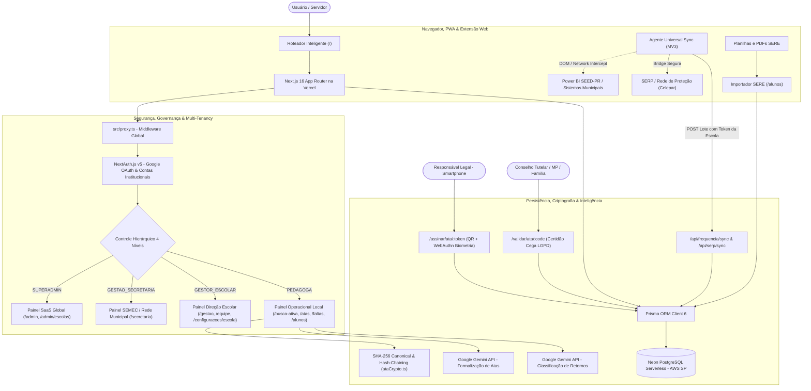

# Documentação Técnica do Sistema: Rede Ativa SaaS
## Plataforma Multi-Escola de Busca Ativa, Gestão de Frequência & Livro Oficial de Atas Pedagógicas

> **Unidade Piloto Fundadora / Laboratório de Validação Tecnológica e Pedagógica:**  
> **Colégio Estadual Leopoldina B. Pedroso** (INEP `41042730`) — Ponta Grossa / Tibagi, Paraná (SEED-PR)  
> *Ambiente oficial de validação em produção com 689 estudantes reais, atuando como centro de referência e homologação para redes municipais e estaduais.*

---

## 1. Visão Geral do Sistema

O **Rede Ativa SaaS** é uma plataforma em nuvem escalável concebida para modernizar a rotina pedagógica de combate ao abandono escolar, agilizar a comunicação com as famílias, substituir com fé pública os cadernos manuscritos de atas e consolidar um **arcabouço jurídico comprobatório inquestionável** de todas as intervenções realizadas pela escola durante o ano letivo.

Originalmente estruturado e homologado no Colégio Estadual Leopoldina B. Pedroso (**Escola Piloto**), o sistema opera hoje sob uma arquitetura **multi-tenant**, permitindo que secretarias municipais de educação (SEMEC), núcleos regionais e colégios autônomos gerenciem suas respectivas redes com isolamento lógico integral de dados, dashboards hierárquicos e suporte a integrações estaduais e municipais.

### Objetivos Fundamentais da Plataforma
1. **Multi-Tenancy & Governança Hierárquica**: Permitir a gestão unificada de múltiplas redes de ensino e escolas simultâneas com 4 níveis de controle: Super Admin, Gestão Secretaria (SEMEC), Direção Escolar e Equipe Pedagógica.
2. **Arcabouço Jurídico & Fé Pública Digital**: Prover um **Livro Oficial de Atas Pedagógicas Digital** juridicamente amparado pela **Lei Federal nº 14.063/2020**, **MP nº 2.200-2/2001**, **ECA** e **LGPD**, com numeração anual sequencial atômica, selo criptográfico `SHA-256`, coleta de assinaturas híbridas (tela ou QR Code móvel com biometria **WebAuthn/FIDO2**) e termos de aditamento encadeados (*"Em tempo"*).
3. **Busca Ativa de Alta Produtividade via WhatsApp**: Fila assistida inteligente por turma com detecção de ambiente (Mobile nativo vs Desktop direto), Janela Dedicada Compacta (Linux/Chrome) e descarte automático de alunos amparados por atestados médicos vigentes.
4. **Dossiês Probatórios para Conselho Tutelar & Ministério Público**: Emissão em 1 clique de relatório pericial A4 auditado contendo a cronologia de faltas, atestados anexos, tentativas de contato e atas oficiais, com anonimização automática de outros menores citados em relatos coletivos (Arts. 17 e 143 do ECA).
5. **Inteligência Artificial Assistiva (Google Gemini 2026)**: Formalização textual de atas com rigor gramatical, redação acolhedora de comunicados e classificação de justificativas familiares com pseudonimização prévia (LGPD).
6. **Agente Universal de Sincronização**: Extensão Web Manifest V3 com tokens de segurança por escola (`syncTokenHash`) para ingestão automatizada de dados de frequência do Power BI e portal SERP/Celepar.

---

## 2. Arquitetura da Solução & Fluxo de Acesso

---

## 3. Modelo de Dados Multi-Tenant (Prisma / PostgreSQL)

O banco de dados está hospedado no **Neon PostgreSQL Serverless (AWS São Paulo - `sa-east-1`)**, estruturado em [`prisma/schema.prisma`](../prisma/schema.prisma) com segregação lógica estrita de inquilinos (*tenants*):

- **`EducationNetwork`**: Mantenedora ou rede de ensino (ex.: SEMEC Tibagi, SEED-PR Estadual, Redes Privadas), agrupando múltiplas escolas com consolidação de indicadores.
- **`School`**: Unidade escolar individual (`inepCode`, `name`, `city`, `state`, `network`, `syncTokenHash`, `logoUrl`, `settingsJson`). A sede piloto **Leopoldina (INEP `41042730`)** conta com salvaguardas adicionais no código contra exclusão ou reinicialização.
- **`User` & `UserSchool`**: Servidores institucionais vinculados a uma ou mais escolas com papéis específicos (`SUPERADMIN`, `GESTAO_SECRETARIA`, `GESTOR_ESCOLAR`, `PEDAGOGA`).
- **`ClassGroup` & `Student`**: Turmas e estudantes vinculados obrigatoriamente a uma `schoolId`, com CGM, turma regular, idade, filiação e contatos.
- **`StudentContact`**: Múltiplos responsáveis familiares cadastrados (`kinship`, `phone`, `isPrimary`, `whatsappValid`).
- **`AbsenceJustification`**: Atestados médicos/odontológicos e dispensas com vigência temporal (`startDate`, `endDate`, `cidCode`) e cálculo automático de afastamento.
- **`AttendanceSnapshot` & `LowAttendanceRecord`**: Série histórica de infrequência e status no sistema SERP vinculados ao aluno e à escola.
- **`MessageTemplate` & `MessageLog`**: Modelos de mensagem e registros de busca ativa com status de entrega (`SENT`, `FAILED_NO_WHATSAPP`), autor, data/hora, IP e retorno classificado.
- **`PedagogicalMinute` (Livro Oficial Digital de Atas)**:
  - Identificação: `schoolId`, `year`, `ataNumber` (`@@unique([schoolId, year, ataNumber])`), `status` (`DRAFT`, `FINALIZED`, `VOIDED`), `contentHash` (`SHA-256` canônico) e `verificationCode` único não enumerável (`ATA-XXXX-XXXX`).
  - Sigilo e fé pública: `isConfidential` (ECA), `authorId`, `authorName`, `authorEmail`, `authorRole`, `authorIp`, `finalizedAt`, `voidedAt`, `voidReason`.
- **`PedagogicalMinuteStudent`**: Vínculo N:N entre estudantes e atas, preservando o nome e turma do estudante na época da lavratura.
- **`PedagogicalMinuteParticipant`**: Signatários presentes (`role`, `name`, `signatureMode`, `signatureData`, `mobileSignToken`, `biometricVerified`, `witnessName`).
- **`PedagogicalMinuteAddendum`**: Termos de aditamento encadeados (*"Em tempo"*), selados por hash criptográfico encadeado.
- **`PedagogicalActionItem`**: Combinados pedagógicos e prazos firmados com a família (`dueDate`, `status`, `completedAt`).
- **`AuditLog`**: Trilha imutável de conformidade contendo `action`, `entityType`, `entityId`, `userEmail`, `ipAddress` e detalhes em JSON.

---

## 4. Módulos do Sistema e Funcionalidades

### 4.1. Painel Global Super Admin (`/admin` e `/admin/escolas`)
- Métricas globais SaaS: total de redes, escolas ativas, estudantes e mensagens disparadas.
- Diretório de escolas com chaveamento contextual imediato para qualquer unidade.
- **Provisionamento e Cadastro de Novas Escolas**: Formulário completo com auto-geração dos modelos pedagógicos padrão.
- **Higienização de Escolas de Teste (`POST /api/schools/[id]/sanitize`)**: Zera alunos, turmas e atas de homologação mantendo os dados cadastrais da escola.
- **Exclusão Segura em Cascata (`DELETE /api/schools/[id]`)**: Remove escolas temporárias com proteção estrita da Unidade Piloto Leopoldina.

### 4.2. Painel Executivo Secretaria de Educação (`/secretaria`)
- Exclusivo para Secretários(as) e equipe técnica da SEMEC.
- Visão agregada da taxa de frequência da rede municipal, escolas com maior risco de evasão e supervisão da equipe gestora local.

### 4.3. Painel da Direção Escolar (`/gestao`, `/equipe`, `/configuracoes/escola`)
- Painel focado na unidade: total de alunos ativos, turmas, alertas imediatos de infrequência e status da chave de sincronização.
- Gestão de servidores autorizados da escola com atribuição de funções (`GESTOR_ESCOLAR` ou `PEDAGOGA`).
- Configuração do brasão oficial em SVG/PNG para cabeçalho das atas impressas.

### 4.4. Busca Ativa Assistida via WhatsApp (`/busca-ativa`)
- **Modo Individual e Fila Guiada por Turma**: Disparo assistido sem necessidade de contratação de APIs externas caras.
- **Detecção Inteligente de Plataforma**: Abertura nativa via `wa.me` em smartphones e link otimizado no desktop.
- **Janela Dedicada Compacta (Linux/Chrome)**: Popup minimalista 480x760px gerenciado pelo agente universal de extensão, sem abas e sem expor a lista de contatos do WhatsApp Web.
- **Salto Automático de Atestados**: Alunos com atestado médico vigente são desmarcados automaticamente da fila diária.
- **Saneamento de Telefones**: Marcação de números sem WhatsApp (`FAILED_NO_WHATSAPP`), impedindo novas tentativas inúteis.

### 4.5. Livro Oficial de Atas Pedagógicas Digital (`/atas`)
- **Editor Widescreen em Duas Colunas**: Catálogo ágil de alunos, ditado por voz nativo (`pt-BR`) e formalização com Gemini AI.
- **Assinatura Digital Institucional em 1 Clique**: Servidores públicos assinam comprovando posse da conta, IP e timestamp oficial UTC.
- **Coleta Móvel com Biometria do Celular (`/assinar/ata/[token]`)**: QR Code temporário para o responsável assinar no smartphone com autenticação biométrica **WebAuthn / Passkeys (FIDO2)**.
- **Selo SHA-256 e Imutabilidade**: Numeração anual sequencial travada por escola e hash canônico que sela o teor do documento.
- **Adendos (*"Em tempo"*) e Anulação Auditada**: Retificações registradas exclusivamente por aditamento encadeado; cancelamentos exigem motivação justificada sem apagar o histórico.
- **Impressão A4 em Folha Única (`1 of 1`)**: Diagramação pericial com brasão oficial, carimbo temporal completo e QR Code de conferência pública (`/validar/ata/[code]`).
- **Livro Anual Consolidado (`/atas/livro/[ano]`)**: Termo de abertura, atas encadeadas de 1 a N e termo de encerramento para arquivo definitivo.

### 4.6. Prontuário 360º (`/alunos/[id]`) & Dossiê Probatório (`/alunos/[id]/dossie`)
- **Prontuário 360º**: Histórico completo de frequência, contatos, atestados e atas pedagógicas daquele estudante.
- **Dossiê Oficial perante Conselho Tutelar e Ministério Público**:
  - Consolida todas as tentativas de busca ativa, atestados, atas e encaminhamentos durante o ano letivo.
  - **Blindagem ECA (Art. 17 e 143)**: Ocultação por padrão de atas com **Sigilo Reforçado** e **anonimização automática por iniciais** de outros menores citados em relatos de ocorrências conjuntas.

---

## 5. Inteligência Artificial com Google Gemini 2026

1. **Formalização Gramatical e Jurídica de Atas (`/api/ai/formalize-ata`)**:
   - Converte anotações informais em texto formal na norma culta, alinhado às diretrizes da SEED-PR e SEMEC.
   - Utiliza **`gemini-3.5-flash`** com `thinkingLevel: "low"` para resposta ultrarrápida (~1.8s) e fuso horário oficial `America/Sao_Paulo` para datas por extenso.
   - Retorna estrutura JSON estrita (`responseSchema`) com pauta, resumo e encaminhamentos com prazos calculados.
2. **Classificação & Formalização de Retornos Familiares (`/api/ai/classify-reply`)**:
   - Classifica mensagens de pais recebidas no WhatsApp (`SAUDE`, `TRANSPORTE`, `TRABALHO`, `VULNERABILIDADE`, etc.) e sinaliza a exigência de atestado médico comprobatório.
3. **Geração de Modelos Institucionais (`/api/ai/generate-template`)**:
   - Cria comunicados acolhedores com tags dinâmicas para pais e responsáveis.

---

## 6. Qualidade, Testes & Conformidade Jurídica

- **Suíte de Testes Automatizados (Vitest — 96 testes em 21 arquivos, 100% de aprovação)**:
  - `securityAndRbac.test.ts`: Controle perimetral, permissões dos 4 papéis, rotas protegidas e blindagem da sede piloto Leopoldina.
  - `multiTenancy.test.ts`: Resolução de inquilinos, isolamento por `schoolId` e persistência de dados.
  - `ataCrypto.test.ts` e `escolaSign.test.ts`: Integridade do hash `SHA-256`, assinaturas institucionais e biometria móvel WebAuthn.
  - `aiPseudonymizer.test.ts`: Mascaramento de dados de menores antes do envio à inteligência artificial.
  - `nreAtaFormalize.test.ts`: Rigor gramatical, fuso horário `America/Sao_Paulo` e formatação canônica de atas.
  - `sereParser.test.ts`: Extração de arquivos `.xls` (BIFF8), `.xlsx`, `.pdf` e `.csv` do SERE.
  - `clientDispatcher.test.ts`: Despacho de mensagens, detecção de navegador e janela compacta.
  - `buscaAtivaPageReal.test.tsx` e `faltasPageReal.test.tsx`: Renderização SSR resiliente em componentes React de servidor.

---

*Rede Ativa SaaS — Desenvolvido a partir da experiência e validação prática do Colégio Estadual Leopoldina B. Pedroso (Unidade Piloto Fundadora).*
