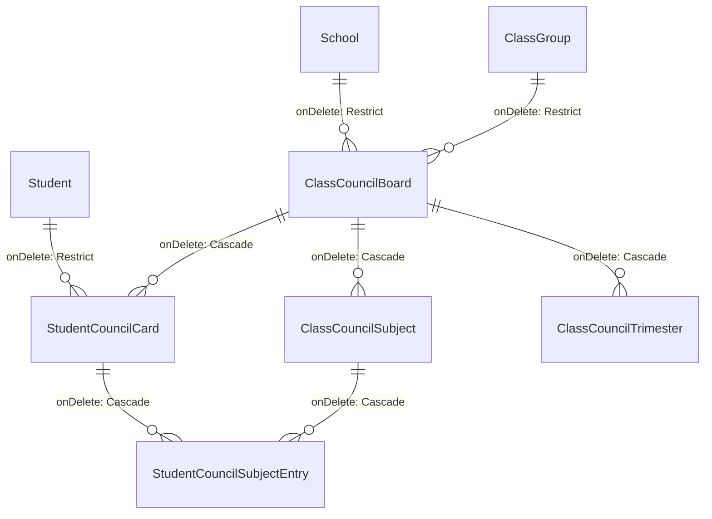

# Consolidação Arquitetural & de Segurança — Acompanhamento Trimestral de Turmas, Conselho de Classe e Pós-Conselho

> **Data-Base:** `18/11/2026` · **Sistema:** Rede Ativa SaaS  
> **Escopo:** Modelagem Prisma, Camada de Serviço, 7 Route Handlers REST, UI Modular, Impressão A4, Prontuário 360º e Suíte Vitest  
> **Contadores Verificados do Repositório:** **26 models Prisma** · **33 páginas SSR (`page.tsx`)** · **60 Route Handlers (`route.ts`)** · **8 módulos em `src/services/`** · **45 bibliotecas em `src/lib/`** · **78 arquivos Vitest (`75` aprovados + `3` `skipIf` de banco isolado) / `711` testes (`699` aprovados + `12` ignorados)**

---

## 1. Índice Completo de Arquivos Criados e Modificados

### Arquivos Criados (24)
1. **Camada de Domínio e Serviços (`1`):**
   - [`src/services/classCouncilService.ts`](../../src/services/classCouncilService.ts)
2. **Route Handlers REST (`src/app/api/conselho-classe/**` — `7` endpoints):**
   - [`src/app/api/conselho-classe/route.ts`](../../src/app/api/conselho-classe/route.ts) (`GET`, `POST`)
   - [`src/app/api/conselho-classe/[boardId]/route.ts`](../../src/app/api/conselho-classe/%5BboardId%5D/route.ts) (`GET`, `PATCH`)
   - [`src/app/api/conselho-classe/[boardId]/subjects/route.ts`](../../src/app/api/conselho-classe/%5BboardId%5D/subjects/route.ts) (`PUT`)
   - [`src/app/api/conselho-classe/[boardId]/trimesters/route.ts`](../../src/app/api/conselho-classe/%5BboardId%5D/trimesters/route.ts) (`PATCH`)
   - [`src/app/api/conselho-classe/[boardId]/matrix/route.ts`](../../src/app/api/conselho-classe/%5BboardId%5D/matrix/route.ts) (`PUT`)
   - [`src/app/api/conselho-classe/[boardId]/students/[studentId]/route.ts`](../../src/app/api/conselho-classe/%5BboardId%5D/students/%5BstudentId%5D/route.ts) (`PATCH`)
   - [`src/app/api/conselho-classe/[boardId]/generate-minute/route.ts`](../../src/app/api/conselho-classe/%5BboardId%5D/generate-minute/route.ts) (`POST`)
3. **Subcomponentes Modulares (`src/components/conselho/*` — `8` arquivos, tipagem estrita sem `any`):**
   - [`src/components/conselho/types.ts`](../../src/components/conselho/types.ts)
   - [`src/components/conselho/CouncilHeaderMetadataCard.tsx`](../../src/components/conselho/CouncilHeaderMetadataCard.tsx)
   - [`src/components/conselho/CouncilSubjectsManagerModal.tsx`](../../src/components/conselho/CouncilSubjectsManagerModal.tsx)
   - [`src/components/conselho/CouncilTrimesterOverviewTab.tsx`](../../src/components/conselho/CouncilTrimesterOverviewTab.tsx)
   - [`src/components/conselho/CouncilMatrixGrid.tsx`](../../src/components/conselho/CouncilMatrixGrid.tsx)
   - [`src/components/conselho/CouncilStudentFichaModal.tsx`](../../src/components/conselho/CouncilStudentFichaModal.tsx)
   - [`src/components/conselho/CouncilPostMeetingTab.tsx`](../../src/components/conselho/CouncilPostMeetingTab.tsx)
   - [`src/components/conselho/CouncilStudent360Section.tsx`](../../src/components/conselho/CouncilStudent360Section.tsx)
4. **Páginas SSR e Client Components (`src/app/conselho-classe/**` — `6` arquivos):**
   - [`src/app/conselho-classe/page.tsx`](../../src/app/conselho-classe/page.tsx) e [`ConselhoIndexClient.tsx`](../../src/app/conselho-classe/ConselhoIndexClient.tsx)
   - [`src/app/conselho-classe/[boardId]/page.tsx`](../../src/app/conselho-classe/%5BboardId%5D/page.tsx) e [`ConselhoTurmaClient.tsx`](../../src/app/conselho-classe/%5BboardId%5D/ConselhoTurmaClient.tsx)
   - [`src/app/conselho-classe/[boardId]/imprimir/page.tsx`](../../src/app/conselho-classe/%5BboardId%5D/imprimir/page.tsx) e [`ConselhoPrintClient.tsx`](../../src/app/conselho-classe/%5BboardId%5D/imprimir/ConselhoPrintClient.tsx)
5. **Suíte de Testes e Registro Técnico (`2`):**
   - [`src/lib/__tests__/classCouncilModule.test.ts`](../../src/lib/__tests__/classCouncilModule.test.ts)
   - [`docs/auditorias/2026-11-18_CONSOLIDACAO_CONSELHO_CLASSE.md`](./2026-11-18_CONSOLIDACAO_CONSELHO_CLASSE.md)

### Arquivos Existentes Atualizados (14)
- [`prisma/schema.prisma`](../../prisma/schema.prisma) (5 novos models + relações reversas em `School`, `ClassGroup` e `Student`)
- [`src/lib/schemas.ts`](../../src/lib/schemas.ts) (contratos Zod estritos para conselho, matriz `1..5`, clonagem e geração de atas)
- [`src/lib/audit.ts`](../../src/lib/audit.ts) (7 novas ações em `AuditAction`)
- [`src/app/api/schools/[id]/sanitize/route.ts`](../../src/app/api/schools/%5Bid%5D/sanitize/route.ts) e [`src/app/api/schools/[id]/route.ts`](../../src/app/api/schools/%5Bid%5D/route.ts) (limpeza topológica das tabelas do conselho antes de `student.deleteMany` e `classGroup.deleteMany`, preservando bloqueio `403` da Escola Piloto `41042730`)
- [`src/components/Sidebar.tsx`](../../src/components/Sidebar.tsx) (link `"Conselho de Classe"` na seção *Registros*)
- [`src/lib/safePhase3Queries.ts`](../../src/lib/safePhase3Queries.ts), [`src/app/alunos/[id]/page.tsx`](../../src/app/alunos/%5Bid%5D/page.tsx) e [`src/app/alunos/[id]/ProntuarioClient.tsx`](../../src/app/alunos/%5Bid%5D/ProntuarioClient.tsx) (Prontuário 360º)
- [`AI_CONTEXT.md`](../../AI_CONTEXT.md), [`GEMINI.md`](../../GEMINI.md), [`docs/ARQUITETURA_E_ENGENHARIA.md`](../ARQUITETURA_E_ENGENHARIA.md), [`docs/auditorias/README.md`](./README.md) e [`docs/BACKLOG.md`](../BACKLOG.md)

---

## 2. Modelagem Relacional (`prisma/schema.prisma` — 5 Novos Models)

| Model Prisma | Unicidade Composta (`@@unique`) | Índices (`@@index`) | Proteção Referencial & Campos Principais |
| :--- | :--- | :--- | :--- |
| `ClassCouncilBoard` | `[schoolId, classGroupId, year]` | `[schoolId, year]`, `[classGroupId, year]` | `onDelete: Restrict` em `School` e `ClassGroup`. Armazena `peerLeader*`, `teacherLeader*`, `externalEvalEd1..3Percent`, `seatingMapMode` e `seatingMapNotes`. |
| `ClassCouncilSubject` | `[boardId, name]` | `[schoolId, boardId, displayOrder]` | `onDelete: Restrict` em `School`. Registra `name`, `teacherName`, `teacherEmail`, `displayOrder` e `active` (desativação preserva histórico). |
| `ClassCouncilTrimester` | `[boardId, trimester]` | `[schoolId, trimester]` | `onDelete: Restrict` em `School`. Registra `status` (`IN_PROGRESS \| CONSOLIDATED`), observações da turma, 4 eixos do Pós-Conselho (`postCouncil*`) e `linkedMinuteId`. |
| `StudentCouncilCard` | `[boardId, studentId]` | `[schoolId, studentId]`, `[boardId, enrollmentStatus]` | `onDelete: Restrict` em `School` e `Student`. Registra `enrollmentStatus`, `externalEvalEd1..3Percent`, `tags` (`String[]`), `hasSensitiveHealthTag`, `trimester1..3Opinion` e `trimester1..3BelowAvgJson`. |
| `StudentCouncilSubjectEntry` | `[cardId, subjectId, trimester]` | `[schoolId, subjectId, trimester]`, `[cardId, trimester]` | `onDelete: Restrict` em `School`. Célula da matriz `Estudante x Componente x Trimestre` com `descriptorCodes` (`Int[]` ordenado em `[1..5]`) e `grade` opcional. |

### Ordem Topológica em `sanitize` e `DELETE /api/schools/[id]`
Para escolas de teste/homologação (com bloqueio `403` mantido para a Escola Piloto `inepCode === "41042730"`), a transação `prisma.$transaction([...])` remove os registros do conselho na sequência abaixo antes de `student.deleteMany` e `classGroup.deleteMany`:
1. `studentCouncilSubjectEntry.deleteMany({ where: { schoolId: id } })`
2. `studentCouncilCard.deleteMany({ where: { schoolId: id } })`
3. `classCouncilTrimester.deleteMany({ where: { schoolId: id } })`
4. `classCouncilSubject.deleteMany({ where: { schoolId: id } })`
5. `classCouncilBoard.deleteMany({ where: { schoolId: id } })`

---

## 3. Contratos Zod, Matriz RBAC/LGPD e Regras de Negócio

### 3.1 Contratos Estritos em [`src/lib/schemas.ts`](../../src/lib/schemas.ts)
- `councilBoardUpsertSchema` e `councilBoardMetadataUpdateSchema`: validam ano letivo (`2024..2100`), líderes, percentuais `0..100` e `seatingMapMode`.
- `councilSubjectsBatchSchema`: aceita `sourceBoardId` (clonagem intra-tenant) ou array `subjects` (até 40 disciplinas), bloqueando submissão vazia.
- `councilMatrixBatchSaveSchema`: valida lote de até `1.500` células, normalizando `descriptorCodes` via `Array.from(new Set(arr)).sort((a, b) => a - b)` restrito a inteiros `1..5`.
- `councilStudentCardUpdateSchema`: valida `enrollmentStatus`, percentuais individuais, até 7 selos (`councilStudentTagEnum`), `qualitativeOpinion` e `belowAverageSubjects`.
- `councilGenerateMinuteSchema`: valida `source` (`POST_COUNCIL | STUDENT_DELIBERATION`), `trimester`, `studentIds` (default `[]`) e `isConfidential`.

### 3.2 Matriz de Segurança Multi-Tenant, RBAC e LGPD

| Camada / Endpoint | Métodos | Guardas de Acesso e Tenant | Controles LGPD / ECA & Auditoria |
| :--- | :---: | :--- | :--- |
| `/api/conselho-classe` | `GET, POST` | `requireAuth()` + `getCurrentSchool()` (ignora `schoolId` no corpo) + `canMutateSchoolCouncil()` no `POST` (`GESTAO_SECRETARIA` sem vínculo local recebe `403`). | `logAudit` com `schoolId` raiz e `{ boardId, classGroupId, year }`. |
| `/api/conselho-classe/[boardId]` | `GET, PATCH` | `assertTenantOwnership(ownership.schoolId, school.id, session)` + `canMutateSchoolCouncil()` no `PATCH`. | Valida pertencimento de líderes à turma (`schoolId` + `classGroupId`). |
| `/api/conselho-classe/[boardId]/subjects` | `PUT` | `assertTenantOwnership()` + `canMutateSchoolCouncil()`. Se `sourceBoardId` presente, valida `sourceBoard.schoolId === ownership.schoolId` (`403` caso contrário). | Grava `CLONE_COUNCIL_SUBJECTS` ou `UPDATE_COUNCIL_SUBJECTS` com `schoolId` raiz. |
| `/api/conselho-classe/[boardId]/trimesters` | `PATCH` | `assertTenantOwnership()` + `canMutateSchoolCouncil()`. | Grava `UPDATE_COUNCIL_TRIMESTER` com `{ boardId, trimester, status }`. |
| `/api/conselho-classe/[boardId]/matrix` | `PUT` | `assertTenantOwnership()` + `canMutateSchoolCouncil()`. Validação `cards.length === distinctStudentIds.length` e `subjects.length === distinctSubjectIds.length` (`400` em FK traversal). | Recalcula `trimesterXBelowAvgJson` para notas `< 6.0` (escala `0..10`) ou `< 60` (escala `0..100`) preservando itens manuais. |
| `/api/conselho-classe/[boardId]/students/[studentId]` | `PATCH` | `assertTenantOwnership()` + `canMutateSchoolCouncil()`. Confere `card.schoolId === ownership.schoolId` e valida FKs de `belowAverageSubjects`. | Calcula `hasSensitiveHealthTag` para `ALUNO_COM_LAUDO`/`AEE`. `AuditLog` registra apenas `tagsCount` — nunca nomes de tags clínicas nem texto do parecer. |
| `/api/conselho-classe/[boardId]/generate-minute` | `POST` | `assertTenantOwnership()` + `canMutateSchoolCouncil()`. Valida todos os `studentIds` na turma/escola. | Em `POST_COUNCIL`, cria `DRAFT` sem auto-vincular toda a turma (`students: []` salvo `studentIds` explícitos) e vincula `linkedMinuteId`. Em `STUDENT_DELIBERATION`, ativa `isConfidential: true` automaticamente se houver `ALUNO_COM_LAUDO`/`AEE`. |
| Erros HTTP 500 | Todos | `resolveCouncilHttpError` em [`classCouncilService.ts`](../../src/services/classCouncilService.ts). | Apenas `CouncilDomainError` (`400/403/404/409`) expõe mensagem controlada; erros inesperados retornam sempre `{ error: "Erro interno ao processar operação do conselho de classe." }` com status `500`. |

---

## 4. Arquitetura de Frontend, Acessibilidade & Prontuário 360º

- **Lançamento Produtivo da Matriz ([`CouncilMatrixGrid.tsx`](../../src/components/conselho/CouncilMatrixGrid.tsx)):** contêiner com `tabIndex={0}` e `role="region"`, cabeçalhos fixos (`sticky top-0` e `sticky left-0` com fundo opaco), atalhos de teclado `1..5` na célula focada (sem interferir no `<input>` de nota), ação `"Vazios = 1"` por disciplina e rastreamento de células alteradas (`dirtyCells`).
- **Clonagem Curricular ([`CouncilSubjectsManagerModal.tsx`](../../src/components/conselho/CouncilSubjectsManagerModal.tsx)):** seletor `"Importar componentes curriculares de outra turma da mesma escola"` listado a partir de turmas do mesmo `schoolId` ativo.
- **Privacidade em Projeção e Impressão A4:** alternador `"Ocultar laudo e AEE"` em [`CouncilHeaderMetadataCard.tsx`](../../src/components/conselho/CouncilHeaderMetadataCard.tsx) e [`CouncilStudent360Section.tsx`](../../src/components/conselho/CouncilStudent360Section.tsx); impressão A4 ([`/conselho-classe/[boardId]/imprimir`](../../src/app/conselho-classe/%5BboardId%5D/imprimir/page.tsx)) aplica [`anonymizeOtherMinorsInText`](../../src/lib/ataCrypto.ts) nos pareceres individuais.
- **Prontuário 360º:** [`loadStudent360Bundle`](../../src/lib/safePhase3Queries.ts) consulta `studentCouncilCard` com `safeQueryList` e filtro `scopedCouncilCards` por `student.schoolId`, alimentando [`CouncilStudent360Section.tsx`](../../src/components/conselho/CouncilStudent360Section.tsx) em [`ProntuarioClient.tsx`](../../src/app/alunos/%5Bid%5D/ProntuarioClient.tsx).
- **UX Writing (Seção 10 de [`GEMINI.md`](../../GEMINI.md)):** 100% da interface livre de termos proibidos (*"fé pública"*, *"imutável"*, *"inviolável"*, siglas técnicas e citações normativas).

---

## 5. Cobertura Automatizada & Resultados do Quality Gate

### Cenários Validados em [`src/lib/__tests__/classCouncilModule.test.ts`](../../src/lib/__tests__/classCouncilModule.test.ts) (`8` testes)
1. Validação Zod da matriz (desduplicação e ordenação de `descriptorCodes` em `1..5`) e clonagem de componentes (`sourceBoardId`).
2. Bloqueio de acesso/mutação cross-tenant via `assertTenantOwnership` (`403`) e modo somente leitura para `GESTAO_SECRETARIA` (`200` no `GET`, `403` no `POST`).
3. Clonagem curricular intra-tenant (`mode: "CLONED"`, `logAudit` `CLONE_COUNCIL_SUBJECTS` com `schoolId` raiz) e bloqueio `403` para clonagem cross-tenant.
4. Bloqueio `400` de FK traversal na matriz e sincronização de `trimester1BelowAvgJson` preservando itens manuais (`subjectId: null`).
5. Controle LGPD/ECA em `hasSensitiveHealthTag` e higiene estrita de `AuditLog.details` (sem rótulos clínicos nem parecer livre).
6. Geração de minuta `POST_COUNCIL` sem auto-vincular toda a turma (`students: []` + `linkedMinuteId`) e `STUDENT_DELIBERATION` com `isConfidential: true` automático para `ALUNO_COM_LAUDO`/`AEE`.
7. Contenção absoluta de erros HTTP 500 sem vazamento de `error.message` interno.
8. Isolamento multi-tenant no Prontuário 360º (`loadStudent360Bundle` + SSR `CouncilStudent360Section`), `onDelete: Restrict` nos 5 models em `prisma/schema.prisma` e ausência de termos proibidos pela Seção 10 de `GEMINI.md` nos 11 arquivos de UI.

### Comandos Verificados
- `npx prisma generate`: concluído com êxito (`Prisma Client v6.4.0`).
- `npx tsc --noEmit`: código `0` (zero erros de tipagem).
- `npm test`: **75 arquivos aprovados | 3 `skipIf` de banco isolado (78 arquivos)** e **699 testes aprovados | 12 ignorados (711 testes)**.
- `npm run build`: código `0` (empacotamento da extensão MV3 + build Next.js 16.4.6 Turbopack sem erros).
