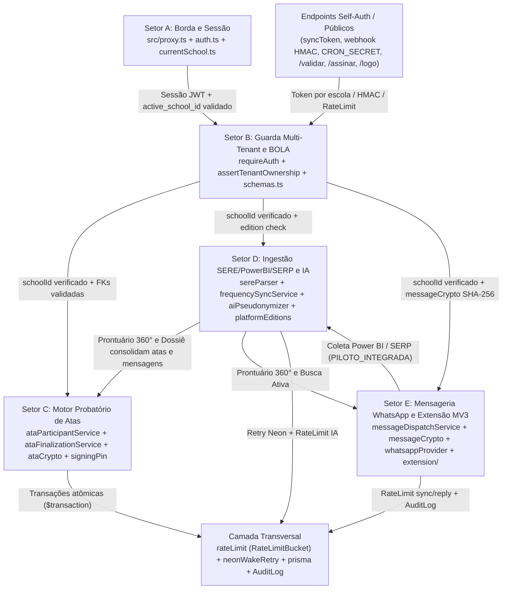

# Diretrizes Metodológicas, Mapeamento Minucioso e Escopos de Auditoria — Rede Ativa SaaS

Este documento estabelece o **mapa arquitetural minucioso** e as **diretrizes operacionais** para implementações e execução das auditorias setoriais, de integração e geral na plataforma **Rede Ativa SaaS**. Nenhum agente deve iniciar uma varredura de auditoria sem antes referenciar este mapa de escopo e as regras de preservação em [`AGENTS.md`](../../AGENTS.md) e [`GEMINI.md`](../../GEMINI.md).

> **Inventário Verificado do Código-Fonte:** **21 models Prisma** ([`prisma/schema.prisma`](../../prisma/schema.prisma)), **30 páginas `page.tsx`** (`src/app/`), **53 Route Handlers `route.ts`** (`src/app/api/`), **7 módulos em `src/services/`**, **45 módulos em `src/lib/`**, **77 arquivos de teste (`74` aprovados / `691` testes aprovados + `12` `skipIf`)** e **extensão Chrome MV3 `v1.6.5`** ([`extension/manifest.json`](../../extension/manifest.json)).

---

## FASE 1: MAPA MINUCIOSO DOS SETORES (EXPLORAÇÃO PRÉ-AUDITORIA)

Os módulos do projeto encontram-se rigorosamente categorizados em **5 setores operacionais** e **1 camada transversal / superfícies públicas**, eliminando pontos cegos entre camadas de borda, domínio, persistência e extensão.

---

### Setor A: Núcleo de Autenticação, Perímetro de Borda, Governança RBAC 4-Tier e Edições da Plataforma

- **Responsabilidade:** Portão de entrada da aplicação (OAuth Google institucional e `escola-dev-auth` bloqueado em produção), redirecionamento canônico de domínio (`redeativa.app.br` → `www.redeativa.app.br`), resolução anti-spoofing de contexto escolar (`active_school_id`), governança hierárquica em 4 níveis (`SUPERADMIN`, `GESTAO_SECRETARIA`, `GESTOR_ESCOLAR`, `PEDAGOGA` + alias legado `ADMIN`), provisionamento de redes/escolas e controle das duas edições da plataforma (`PILOTO_INTEGRADA` vs `INSTITUCIONAL_ESSENCIAL`).
- **Núcleo & Borda (`src/proxy.ts`, `src/lib/`, `src/types/`):**
  - [`src/proxy.ts`](../../src/proxy.ts) e [`src/lib/proxyConstants.ts`](../../src/lib/proxyConstants.ts) (`PUBLIC_PATHS`, `PUBLIC_PREFIXES`, `SELF_AUTH_API_PREFIXES`, `ADMIN_PAGE_PREFIXES`)
  - [`src/lib/auth.ts`](../../src/lib/auth.ts), [`src/lib/auth.config.ts`](../../src/lib/auth.config.ts), [`src/lib/escolaGoogleVerify.ts`](../../src/lib/escolaGoogleVerify.ts), [`src/types/next-auth.d.ts`](../../src/types/next-auth.d.ts)
  - [`src/lib/roles.ts`](../../src/lib/roles.ts), [`src/lib/permissions.ts`](../../src/lib/permissions.ts), [`src/lib/currentSchool.ts`](../../src/lib/currentSchool.ts)
  - [`src/lib/platformEditions.ts`](../../src/lib/platformEditions.ts), [`src/lib/schoolLogo.ts`](../../src/lib/schoolLogo.ts)
- **Páginas (`src/app/`):** `/login`, `/admin`, `/admin/escolas`, `/secretaria`, `/gestao`, `/visao-geral`, `/onboarding`, `/equipe`, `/configuracoes/escola`, `/auditoria`.
- **Route Handlers (`src/app/api/`):**
  - `/api/auth/[...nextauth]`, `/api/auth/switch-school`
  - `/api/users`, `/api/schools`, `/api/schools/[id]`, `/api/schools/[id]/sanitize`, `/api/schools/[id]/logo`, `/api/schools/[id]/sync-token`
  - `/api/sync-config`, `/api/secretaria/metrics`
- **Models Prisma:** `EducationNetwork`, `UserNetwork`, `School`, `User`, `UserSchool`, `AuditLog`.
- **Relações e Dependências:** Injeta sessão validada e `currentSchool.id` nos demais setores. Atenção crítica: `src/proxy.ts` **não** valida posse de tenant em rotas dinâmicas (`[id]`, `[ano]`) e libera explicitamente `SELF_AUTH_API_PREFIXES` e `GET /api/schools/[id]/logo` (que possuem autenticação própria ou rate limit).

---

### Setor B: Isolamento Multi-Tenant, Guarda BOLA/IDOR, Integridade Referencial e Auditoria

- **Responsabilidade:** Interceptação obrigatória de leituras e mutações por `schoolId`, prevenção absoluta contra BOLA/IDOR em APIs e Server Components dinâmicos, validação institucional de chaves estrangeiras (`matched.length === requestedIds.length`), proteção inviolável da Escola Piloto Fundadora (INEP `41042730` / `default-leopoldina`), prevenção contra colisão global de `Student.cgm` (`P2002`), trilha de auditoria append-only com `schoolId` raiz obrigatório e sanitização CSV contra Formula Injection (CWE-1236).
- **Núcleo (`prisma/`, `src/lib/`):**
  - [`prisma/schema.prisma`](../../prisma/schema.prisma) (21 models, restrições `onDelete: Restrict` em entidades probatórias)
  - [`src/lib/tenantGuard.ts`](../../src/lib/tenantGuard.ts) (`assertTenantOwnership`)
  - [`src/lib/safePhase3Queries.ts`](../../src/lib/safePhase3Queries.ts) (`loadStudent360Bundle`, projeções leves)
  - [`src/lib/csvSanitizer.ts`](../../src/lib/csvSanitizer.ts) (`sanitizeCsvField`)
  - [`src/lib/syncCgmGuard.ts`](../../src/lib/syncCgmGuard.ts)
  - [`src/lib/audit.ts`](../../src/lib/audit.ts) (`logAudit`, `extractClientIp`)
- **Páginas SSR Dinâmicas Críticas (validação obrigatória de `auth()` + `assertTenantOwnership`):**
  - `/alunos/[id]`, `/alunos/[id]/dossie`, `/atas/[id]/imprimir`, `/atas/livro/[ano]`
  - Painéis com escopo de rede/auditoria: `/auditoria`, `/modelos`
- **Route Handlers Sob Guarda Transversal de Tenant:**
  - `/api/students`, `/api/students/[id]/attendances`, `/api/students/[id]/contacts`, `/api/students/[id]/justifications`
  - `/api/classes`, `/api/low-attendance`, `/api/reports`, `/api/templates`
  - `/api/atas`, `/api/atas/[id]/*`, `/api/atas/participant-candidates`
  - `/api/messages/*`, `/api/justifications`, `/api/justifications/[id]`
- **Referência de Auditoria Local:** Checklist adversarial da skill [`.agents/skills/multi-tenant-security-audit/SKILL.md`](../../.agents/skills/multi-tenant-security-audit/SKILL.md) e suítes [`adversarialQa.test.ts`](../../src/app/api/__tests__/adversarialQa.test.ts) / [`multiTenantSecurityAudit.test.ts`](../../src/lib/__tests__/multiTenantSecurityAudit.test.ts).

---

### Setor C: Motor Probatório de Atas, Confirmação de Autoria por PIN e Criptografia (Contexto Interno: Lei nº 14.063/2020)

- **Responsabilidade:** Ciclo completo do Livro Oficial Digital de Atas Pedagógicas: criação e edição de rascunhos, pareamento anti-forja de participantes, coleta remota por QR Code / WebAuthn e assinatura manuscrita vetorial, confirmação de autoria por PIN do servidor (`PBKDF2-SHA512` com lockout), governança extemporânea (> 5 dias úteis), selagem canônica `SHA-256`, termos aditivos (*"Em tempo"*) com *hash-chaining*, cancelamento histórico (`VOIDED`), custódia de vias físicas / protocolo Gov.br, emissão `PDF/A-1b` (ISO 19005-1) e gestão de encaminhamentos e prazos.
  > *(Nota Regra 10 `GEMINI.md`: O termo "fé pública" e equivalentes permanecem proibidos nas interfaces visíveis; usar sempre "Confirmação de autoria por PIN" e descrições comportamentais verificáveis.)*
- **Camada de Serviços (`src/services/`):**
  - [`src/services/ataParticipantService.ts`](../../src/services/ataParticipantService.ts)
  - [`src/services/ataFinalizationService.ts`](../../src/services/ataFinalizationService.ts)
- **Núcleo Criptográfico, Armazenamento & Domínio (`src/lib/`):**
  - [`src/lib/ataCrypto.ts`](../../src/lib/ataCrypto.ts) (`computeMinuteHash`, `verifyMinuteIntegrity`, `computeAddendumHash`, `verifyAddendumChain`, `generateVerificationCode`, `maskName`, `maskDocument`, `maskEmail`, `canAccessConfidentialMinute`)
  - [`src/lib/signingPin.ts`](../../src/lib/signingPin.ts), [`src/lib/ataPdfArchive.ts`](../../src/lib/ataPdfArchive.ts), [`src/lib/objectStorage.ts`](../../src/lib/objectStorage.ts)
  - [`src/lib/minuteLock.ts`](../../src/lib/minuteLock.ts), [`src/lib/nreAtaFormatter.ts`](../../src/lib/nreAtaFormatter.ts), [`src/lib/participantKinship.ts`](../../src/lib/participantKinship.ts), [`src/lib/actionClassifier.ts`](../../src/lib/actionClassifier.ts)
  - [`src/lib/qrCode.ts`](../../src/lib/qrCode.ts), [`src/lib/signTokenExpiry.ts`](../../src/lib/signTokenExpiry.ts)
- **Componentes UI Críticos (`src/components/ata/`):**
  - `AtaEditorModal.tsx`, `AtaDialog.tsx`, `AtaQrCode.tsx`, `PhysicalScanModal.tsx`, `SignatureCanvas.tsx`, `SigningPinModal.tsx`
  - Subsistema modular `src/components/ata/editor/`: `types.ts`, `qrPollController.ts`, `useQrSignaturePolling.ts`, `AtaQrPollStatusBanner.tsx`, `signatureState.ts`, `signLinkValidity.ts`, `participantCandidates.ts`, `participantIdentity.ts`, `AtaActionItemsSection.tsx`, `AtaAddendumsSection.tsx`, `AtaExtemporaneousBanner.tsx`
- **Páginas:** `/atas`, `/atas/[id]/imprimir`, `/atas/livro/[ano]`, `/encaminhamentos`, `/validar/ata/[code]` (pública), `/assinar/ata/[token]` (pública).
- **Route Handlers (17 rotas):**
  - `/api/atas`, `/api/atas/[id]`, `/api/atas/[id]/finalize`, `/api/atas/[id]/addendums`, `/api/atas/[id]/void`, `/api/atas/[id]/pdfa`, `/api/atas/[id]/physical-scan`, `/api/atas/[id]/sign-token`, `/api/atas/[id]/actions/[actionId]`
  - `/api/atas/actions`, `/api/atas/actions/[id]`, `/api/atas/actions/alerts`
  - `/api/atas/participant-candidates`, `/api/atas/public/[code]`, `/api/atas/sign-token/[token]`, `/api/atas/qr`
  - `/api/user/signing-pin`
- **Models Prisma:** `PedagogicalMinute`, `PedagogicalMinuteStudent`, `PedagogicalMinuteParticipant`, `PedagogicalMinuteAddendum`, `PedagogicalActionItem`.

---

### Setor D: Ingestão de Dados (SERE/Power BI/SERP), Matcher Cadastral, Inteligência Preditiva e Compliance LGPD/ECA

- **Responsabilidade:** Ingestão poliglota de matrículas SERE (`.xls` BIFF8, `.xlsx`, `.pdf`, `.csv`), importação manual de frequência (CSV/JSON 11 colunas), sincronização assistida de Power BI (*Presente na Escola*) e portal SERP (*Rede de Proteção*) restrita à edição `PILOTO_INTEGRADA` (bloqueio `403` em `INSTITUCIONAL_ESSENCIAL`), emparelhamento determinístico por CGM, pseudonimização obrigatória de dados de menores antes de envio ao Google Gemini, consolidação do Prontuário 360º, histórico exportável do estudante (Dossiê) e análise preditiva para SEMEC.
- **Camada de Serviços (`src/services/`):**
  - [`src/services/frequencySyncService.ts`](../../src/services/frequencySyncService.ts)
- **Núcleo (`src/lib/`):**
  - [`src/lib/sereParser.ts`](../../src/lib/sereParser.ts), [`src/lib/frequencyImportParser.ts`](../../src/lib/frequencyImportParser.ts), [`src/lib/studentMatcher.ts`](../../src/lib/studentMatcher.ts), [`src/lib/syncCgmGuard.ts`](../../src/lib/syncCgmGuard.ts)
  - [`src/lib/aiPseudonymizer.ts`](../../src/lib/aiPseudonymizer.ts)
  - [`src/lib/pedagogicalClassifier.ts`](../../src/lib/pedagogicalClassifier.ts), [`src/lib/predictiveAnalytics.ts`](../../src/lib/predictiveAnalytics.ts), [`src/lib/reportsAggregator.ts`](../../src/lib/reportsAggregator.ts)
- **Componentes Específicos:** [`src/app/alunos/SereImportModal.tsx`](../../src/app/alunos/SereImportModal.tsx).
- **Páginas:** `/alunos`, `/alunos/[id]`, `/alunos/[id]/dossie`, `/faltas`, `/atestados`, `/boletim`, `/relatorios`, `/secretaria`.
- **Route Handlers:**
  - `/api/students`, `/api/students/import`, `/api/students/[id]/attendances`, `/api/students/[id]/contacts`, `/api/students/[id]/justifications`
  - `/api/classes`, `/api/frequencia/sync` (bloqueado `403` em `INSTITUCIONAL_ESSENCIAL`), `/api/serp/sync` (bloqueado `403` em `INSTITUCIONAL_ESSENCIAL`)
  - `/api/low-attendance`, `/api/low-attendance/import`, `/api/justifications`, `/api/justifications/[id]`, `/api/reports`, `/api/secretaria/metrics`
  - `/api/ai/classify-reply`, `/api/ai/formalize-ata`, `/api/ai/generate-template`, `/api/ai/test-key`
- **Models Prisma:** `ClassGroup`, `Student`, `LowAttendanceRecord`, `AttendanceSnapshot`, `StudentContact`, `AbsenceJustification`, `InPersonAttendance`.

---

### Setor E: Mensageria WhatsApp, Selagem de Retornos, Extensão Chrome MV3 (`v1.6.5`) e Rotinas Assíncronas

- **Responsabilidade:** Orquestração do fluxo vigente de Busca Ativa (`wa.me`, janela compacta `480x760px` e fila companion), captura assistida e triagem de retornos familiares (`WhatsAppReplyCaptureModal`), selagem `SHA-256` bipartida de mensagens (`computeMessageContentHash`), webhook passivo (`503` sem `WHATSAPP_WEBHOOK_SECRET`, comparação em tempo constante e desambiguação anti-IDOR passivo), boletim semanal (`/api/cron/weekly-digest`), autenticação zero-write de tokens de extensão e preservação da fronteira isolada do piloto Evolution (`MSG-*`).
- **Camada de Serviços (`src/services/`):**
  - Fluxo vigente: [`src/services/messageDispatchService.ts`](../../src/services/messageDispatchService.ts)
  - Fronteira isolada do piloto Evolution (`MSG-03` parcial — sem integração operacional concluída): [`src/services/messaging/contracts.ts`](../../src/services/messaging/contracts.ts), [`src/services/messaging/authorization.ts`](../../src/services/messaging/authorization.ts), [`src/services/messaging/capabilities.ts`](../../src/services/messaging/capabilities.ts) e laboratório isolado `lab/mensageria/` (ver [`ESTADO_IMPLEMENTACAO.md`](../mensageria/ESTADO_IMPLEMENTACAO.md)).
- **Núcleo (`src/lib/` & `src/components/whatsapp/`):**
  - [`src/lib/whatsappProvider.ts`](../../src/lib/whatsappProvider.ts), [`src/lib/clientDispatcher.ts`](../../src/lib/clientDispatcher.ts), [`src/lib/messageCrypto.ts`](../../src/lib/messageCrypto.ts), [`src/lib/messageFormatter.ts`](../../src/lib/messageFormatter.ts)
  - [`src/lib/extensionSyncAuth.ts`](../../src/lib/extensionSyncAuth.ts), [`src/lib/extensionDiagnostics.ts`](../../src/lib/extensionDiagnostics.ts), [`src/lib/syncToken.ts`](../../src/lib/syncToken.ts), [`src/lib/cors.ts`](../../src/lib/cors.ts), [`src/lib/weeklyDigest.ts`](../../src/lib/weeklyDigest.ts)
  - [`src/components/whatsapp/WhatsAppDispatchToggle.tsx`](../../src/components/whatsapp/WhatsAppDispatchToggle.tsx), [`src/components/whatsapp/WhatsAppReplyCaptureModal.tsx`](../../src/components/whatsapp/WhatsAppReplyCaptureModal.tsx), [`src/components/ExtensionDiagnosticsPanel.tsx`](../../src/components/ExtensionDiagnosticsPanel.tsx)
- **Extensão Chrome MV3 (`extension/` — `v1.6.5`):**
  - *Automação WhatsApp Web, Bridge & Popup (Setor E):* `manifest.json`, `background.js`, `whatsapp-content.js`, `whatsapp-focus.css`, `registro-bridge.js`, `popup.html`, `popup.js`
  - *Coletores Power BI & SERP (ponte Setor E → Setor D):* `interceptor.js`, `content.js`, `serp-bridge.js`, `serp-content.js`
- **Páginas:** `/busca-ativa`, `/historico`, `/modelos`.
- **Route Handlers:** `/api/messages`, `/api/messages/send`, `/api/messages/reply`, `/api/messages/status`, `/api/messages/pending`, `/api/messages/manage`, `/api/templates`, `/api/webhooks/whatsapp`, `/api/cron/weekly-digest`.
- **Models Prisma:** `MessageTemplate`, `MessageLog`.

---

### Camada Transversal & Superfícies Públicas (Zero Pontos Cegos)

- **Infraestrutura & Resiliência Serverless:**
  - [`src/lib/prisma.ts`](../../src/lib/prisma.ts), [`src/lib/neonWakeRetry.ts`](../../src/lib/neonWakeRetry.ts)
  - [`src/lib/rateLimit.ts`](../../src/lib/rateLimit.ts) (`RateLimitBucket` — protege Setor A `/logo`, Setor C `signingPin` / `/validar` / `/sign-token`, Setor D `/api/ai/*` e Setor E `extensionSyncAuth` / `/api/messages/reply`)
  - [`src/lib/schemas.ts`](../../src/lib/schemas.ts) (contratos Zod globais)
  - [`src/lib/storageKeys.ts`](../../src/lib/storageKeys.ts) (padrão *Dual-Read / Single-Write* `redeativa_*` vs `leopoldina_*`)
  - `RateLimitBucket` (Model Prisma)
- **Superfícies Públicas, Simulador, Shell & Conformidade UX Writing (Regra 10 `GEMINI.md`):**
  - Páginas: `/` (`src/app/page.tsx`), `/impacto`, `/preview-landing`, `/treinamento` (`src/app/layout.tsx`, `src/app/error.tsx`)
  - Componentes: `src/components/landing/` (`LandingPageClient.tsx`, `MasterWorkflowAnimation.tsx`, `WorkflowAnimation.tsx`), `PedagogicalFlowSimulator.tsx`, `AppLayoutClient.tsx`, `Sidebar.tsx`, `TopHeader.tsx`, `SchoolSelector.tsx`, `ElevationBanner.tsx`, `ThemeToggle.tsx`, `PwaRegister.tsx`, `ModalDialog.tsx`.

---

## FASE 2: MAPA DE RELAÇÕES SISTÊMICAS (ACOPLAMENTO E INTEGRAÇÃO)

1. **Fronteira Real de Entrada e Autenticação:** Rotas autenticadas passam por [`src/proxy.ts`](../../src/proxy.ts) + `requireAuth()` / `requireAdmin()` / `requireSecretariat()` / `requireSuperAdmin()` + `getCurrentSchool()` + `assertTenantOwnership()`. Rotas em `SELF_AUTH_API_PREFIXES` e `GET /api/schools/[id]/logo` possuem autenticação ou rate limit próprios (token hash por escola via `extensionSyncAuth.ts`, HMAC/secret via `safeCompareStrings`, tokens de assinatura `sign-token`, código público `/validar`).
2. **Atomicidade de Transações (`$transaction`):** A lavratura de atas (`ataFinalizationService.ts`) executa transação atômica validando estudantes e participantes no tenant, validando o PIN (`signingPin.ts`), calculando o selo canônico `SHA-256` (`ataCrypto.ts`) e gravando `AuditLog` com `schoolId` raiz.
3. **Fronteira de Edições e Piloto Evolution:** `platformEditions.ts` garante rejeição `403 Forbidden` em `/api/frequencia/sync` e `/api/serp/sync` para escolas na edição `INSTITUCIONAL_ESSENCIAL`. No Setor E, o piloto Evolution (`src/services/messaging/*`, `lab/mensageria/`) permanece isolado do transporte vigente até o avanço formal registrado em [`ESTADO_IMPLEMENTACAO.md`](../mensageria/ESTADO_IMPLEMENTACAO.md).

---

## FASE 3: PROTOCOLO DE EXECUÇÃO DAS AUDITORIAS

1. **Auditorias Setoriais (Setores A a E + Camada Transversal & Superfícies Públicas):**
   - Executadas individualmente sobre os escopos da Fase 1, verificando invariantes de negócio, cobertura em `src/lib/__tests__/` e `src/app/api/__tests__/`, sanitização de erros HTTP 500 e aderência à Regra 10 (`GEMINI.md`) em interfaces.
   - **Regra específica do Setor B:** Executar o roteiro adversarial completo da skill [`.agents/skills/multi-tenant-security-audit/SKILL.md`](../../.agents/skills/multi-tenant-security-audit/SKILL.md).
   - **Regra específica do Setor E:** Auditar apenas contratos isolados e isolamento da fronteira Evolution (`src/services/messaging/*`) junto ao fluxo vigente (`wa.me` + extensão `v1.6.5`), sem iniciar containers/serviços de laboratório nem reutilizar evidências antigas da extensão como homologação Evolution ([`AGENTS.md`](../../AGENTS.md)).
2. **Auditoria de Integração:**
   - Avalia os pontos de acoplamento da Fase 2: rotas SSR dinâmicas vs escopo de `src/proxy.ts`, ponte `extension/` → `frequencySyncService.ts` → `syncCgmGuard.ts`, selo bipartido `messageCrypto.ts` → Dossiê/Histórico e atomicidade de `ataFinalizationService.ts`.
3. **Auditoria Geral (Health Check Enterprise):**
   - Consolidação executiva final com verificação de `npm test`, `npm run build` (com `ENABLE_DEV_AUTH=false` e sem carregar `.env` local automaticamente em testes), preservação de alterações locais não commitadas e revisão das pendências abertas antes de qualquer promoção.
