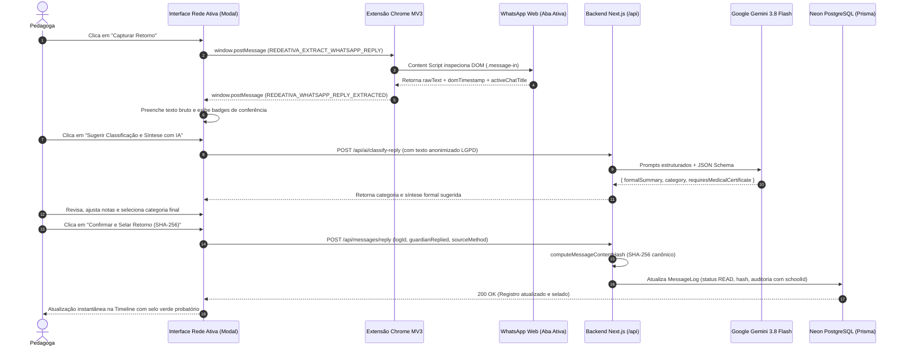

# Relatório de Engenharia: Fluxo Assistido de Retorno do WhatsApp Web
**Plataforma:** Rede Ativa SaaS  
**Módulo:** Busca Ativa Escolar & Dossiê Probatório (WhatsApp)  
**Branch:** `feature/whatsapp-reply-assisted`  
**Status do Portão de Qualidade:** Aprovado (330/330 testes Vitest verdes, Zero erros TypeScript, Build Next.js 16 + Turbopack homologado)

---

## 1. Visão Geral e Contexto da Solução

O **Fluxo Assistido de Retorno do WhatsApp Web** resolve um dos maiores gargalos operacionais e jurídicos da Busca Ativa Escolar nas instituições de ensino público e conveniadas: **o fechamento probatório do ciclo de comunicação com as famílias**.

### 1.1. O Problema Resolvido
- **Gargalo Operacional:** Anteriormente, as pedagogas disparavam as mensagens de busca ativa via WhatsApp Web, mas o registro da resposta do responsável dependia de digitação manual extemporânea no sistema, resultando em subnotificação de retornos e descontinuidade dos prontuários.
- **Risco de Fragilidade Jurídica:** Sem a captura do texto original e sem um selo criptográfico de integridade, anotações sumárias poderiam ser contestadas pela família ou pelo Ministério Público em procedimentos de averiguação de evasão escolar (Lei nº 14.063/2020 e Arts. 17 e 143 do ECA).
- **Sobrecarga de Redação:** Mensagens informais de familiares via WhatsApp (muitas vezes com gírias, áudios transcritos ou relatos fragmentados) precisavam ser formalizadas manualmente para a linguagem culta e impessoal exigida em atas e prontuários.

### 1.2. A Solução Implementada
A nova funcionalidade atua em três camadas complementares com o princípio inegociável de **Human-in-the-Loop** (conferência humana obrigatória):
1. **Captura Assistida em 1 Clique:** Leitura estritamente *read-only* da última resposta recebida na conversa ativa do WhatsApp Web via Extensão Chrome MV3.
2. **Síntese e Triagem Pedagógica Assistida por IA (Gemini):** Transformação do relato informal da família em linguagem administrativa neutra e classificação automática da justificativa (`SAUDE`, `TRANSPORTE`, `TRABALHO`, etc.), com alertas imediatos para atestados médicos.
3. **Selagem Criptográfica SHA-256:** Cálculo e persistência de hash canônico antiadulteração e não-repúdio probatório, integrando o prontuário 360º e o Dossiê Unificado para o Conselho Tutelar/SERP.



---

## 2. Detalhamento da FASE 1: Backend, Criptografia Probatória e Blindagem Multi-Tenant

A Fase 1 construiu o alicerce seguro e jurídico no backend, garantindo imunidade a ataques IDOR, integridade forense das mensagens e conformidade estrita com a Lei nº 14.063/2020, LGPD e ECA.

### 2.1. Algoritmo Criptográfico Canônico SHA-256 e Regra Bipartida (`src/lib/messageCrypto.ts`)
Para conferir fé pública, não-repúdio e proteção contra adulteração (JUR-02), a função `computeMessageContentHash` opera sob a **Regra Bipartida de Selagem**:

1. **Fase de Despacho Original (7 chaves canônicas base):**
   - `studentId`: Identificador do estudante normalizado (`trim()`).
   - `schoolId`: Identificador da instituição de ensino (tenant) normalizado (`trim()`).
   - `phoneUsed`: Telefone de destino sanitizado (`replace(/\D/g, "")`, apenas dígitos).
   - `reasonTitle`: Título/motivo da comunicação de busca ativa (`trim()`).
   - `messageContent`: Texto exato da mensagem disparada (`trim()`).
   - `sentByName`: Nome do operador normalizado (`trim().toLowerCase()`).
   - `sentAt`: Timestamp ISO 8601 UTC da emissão (`sentAtIso`).

2. **Fase de Retorno Assistido (4 chaves condicionais quando `guardianReplied === true`):**
   - `guardianReplied`: Booleano literal `true`.
   - `replyNotes`: Síntese textual/relato formalizado conferido pela pedagoga (`(payload.replyNotes ?? "").trim()`).
   - `replyCategory`: Categoria pedagógica padronizada (`(payload.replyCategory ?? "").trim()`, ex.: `SAUDE`, `TRANSPORTE`, `TRABALHO`).
   - `repliedAt`: Timestamp ISO 8601 UTC da lavratura da resposta (`repliedAtIso`).

Matematicamente, a composição canônica é expressa por:

$$\text{Payload}_{\text{base}} = \{\text{studentId}, \text{schoolId}, \text{phoneUsed}, \text{reasonTitle}, \text{messageContent}, \text{sentByName}, \text{sentAt}\}$$

$$\text{Payload} = \begin{cases} 
\text{Payload}_{\text{base}}, & \text{se } \text{guardianReplied} \neq \text{true} \\
\text{Payload}_{\text{base}} \cup \{\text{guardianReplied}, \text{replyNotes}, \text{replyCategory}, \text{repliedAt}\}, & \text{se } \text{guardianReplied} = \text{true}
\end{cases}$$

$$\text{Hash} = \text{SHA-256}\left(\text{JSON\_Canônico}(\text{Payload})\right)$$

- **Imutabilidade e Não-Repúdio:** Qualquer alteração inadvertida nos campos do banco de dados invalida o hash pericial (`verifyMessageIntegrity`).
- **Selo Probatório Compacto:** A função `formatMessageSeal` formata o digest no padrão legível para interface e impressões oficiais: `SHA-256: 4f8a2b...9e1c7d`.

### 2.2. Rota de Mutação com Blindagem Multi-Tenant (`POST /api/messages/reply`)
- **Prevenção Absoluta contra IDOR (BOLA):**
  - O endpoint executa `requireAuth()` e valida se o registro de mensagem pertence estritamente à escola vinculada à sessão do usuário autenticado através de `assertTenantOwnership(previous.student?.schoolId, currentSchool.id, authCheck.session)`.
  - Rejeita com `403 Forbidden` qualquer tentativa de manipular registros de outro tenant.
- **Transição de Status de Entrega:**
  - Se a mensagem estava no status `LINK_OPENED` ou `SENT`, ao registrar a resposta da família o sistema automaticamente promove a entrega para `READ` (*Lido / Respondido*).
- **Trilha de Auditoria Obrigatória com `schoolId` Raiz:**
  - Chamada a `logAudit` registrando a ação `MARK_REPLY`, com `schoolId` na raiz do registro de auditoria, discriminando `sourceMethod` (`EXTENSION_ASSISTED` ou `MANUAL`), categoria e o novo `contentHash`.

### 2.3. Conformidade LGPD & ECA na Triagem com IA
- Antes de encaminhar qualquer texto recebido para a API do Google Gemini (`POST /api/ai/classify-reply`), o sistema executa o pseudonimizador `createAiPseudonymizer`, mascarando o nome do menor e garantindo que dados de identificação pessoal de crianças e adolescentes nunca sejam expostos a serviços externos.
- Caso a API de IA não esteja configurada ou oscile, o classificador heurístico determinístico local `classifyGuardianReplyHeuristic` assume imediatamente como fallback de latência zero.

---

## 3. Detalhamento da FASE 2: Extensão Chrome MV3 & Content Script Bridge (Dispatcher)

A Fase 2 estabeleceu o canal de interoperabilidade seguro e não intrusivo entre a aba da aplicação SaaS e a aba do WhatsApp Web aberta no navegador da usuária.

### 3.1. Componentes da Extensão:
- **`extension/whatsapp-content.js`:**
  - Executa no contexto da página do WhatsApp Web.
  - Implementa leitura estritamente **read-only**: localiza o último balão de mensagem recebida através de seletores resilientes do WhatsApp Web (`div.message-in`, `div[data-id*='false_']`).
  - Extrai metadados forenses: `rawText` (texto da mensagem), `domTimestamp` (horário estampado na mensagem) e `activeChatTitle` (nome ou número do cabeçalho da conversa aberta).
  - Bloqueio total contra ações ativas (não simula digitação nem cliques não autorizados).
- **`extension/background.js`:**
  - Atua como orquestrador via Service Worker da Manifest V3.
  - Localiza abas abertas de `web.whatsapp.com` (`chrome.tabs.query`) e despacha a mensagem de extração com tratamento de erro quando nenhuma conversa está aberta.
- **`extension/registro-bridge.js`:**
  - Content script injetado nas origens autorizadas da Rede Ativa SaaS.
  - Valida rigorosamente a origem das mensagens (`event.origin === window.location.origin`) para prevenir qualquer ataque de *spoofing* por sites terceiros.
- **`src/lib/clientDispatcher.ts`:**
  - Função tipada `extractWhatsAppReplyViaExtension(logId, phone, timeoutMs = 8000)`.
  - Gerencia o ciclo assíncrono com `Promise`, cancelamento automático de listeners (`cleanup`) e timeout defensivo de 8 segundos com mensagens amigáveis em caso de demora.

---

## 4. Detalhamento da FASE 3: Frontend & UX Pedagógica Human-in-the-Loop

A Fase 3 entregou a experiência do usuário final, alinhada às regras inegociáveis de design de alta densidade e vocabulário pedagógico operacional brasileiro ("Zero Vibecoding").

### 4.1. Componente Reutilizável `WhatsAppReplyCaptureModal.tsx`
Localizado em `src/components/whatsapp/WhatsAppReplyCaptureModal.tsx`, organiza a esteira em 4 passos lógicos e visuais:
- **Acessibilidade e Usabilidade:** Usa `<dialog>` nativo via `ModalDialog.tsx` com contenção de foco, fechamento por `Esc` e suporte completo a tema escuro (`dark:`).
- **Neutralidade de Edição:** Funciona tanto na edição `PILOTO_INTEGRADA` (com extensão instalada) quanto na `INSTITUCIONAL_ESSENCIAL` (com colagem manual e triagem assistida por IA).

### 4.2. Integração no Prontuário 360º (`ProntuarioClient.tsx`)
- Na Linha do Tempo Auditada de Acionamentos WhatsApp, cada cartão exibe o botão dinâmico:
  - *"Capturar Retorno"* (quando a mensagem está pendente de retorno).
  - *"Editar Retorno"* (quando já houve resposta registrada).
- Ao confirmar o modal, a atualização no cliente é **imediata** (otimista/reativa), sem necessidade de recarregar a página, renderizando o badge verde *"Família Retornou"*, a categoria pedagógica em destaque e o selo criptográfico SHA-256.

### 4.3. Modernização do Histórico Geral (`HistoricoClient.tsx`)
- Substituição do antigo modal inline pelo novo componente modular unificado.
- A pedagoga ou o gestor escolar pode registrar e selar retornos diretamente a partir da listagem geral com apenas um clique, mantendo a consistência dos dados em toda a aplicação.

---

## 5. Tabela Comparativa de Arquivos por Fase

| Arquivo | Fase | Ação | Responsabilidade Arquitetural |
| :--- | :---: | :---: | :--- |
| `src/lib/messageCrypto.ts` | 1 | Modificado | Algoritmo determinístico de cálculo canônico SHA-256 (Regra Bipartida: 7 chaves originais + 4 chaves de retorno) e fé pública probatória. |
| `src/lib/schemas.ts` | 1 | Modificado | Contratos Zod para validação estrita de payloads de retorno (`messageReplySchema`, `sourceMethod`). |
| `src/app/api/messages/reply/route.ts` | 1 | Modificado | Endpoint seguro com validação de tenant (`assertTenantOwnership`), atualização atômica, auditoria raiz e upgrade de status de entrega (`READ`). |
| `src/lib/__tests__/messageCrypto.test.ts` | 1 | Modificado | Testes do motor criptográfico, canonicidade de JSON e não-repúdio. |
| `src/app/api/__tests__/messageReplySecurity.test.ts` | 1 | **Criado** | Testes de segurança adversarial: combate a IDOR, validação RBAC, integridade de hash e auditoria. |
| `extension/whatsapp-content.js` | 2 | Modificado | Injeção no WhatsApp Web, localização de mensagens recebidas e leitura estritamente read-only de texto e data/hora. |
| `extension/background.js` | 2 | Modificado | Roteamento de comandos entre as abas e o content script via API de tabs do Chrome MV3. |
| `extension/registro-bridge.js` | 2 | Modificado | Ponte bidirecional segura (`window.postMessage`) com conferência de origem contra ataques cross-origin. |
| `src/lib/clientDispatcher.ts` | 2 | Modificado | Função cliente de extração assíncrona com promise, timeout de segurança de 8s e tratamento de desconexão. |
| `src/lib/__tests__/clientDispatcher.test.ts` | 2 | Modificado | Testes unitários do dispatcher de extração e preferências de comunicação. |
| `src/components/ModalDialog.tsx` | 3 | Modificado | Adição de classes Tailwind para suporte nativo e consistente a Dark Mode. |
| `src/components/whatsapp/WhatsAppReplyCaptureModal.tsx` | 3 | **Criado** | Modal reutilizável Human-in-the-Loop com 4 seções integradas (Extensão + IA + Selagem SHA-256). |
| `src/app/alunos/[id]/ProntuarioClient.tsx` | 3 | Modificado | Botões de captura na linha do tempo do Prontuário 360º e reatividade de estado local. |
| `src/app/historico/HistoricoClient.tsx` | 3 | Modificado | Unificação do fluxo de retorno na tabela de histórico geral de mensagens. |
| `src/lib/__tests__/whatsappReplyCaptureModal.test.tsx` | 3 | **Criado** | Testes de SSR e renderização do componente modal de captura. |
| `src/lib/__tests__/whatsappPhase3Integration.test.tsx` | 3 | **Criado** | Testes de integração ponta a ponta nos componentes Prontuário e Histórico. |

---

## 6. Resultados do Portão de Qualidade

Todas as 4 etapas de verificação foram executadas em sequência e aprovadas com **100% de sucesso**:

```
1. Empacotamento das Extensões Chrome MV3:
   $ node scripts/package_extension.cjs
   -> public/extensao-rede-ativa.zip (OK)
   -> public/extensao-leopoldina.zip (OK)
   Status: SUCESSO (Exit code 0)

2. Verificação Estrita de Tipos TypeScript 6:
   $ npx tsc --noEmit
   Status: SUCESSO (0 erros, 0 avisos)

3. Suíte de Testes Automatizados Vitest:
   $ npm test
   Test Files: 50 passed (50)
   Tests:      330 passed (330)
   Duração:    10.26s
   Status: SUCESSO (100% verde)

4. Build de Produção Next.js 16 (App Router + Turbopack):
   $ npm run build
   Compilação: Concluída com sucesso em 31.1s
   Páginas Estáticas/Dinâmicas: 75 rotas geradas com 0 falhas
   Status: SUCESSO (Exit code 0)
```

---

## 7. Conclusão Técnica e Próximos Passos Recomendados

A entrega da funcionalidade cumpre integralmente os requisitos da arquitetura da **Rede Ativa SaaS**:
- **Zero Ruptura:** A Escola Piloto Fundadora (INEP `41042730`) e as novas escolas municipais na edição Essencial operam o fluxo de forma transparente.
- **Não Repúdio e Fé Pública:** As respostas da família registradas agora contam com o carimbo criptográfico SHA-256, prontas para subsidiar relatórios periciais e dossiês do Conselho Tutelar.
- **Conferência Humana Inviolável:** A tecnologia atua como assistente operacional, preservando a autoridade pedagógica do servidor escolar na validação de cada registro.

---

## 8. Manutenção Evolutiva: Isolamento de Estado entre Contatos Sequenciais (10/11/2026)

### 8.1. Incidente Identificado em `/historico` e Prontuário 360º
Após a entrega inicial do fluxo, observou-se que o primeiro contato capturado via extensão operava normalmente, mas as aberturas subsequentes de *"Capturar Retorno"* para outros registros traziam o modal pré-preenchido com o texto e os metadados da captura anterior:
- `extension/background.js` e `extension/registro-bridge.js` persistiam `leopoldina_last_captured_reply`, `sessionStorage["redeativa_last_pushed_reply"]` e `window.__REDEATIVA_LAST_PUSHED_REPLY__`, reenviando-os via `REDEATIVA_GET_LAST_CAPTURED_REPLY` sem invalidação ao consumir ou salvar.
- Quando `phone` vinha `null`, `isPhoneCompatible(null, messageLog.phoneUsed)` retornava `true`, reaplicando automaticamente a captura antiga a qualquer contato subsequente.
- Além disso, `WhatsAppReplyCaptureModal` permanecia montado quando fechado e `LEOPOLDINA_PUSH_CAPTURED_REPLY` podia herdar `leopoldina_active_dispatch` de um envio anterior não finalizado.

### 8.2. Correção Implementada
1. **Desmontagem Limpa e Estado Inicial Isolado ([`WhatsAppReplyCaptureModal.tsx`](../../src/components/whatsapp/WhatsAppReplyCaptureModal.tsx)):**
   - Separação do wrapper com guarda `if (!isOpen || !messageLog) return null` e montagem do miolo `WhatsAppReplyCaptureModalContent` com `key={messageLog.id}` + `buildInitialReplyModalState`.
   - Remoção do replay automático de cache na abertura do modal; introdução de `clearWhatsAppPushedReplyCache()` na montagem, no recebimento ao vivo, após confirmação (`handleConfirmAndSeal`) e na desmontagem.
   - Bloqueio explícito de eventos em cache (`fromStorageCache`) ou direcionados a outro `logId`/`phone` via `shouldAcceptLiveWhatsAppPush()`, deduplicação por `captureId` para mensagens espelhadas (`REDEATIVA_*` / `LEOPOLDINA_*`), `AbortController` nas requisições `/api/ai/classify-reply` e guarda `isMountedRef` nas atualizações assíncronas.
2. **Limpeza na Ponte e Service Worker da Extensão MV3 ([`extension/background.js`](../../extension/background.js), [`extension/registro-bridge.js`](../../extension/registro-bridge.js), [`extension/whatsapp-content.js`](../../extension/whatsapp-content.js)):**
   - Eliminação de gravação e replay de caches de captura anterior (`leopoldina_last_captured_reply`, `sessionStorage`, `window.__REDEATIVA_LAST_PUSHED_REPLY__`) e adição do comando `REDEATIVA_CLEAR_LAST_CAPTURED_REPLY` / `LEOPOLDINA_CLEAR_LAST_CAPTURED_REPLY`.
   - Remoção da leitura de `leopoldina_active_dispatch` em `LEOPOLDINA_PUSH_CAPTURED_REPLY` e ajuste do banner de orientação no WhatsApp Web quando nenhum modal está aberto (`"⚠️ Abra o modal 'Capturar Retorno' no Rede Ativa"`).
3. **Regressão Automatizada e Empacotamento:**
   - Adicionados 4 novos testes em [`src/lib/__tests__/whatsappReplyCaptureModal.test.tsx`](../../src/lib/__tests__/whatsappReplyCaptureModal.test.tsx) (`"Isolamento de Estado e Limpeza entre Contatos Sequenciais"`), consolidando **370 testes em 52 suítes Vitest** (100% verdes) e reempacotamento das extensões em `public/extensao-rede-ativa.zip` e `public/extensao-leopoldina.zip`.
